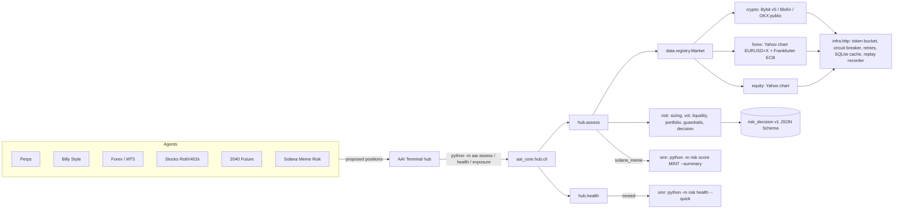

# aai-core — shared read-only data + risk layer for the AAI agents

One pipeline for every AAI agent, with **AAI Terminal** as the hub:

| Agent | Asset class here | Notes |
|---|---|---|
| Perps (Bybit/Blofin, 1-3% risk) | `crypto_perp` | venue failover bybit → blofin → okx |
| Billy Style (mentor crypto) | `crypto_perp` | same feed and rules |
| Forex (majors, MT5 EAs, 1-3% risk) | `forex` | no broker feed (see Gaps) |
| Stocks (Roth IRA / 401k) | `equity` | default account type `retirement` (no shorts, no leverage) |
| 2040 Future (buy-and-hold) | `equity` (and `crypto_perp` data) | positions without a stop count as `long_term` |
| Solana Meme Risk | `solana_meme` | delegated to `/workspace/solana-meme-risk` through its stable CLI |

**Read-only by design.** Only HTTP GET to public market-data endpoints. No order placement, no exchange or
wallet keys, no signing. Nothing here is a trading signal and nothing makes a claim of edge. The rules are
fixed, conservative risk-hygiene thresholds, not fitted models.

## Architecture



Layout:
- `aai_core/infra`: cache, resilience, http, logging, replay and health. The cache and resilience code is extracted from smr unchanged.
- `aai_core/data`: market-data adapters.
- `aai_core/risk`: the risk math.
- `aai_core/hub`: assess, health, the smr bridge and the CLI.
- `aai/`: the `python -m aai` entry point.
- `aai_core/schemas/risk_decision.v1.json`
- `tests/`
- `tools/record_fixtures.py`
- `samples/`

## AAI Terminal contract

### `python -m aai health [--quick] [--no-smr] [--no-tests]`
The output has the same shape as smr's health check:
```json
{"overall": "pass|fail", "provider": "public:bybit,blofin,okx,yahoo,frankfurter+smr", "checked_at": 1793582637,
 "checks": [{"check": "crypto_perp:blofin", "pass": true, "required": false, "ms": 987, "detail": {}}]}
```
Exit code 0 means `overall=pass`; 1 means fail. `overall` passes only if every **required** check passes.

The checks:
- `crypto_perp:bybit`, `crypto_perp:blofin` and `crypto_perp:okx` (optional each).
- `crypto_perp:any_venue` (required).
- `forex:yahoo_eurusd` (required).
- `forex:frankfurter_ecb` (optional).
- `equity:yahoo_spy` (required).
- `cache_db_rw`, `schema:risk_decision.v1` and `imports`.
- `tests_quick`: runs `pytest -m "not network"`.
- `smr_health`: runs smr's `python -m risk health --quick` and checks that its JSON has the right shape and `overall=pass`.
- `e2e_assess_crypto_perp`: skipped with `--quick`.

Health bypasses the cache, so every source check is live. See `samples/health.json`.

### `python -m aai assess --asset-class {crypto_perp,forex,equity,solana_meme} --symbol X [options]`
Options:
- `--side long|short` (default long)
- `--entry E` (default: current ask for a long, bid for a short, or last)
- `--stop S` (default: **assumed** 2×ATR14, flagged `assumed_stop` and lowering confidence to medium)
- `--bankroll B` (default: the book's bankroll, otherwise 10,000 with `bankroll_assumed=true`)
- `--risk-pct P` (default 1; values above 3 are clamped to 3)
- `--book book.json` (all agents' positions, account state and limits; see `samples/book.example.json`)
- `--interval 1m|5m|15m|1h|4h|1d` (default 1h; 1d for equity)
- `--venue auto|bybit|blofin|okx`
- `--account-type margin|cash|retirement`
- `--summary` (print only the orchestrator_summary keys)
- `-o out.json`

Symbol formats:
- `crypto_perp`: `BTC`, `BTCUSDT`, `BTC-USDT` or `BTC-USDT-SWAP`.
- `forex`: `EURUSD` or `EUR/USD`.
- `equity`: `SPY` or `BRK.B`.
- `solana_meme`: a base58 mint.

Exit codes:

| Code | Meaning | Output |
|---|---|---|
| 0 | risk_decision printed | the JSON document |
| 2 | bad input | `{"error": "bad_input"\|"assess_error", "detail": ...}` |
| 3 | every data source failed | `{"error": "SourceError"\|"SmrError", "detail": ...}` |

### risk_decision v1 (`aai_core/schemas/risk_decision.v1.json`, Draft 2020-12)
The first 13 keys are **exactly smr's `orchestrator_summary` v1**. Projecting a risk_decision onto those keys
validates against smr's own schema, and a test checks this. Hub code that already reads smr summaries can
read every asset class:

`v, asset_id, symbol, decision (SKIP|REDUCED|NORMAL), score (0-100 risk points), max_size_pct (0-3), confidence (low|medium|high), hard_flags[], top_reasons[≤3, ≤160 chars], as_of, valid_until, model, line`

Additive keys:
- `schema` ("aai.risk_decision.v1"), `asset_class`, `venue` and `side`.
- `reasons[{code, points, severity: info|warn|hard, detail}]`
- `suggested_size{risk_pct, risk_pct_requested, tier_multiplier, risk_amount, qty, notional, leverage, entry, stop, stop_distance_pct, assumed_stop, bankroll, bankroll_assumed, capped_by[]}`. This is null when the decision is SKIP.
- `metrics` (ATR, realized vol, spread, depth, funding, ADV, ECB check and similar).
- `exposure` (cross-agent aggregation, correlated cluster, remaining budgets).
- `guardrails` (limits, day P&L and drawdown).
- `data{sources, attempts[venue, what, ok, error], interval, last_candle_ts, candles}`
- `warnings[]`
- `source_summary`: smr's summary, copied verbatim, for `solana_meme`.
- `disclaimer`

Semantics:
- **`max_size_pct` is the percent of bankroll at risk**, meaning the loss if the stop is hit. A memecoin position is treated as 100% at risk, so its size equals its risk.
- Tiers use the same defaults as smr: score ≥ 60 or any hard flag gives SKIP (multiplier 0), score ≥ 30 gives REDUCED (0.5), anything lower gives NORMAL (1.0).
- Size = fixed-fractional at `risk_pct × multiplier`. It is then capped, and caps only ever shrink it, by the leverage policy (crypto 5×, FX 20×, equity 1×), the total-risk budget and the correlated-risk budget. A budget cap that forces a cut turns NORMAL into REDUCED. If less than 0.1% of the bankroll is left, the decision becomes SKIP with `risk_budget_exhausted`.

### Rules (fixed thresholds, not fitted)

| code | points | when |
|---|---|---|
| invalid_order | hard | stop on the wrong side of entry, or zero or negative prices |
| stop_inside_noise / tight_stop | 30 / 15 | stop distance under 0.5× / 1× ATR14 |
| volatility_expansion / volatility_elevated | 20 / 10 | 20-bar realized vol at least 2× / 1.5× the 100-bar level |
| spread | 10 / 30 | crypto 5 / 20 bps, FX 3 / 10, equity 10 / 50 (unknown spread = 0 points with lower confidence) |
| book_depth (crypto) | 10 / 30 | order is at least 10% / 50% of same-side top-20 depth |
| funding_cost (perp) | 10 / 20 | paying at least 0.05% / 0.10% per 8 h on your side |
| data_stale (crypto) | 20 | last closed candle older than 3 intervals |
| non_major_pair (FX) | 10 / 20 | known cross / anything else |
| price_source_mismatch (FX) | 10 | Yahoo and the ECB fixing differ by more than 1.5% |
| dollar_volume (equity) | 10 / 30 | order is at least 0.1% / 1% of 20-day average dollar volume |
| concentration (equity) | 15 | position is more than 20% of bankroll |
| short_not_allowed (equity) | hard | short in a cash or retirement account |
| instrument_type (equity) | 20 | not EQUITY or ETF |
| daily_loss_limit | hard | day P&L ≤ −3% (from the book account) |
| drawdown_reduce / max_drawdown_halt | 30 / hard | drawdown from peak ≥ 10% / ≥ 20% |
| risk_budget_cap / risk_budget_exhausted | 0 / hard | across all agents: total trading risk over 6%, or correlated risk over 4% |

Correlation is Pearson on up to 90 aligned daily log returns. A position "moves with" the candidate if
`corr × side_sign × side_sign ≥ 0.7`. Two crypto assets with no shared data, such as memecoins, are
assumed to have a correlation of 0.8. Long-term holdings (`horizon: long_term`, which is the default for an
equity with no stop) count in gross exposure but not in the per-trade risk budgets.

### Other commands
- `python -m aai exposure --book book.json` aggregates exposure by agent and asset class and evaluates the guardrails.
- `python -m aai market --asset-class crypto_perp --symbol BTCUSDT --interval 1h --limit 50` returns a normalized series and quote.

### Normalized market-data schema (`aai_core/schema.py`)
- **Candle:** `[ts, open, high, low, close, volume]`. `ts` is the bar open time in unix seconds UTC, in ascending order. Volume is in base units (0 for FX).
- **Series:** `{v, asset_class, symbol, venue, source, interval, as_of, candles, complete_last}`
- **Quote:** `{v, asset_class, symbol, venue, source, ts, last, bid, ask, mid, spread_bps, depth{levels, bid_notional, ask_notional}, perp{funding_rate, funding_interval_h, next_funding_ts, open_interest_base, open_interest_usd, volume_24h_quote}}`

## Data sources (checked from this box on 2026-11-01)

| Source | Used for | Status |
|---|---|---|
| Bybit v5 public `/v5/market/{kline,tickers,orderbook,instruments-info}` | perps | **HTTP 403 geo-block** (CloudFront "block access from your country"). The same 403 came back from the fetch proxy. The adapter follows the documented format and is tested only with doc-shaped fixtures. It should work from a non-blocked region. |
| Blofin `openapi.blofin.com/api/v1/market/{candles,tickers,books,instruments,funding-rate,open-interest}` | perps (current fallback) | ✅ working |
| OKX `www.okx.com/api/v5/{market,public}/...` | perps (second fallback) | ✅ working |
| Binance futures public | — | ❌ HTTP 451, restricted location; not used |
| Yahoo `query1.finance.yahoo.com/v8/finance/chart` | equities/ETFs (daily), FX intraday | ✅ working. Unofficial: no bid/ask, may change or rate-limit. |
| Frankfurter `api.frankfurter.dev/v1` (ECB reference rates) | FX daily cross-check, cross-currency P&L conversion | ✅ working. `api.frankfurter.app` now returns 301. |
| Stooq CSV | — | ❌ now behind a JavaScript proof-of-work challenge |

Rate budgets are deliberately conservative: bybit 5, blofin 4, okx 4, yahoo 1, frankfurter 2 req/s.
Override them with `AAI_<SOURCE>_RPS`. A 429 pauses the whole source (Retry-After). A 403 or 451 is not
retried, and the venue is skipped for the rest of the session. 5xx and network errors are retried with
full-jitter backoff. After 5 failures the circuit breaker opens for 60 s.

## Runbook
```bash
cd /workspace/aai-core
python3 -m venv .venv && .venv/bin/pip install -r requirements.txt
.venv/bin/python -m aai health --quick          # before relying on anything
.venv/bin/python -m aai assess --asset-class crypto_perp --symbol BTCUSDT --stop 76500 --bankroll 10000 --risk-pct 1
.venv/bin/python -m pytest -q -m "not network"  # offline (replay fixtures); add -m network for live smoke tests
.venv/bin/python tools/record_fixtures.py       # refresh replay fixtures (live), then re-run tests
```

Environment variables:
- `AAI_HOME` (cache and data directory)
- `AAI_CACHE_MODE=readwrite|replay|off`
- `AAI_PERP_VENUES=bybit,blofin,okx` (set this to `blofin,okx` on this box to skip the Bybit 403)
- `AAI_LOG_LEVEL`
- `SMR_HOME`, `SMR_PYTHON`, `SMR_TIMEOUT_S`

Troubleshooting:
- **`crypto_perp:any_venue` fails.** Check `detail` for each venue. A 403 or 451 is a geo-block; set `AAI_PERP_VENUES` to the venues that work.
- **`smr_health` fails.** Run `cd /workspace/solana-meme-risk && .venv/bin/python -m risk health --quick` and read its failing checks.
- **Stale answers.** Delete `data/cache.db` or set `AAI_CACHE_MODE=off`.
- **Confidence is `medium` on every crypto call from this box.** That is expected: the call is served by the fallback venue, not Bybit.

## Gaps (need paid data or input from you)
1. **Bybit is geo-blocked from this box.** Live Perps checks therefore use Blofin or OKX prices and funding. These are close to Bybit's but not the same. To get Bybit itself, run the hub from a region Bybit serves; you decide where.
2. **Forex has no broker feed.** Yahoo gives no bid/ask, so real MT5 spreads, swaps and slippage are unknown. Contract size and lot steps are not applied. The MT5 terminal or broker feed would need to be exported read-only (the MT5 Python package can read quotes, but that needs a logged-in terminal and your input). Also needed: the account currency, which is assumed to be USD.
3. **Equity data.** Yahoo is unofficial, has no bid/ask, its OHLC is not dividend-adjusted, and it has no fundamentals. A paid feed such as Polygon, Tiingo or IEX Cloud would be needed for reliable spreads and adjusted series.
4. **Your book and account state.** Real positions, equity, peak equity and day-start equity have to come from each agent, written to a `book.json`. Until they do, the guardrails are not evaluated. The limits (6% total, 4% correlated, 3% daily, 10/20% drawdown) are defaults; please confirm them.
5. **Venue lot, tick and contract specs** are not applied to qty, except the Blofin/OKX contract value for depth. Rounding to venue lots is still to do.
6. **No validated edge.** These are risk-hygiene rules with fixed thresholds. The smr memecoin score showed no held-out edge (AUC 0.47). No backtest was done in phase 2.
