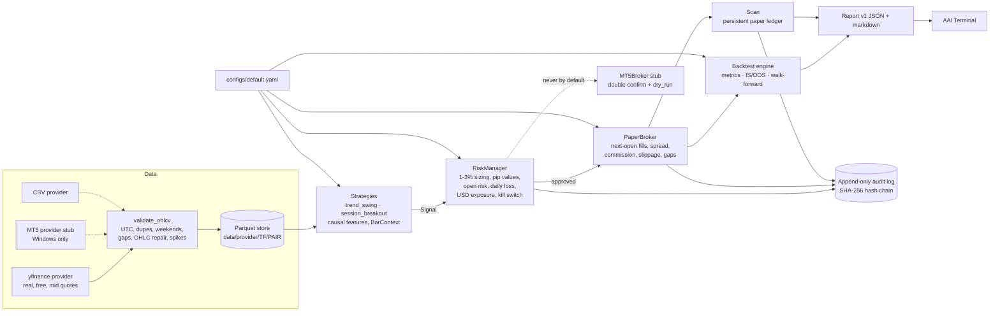

# aai-fx — FX research & paper-trading pipeline

Research, backtesting and **paper-only** signal scanning for the seven USD majors
(EURUSD, GBPUSD, USDJPY, USDCHF, AUDUSD, USDCAD, NZDUSD). Built for **Zoorped**.
Results go to the **AAI Terminal** orchestrator as a versioned JSON report plus a markdown summary.

> **This pipeline never places real trades.** All execution is simulated by `PaperBroker`.
> The MT5 adapter is a stub that refuses every order unless you pass two explicit
> confirmation flags. Even then it defaults to `dry_run=True` and sends nothing. The
> `MetaTrader5` Python package runs **only on Windows**, so any live use has to happen on
> Zoorped's Windows PC with the MT5 terminal running. It can never happen from this Linux box.
> See [Safety](#safety--live-trading-guard).

The two reference strategies are research scaffolding. **No claim of profitability is made.**
In the real-data runs below, neither strategy shows a robust out-of-sample edge.

---

## Architecture



## Install

```bash
cd /workspace/aai-forex
uv venv .venv --python 3.13        # or: python3 -m venv .venv
. .venv/bin/activate
uv pip install -e ".[dev]"         # or: pip install -e ".[dev]"
pytest                             # 75 tests
mypy src                           # clean
```

On Zoorped's Windows PC (MT5 data or adapter only): `pip install -e ".[mt5]"`.

## CLI

| Command | What it does |
|---|---|
| `aai-fx fetch [-t D1 H4 ...] [-p EURUSD ...]` | Downloads from yfinance, validates, and merges into Parquet. Writes `data/fetch_summary.json`. |
| `aai-fx backtest [-s NAME ...] [--walkforward] [--no-oos] [--risk-pct 1.5] [--research-mode \| --with-research]` | Runs event-driven backtests on the stored data and writes `runs/<id>/` plus `reports/backtest-*.{json,md}`. |
| `aai-fx scan [-s NAME ...] [--no-fetch] [--no-paper]` | Refreshes data, evaluates the latest *completed* bar, risk-checks signals, places **paper** orders, and writes `reports/scan-*`. |
| `aai-fx report` | Merges the latest backtest and scan into `reports/latest.{json,md}` for AAI Terminal. |
| `aai-fx schema` | Writes the JSON Schema of the report to `schemas/report.schema.json`. |
| `aai-fx audit-verify` | Verifies the hash chain of `audit/audit.jsonl`. |
| `aai-fx kill on\|off\|status` | Engages, resets or inspects the file-based kill switch. Reset is manual only. |

There is deliberately **no `live` command**.

Global options: `-c configs/default.yaml` and `--root <project dir>`.

## Modules

- **`aai_fx.data`**
  - The `DataProvider` ABC with providers `yfinance` (real), `mt5` (Windows stub using `copy_rates_range`) and `csv`.
  - `ParquetStore`: atomic writes, merge where new rows win, and a `.meta.json` sidecar.
  - `validate_ohlcv`:
    - converts everything to UTC and removes duplicates
    - drops NaN and non-positive prices
    - repairs high/low that are inconsistent with open/close
    - removes weekend bars (FX session Sun 22:00 to Fri 22:00 UTC, with lenient edges)
    - drops the still-forming last bar
    - counts missing bars and flags spikes (more than 12× the rolling median absolute log return)
  - H4 is resampled from H1 on UTC 4-hour boundaries. A bucket must contain at least 50% of its source bars.
- **`aai_fx.strategies`**
  - The `Strategy` interface: `prepare` builds vectorised causal features, then `on_bar(ctx)` emits `Signal`s.
  - `BarContext.get(col, lag)` raises `LookaheadError` for negative lags.
  - `trend_swing` (D1 or H4):
    - **Bias:** the daily bias comes from *completed* daily bars, with close compared against EMA50 and EMA200.
    - **Entry:** a Donchian breakout of the prior N bars.
    - **Stop:** `stop_atr × ATR`.
    - **Exit:** an opposite M-bar channel break or a bias flip.
  - `session_breakout` (M15 or H1):
    - **Range:** the Asian range runs 00:00-07:00 UTC. It is used only after it has closed.
    - **Filter:** the range must be between 0.15 and 0.8 of the daily ATR, taken from completed days.
    - **Entry:** a breakout plus a buffer, before 11:00 UTC.
    - **Stop and target:** the stop sits at the range midpoint or the opposite side, and the target is 1.5R.
    - **Exit:** positions are flattened at 16:00 UTC.
- **`aai_fx.risk`**
  - **Pip value:** `pip_size × contract × rate(quote→account)`. The pip size is 0.01 for JPY-quoted pairs and 0.0001 otherwise.
    - USD-quoted pairs give $10 per pip per lot.
    - USD-base pairs divide by the pair's own rate.
    - Crosses and non-USD accounts convert through a direct rate, an inverse rate, or USD/EUR triangulation.
  - **Sizing:** the stop distance is widened by the modelled round-trip cost, the size is rounded *down* to the lot step, and anything below the minimum lot is rejected. A randomised test checks 2,000 cases and confirms realised risk never exceeds the target.
  - **`RiskManager` checks, in order:**
    1. kill switch
    2. drawdown kill (default 20%)
    3. daily loss limit (4%)
    4. stop on the correct side of the entry
    5. one position per pair
    6. risk % clamped to [1, 3]. The hard cap of 3% is also enforced in config validation.
    7. max open risk (6%)
    8. max positions (3) and max risk (4%) in the same USD direction
  - **Kill switch:** a file flag at `state/KILL_SWITCH` plus an automatic drawdown trigger. It is sticky, and by default it flattens all open positions when it engages.
- **`aai_fx.backtest`**
  - **Event loop:** signals on bar *t* fill at the open of bar *t+1*.
  - **Fills:**
    - Market orders fill at open ± half spread ± slippage.
    - Stops trigger on the bid/ask side and gap through at the open, plus stop slippage.
    - Targets fill as limits.
    - If the stop and target are both touched in one bar, the stop is assumed to fill first.
    - Commission is charged per lot per side.
  - **Metrics:**
    - CAGR, total return, max drawdown and longest drawdown
    - Sharpe and Sortino, from daily returns annualised by the observed days per year
    - win rate, profit factor, expectancy in R, average win/loss in R
    - trade count, exit-kind breakdown and per-pair table
  - **Out-of-sample testing:**
    - A chronological IS/OOS split (70/30), with each side run on a fresh account.
    - Rolling walk-forward: a parameter grid is fitted on the train window and run on the next unseen window, and the OOS windows are stitched together.
  - **Research mode** (`--research-mode`, `--with-research`) disables the in-simulation drawdown kill so you can see the raw strategy behaviour. The first breach is still reported.
- **`aai_fx.execution`**
  - `PaperBroker` is the only executor that is ever used. It keeps cash and positions, supports snapshot/restore, and can write a JSONL ledger.
  - `MT5Broker` is the stub with the live guard.
- **`aai_fx.reporting`**
  - The `AAIReport` pydantic schema (`aai-fx/report/v1`). `mode` is the literal `"paper"` and `live_trading` is the literal `false`.
  - A markdown renderer.
  - `AuditLog`: append-only JSONL. Each record carries `prev_hash`/`hash` (SHA-256), and `verify_audit_log` detects edits, deletions and reordering.

## Configuration (`configs/default.yaml`)

| Setting | Default |
|---|---|
| Account | USD 10,000 (simulated) |
| Risk per trade | 1% (allowed range 1-3%) |
| Max open risk | 6% |
| Daily loss limit | 4% |
| USD-direction limits | 4% and 3 positions |
| Kill switch | 20% drawdown, flatten on engage |
| Spreads (pips) | EURUSD 0.6, GBPUSD 0.9, USDJPY 0.7, USDCHF 1.1, AUDUSD 0.8, USDCAD 1.2, NZDUSD 1.3 |
| Commission | $3.50 per lot per side |
| Entry slippage | 0.1-0.2 pips |
| Stop slippage | 0.3-0.5 pips |
| Strategies | `trend_swing` (D1), `trend_swing_h4`, `session_breakout` (M15), `session_breakout_h1` (H1, backtest only, used for a longer sample) |

The config is validated by pydantic. `execution.mode` can only be `paper`.
Every report carries a config fingerprint.

## Safety / live-trading guard

1. Nothing in the pipeline (backtest, scan or CLI) imports or calls `MT5Broker`. Scan orders go to `PaperBroker`, and its state is kept in `state/paper/<strategy>.json`.
2. `MT5Broker.place_order(req, confirm_live=...)` raises `LiveTradingNotConfirmed` unless **both** the constructor *and* the call receive the literal `True`. Truthy values such as `"yes"` or `1` are refused. Every refusal is audited.
3. Even when both flags are set, `dry_run=True` is the default. In that case the adapter only returns the MT5 request dict.
4. On a non-Windows OS it raises `MT5NotAvailable`. `MetaTrader5` only works on Windows with a running, logged-in terminal. Live use is therefore only possible on Zoorped's Windows PC.
5. The `order_send` path follows the documented MT5 API but **has never been run against a terminal**. Before relying on it, test it on a demo account and check the broker's symbol suffixes, filling modes and contract specs.
6. `tests/test_live_guard.py` covers all of the above.

## Real-data run (2026-11-01)

These metrics come from `aai-fx backtest --walkforward --with-research` on yfinance data fetched on 2026-11-01. They are recorded in `reports/latest_backtest.md` and `runs/`. They are historical simulations and not evidence of edge.

- **trend_swing D1, 2012-01-03 → 2026-10-30:**
  - 108 trades, CAGR 0.65%, Sharpe 0.14, MaxDD 20.55%, PF 1.18, expectancy 0.109 R.
  - The 20% drawdown kill tripped on 2018-07-10.
  - Without the kill: CAGR -1.69%, MaxDD 45.8%.
  - Walk-forward OOS: CAGR -3.17%, expectancy -0.184 R.
- **trend_swing_h4, 2024-11 → 2026-10:** CAGR -8.96%, expectancy -0.199 R. The kill tripped on 2026-07-30.
- **session_breakout M15, 2026-09-03 → 2026-10-30 (8 weeks):** 88 trades, expectancy 0.033 R, PF 1.06, MaxDD 9.73%. The annualised CAGR is meaningless on this sample: IS was +12% and OOS was -8.6%.
- **session_breakout H1, 2024-11 → 2026-10:** without the kill there were 1,329 trades at -0.063 R, with MaxDD 72.7%. Walk-forward OOS was -0.018 R.

## Limitations (candid)

**Data**
- yfinance gives **indicative mid quotes, not broker bid/ask**. Volume is always 0 and the bar boundaries are Yahoo's, not the broker's server time. The D1 close does not match the last H4 or M15 close.
  - Spread is a fixed per-pair assumption. Real spreads widen at the rollover and around news.
- History is capped by Yahoo:
  - H1 goes back about 730 days.
  - M5 and M15 go back about 60 days.
  - M1 goes back about 30 days and arrives in 7-day chunks.
- AUDUSD and NZDUSD 1-minute data arrives at **2-minute cadence**, so about half the expected bars are missing. A re-fetch does not fix this.
- H4 is resampled from H1.
- The Sunday-evening open often has no bars yet.
- Spikes and OHLC inconsistencies are flagged or repaired, not removed:
  - 80-240 D1 bars repaired per pair.
  - The H1 and M1 spike flags hit the listing cap of 20.
- **Session times are fixed UTC hours with no DST adjustment.** The London/NY opens shift by an hour twice a year.

**Sample size and statistics**
- **The M15 backtest sample is far too short** (about 8 weeks, 88 trades). Its CAGR and Sharpe figures are noise.
- There is no multiple-testing correction, bootstrap confidence interval or deflated Sharpe.
- Walk-forward grids are small, but the strategy and grid were still chosen with the full history visible.

**Model**
- Bar-level simulation with no tick data. When the stop and target fall in the same bar, the stop is assumed to fill first, which is conservative.
- **Not modelled:** swaps/rollover, broker contract specs, margin, and partial fills. Requotes and liquidity limits are also missing; the only size cap is `max_lot`.
- Correlation control uses **USD direction only**. It ignores co-movement such as EUR and CHF, or AUD and NZD.
- In `scan`, each strategy has its own paper account, so risk limits are not aggregated across strategies.
- `session_breakout` counts *emitted* signals against `max_trades_per_day`, including signals that the risk manager rejected.
- Each walk-forward window starts with a fresh account. The stitched OOS equity compounds returns, so it is not one continuous account.
- With the kill switch enforced, flattening happens at the next bar open, so the realised max drawdown can overshoot the 20% trigger slightly (20.55% on D1).
- The MT5 data and execution paths cannot be tested on Linux.

## Next steps

1. Use broker data. Export MT5 bid/ask bars or ticks on the Windows PC (`mt5` provider) or a CSV dump to get real spreads, server time and longer intraday history. Then re-run everything.
2. Model swaps, per-session spreads and news blackouts.
3. Use a correlation matrix (rolling) for exposure limits, and aggregate risk across strategies.
4. Add DST-aware session windows (London and New York local time).
5. Add statistical robustness checks: bootstrap and Monte Carlo trade resampling, deflated Sharpe, and parameter-stability heatmaps.
6. Write a Windows demo-account harness for `MT5Broker`. Keep `dry_run` and both confirm flags, and add a per-order human confirmation prompt.
7. Schedule `aai-fx scan` (e.g. every 15 minutes in market hours) with the report pushed to AAI Terminal.

## Layout

```
configs/default.yaml        config
src/aai_fx/                 package (data, strategies, risk, execution, backtest, reporting, pipeline, cli)
tests/                      pytest suite (sizing, no-lookahead, risk limits, live guard, broker, metrics, reporting)
data/                       Parquet store + fetch_summary.json          (git-ignored)
runs/<id>/                  per-backtest audit.jsonl, trades.csv, equity.csv, result.json (git-ignored)
reports/                    report JSON/markdown; latest.{json,md} for AAI Terminal
audit/audit.jsonl           scan audit trail (hash-chained)
state/                      paper ledgers, kill-switch flag                (git-ignored)
schemas/report.schema.json  report JSON Schema
```

## Zoora Strategy research (AUDUSD + XAUUSD, EMA 200/800 vs 198/792)

- Config: `configs/zoora.yaml` (AUDUSD+/XAUUSD+ broker symbols, gold = 100 oz/lot, assumed Bybit costs and swaps; confirm in MT5).
- Data: Dukascopy free H1 BID/ASK feed (`aai_fx.data.dukascopy_provider`, H4/D1 resampled on NY+7 server time) plus yfinance D1 (`GC=F` futures for gold) as a cross-check.
- Strategies: `zoora_trend`, `zoora_pullback`, `zoora_cross` (`src/aai_fx/strategies/zoora.py`). EMA800 needs 1,843 bars of warm-up, which is excluded.
- Run: `aai-fx -c configs/zoora.yaml zoora [--no-prepare]`. Outputs go to `research/zoora/results.{md,json}`; run `python scripts/zoora_sensitivity.py` for the stress tests.
- Findings and exact rules: **`docs/zoora_strategy.md`**. Summary: no robust candidate, and 198/792 is no different from 200/800.
- Research and paper only. Live MT5 orders stay behind the confirmation flag **and** the agent-guard check.
