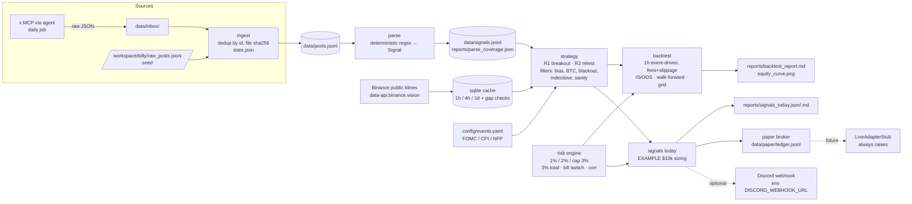

# billy-pipeline

Turns the daily outlooks of **Billy (@cryptoWZRD_)** into structured signals, backtests them on real
Binance data, and produces **risk-sized paper signals**.

> **PAPER ONLY.** There is no live-trading code, no exchange API keys, and no order code that can reach an
> exchange. The execution layer is a paper broker plus a live-adapter **stub that always raises**.

## Architecture



## Quick start

```bash
make install          # venv + editable install (Python ≥3.11)
make all              # tests → ingest → parse → data → backtest → report → paper signals
# or: scripts/run_all.sh
```

CLI (`.venv/bin/billy --help`):

| Command | What it does |
|---|---|
| `billy ingest [--keep-inbox]` | Merge seed JSONL + every file in `data/inbox/` into `data/posts.jsonl`; dedup by post id and file hash; update `data/state.json`. |
| `billy parse` | Parse all outlooks → `data/signals.jsonl`; coverage → `reports/parse_coverage.json`. |
| `billy data [--offline]` | Incrementally fetch closed 1h/4h/1d klines for BTC, ETH, XRP, LTC, LINK into sqlite; print gap report. |
| `billy backtest [--quick]` | Full-period backtest + 70/30 IS/OOS + rolling walk-forward + parameter grid → `reports/artifacts/`. |
| `billy report` | Render `reports/backtest_report.md` + `reports/equity_curve.png` from the artifacts. |
| `billy signals [--equity N] [--now ISO] [--paper] [--notify]` | Today's candidates → `reports/signals_today.{json,md}`; `--paper` writes the paper ledger; `--notify` posts to Discord if the env var is set. |

## Runbook

### Daily job (agent + cron)
A Python process cannot call the x MCP, so the daily routine is two steps:

1. **Agent step:** read `data/state.json` → `last_post_id`, call
   `x.get_users_posts(id=1100373132135804928, since_id=<last_post_id>, exclude=["retweets"])`
   (paginate), and save each raw JSON response to `data/inbox/<UTC-date>_<n>.json`.
   `search_posts_all` payloads (`{"data": [...], "meta": {...}}`, even wrapped in tool text) are accepted too.
2. **Pipeline step:** `make daily` (ingest → parse → data → signals). Re-running is safe: files are
   deduped by sha256, posts by id, and processed files move to `data/inbox/processed/`.

Run the full `make backtest report` weekly, or after parser/strategy changes.

### Config
`config/default.yaml` holds every parameter (pydantic-validated). Risk hard caps are enforced in three
places: the config validator refuses >3% per trade or >3% total; `RiskEngine` clamps to the hard
constants; and assertions run on every sizing decision.

| Risk rule | Value |
|---|---|
| Base risk / trade | 1% |
| Confirmed (close-label bias aligned + BTC aligned + explicit long/short wording) | 2% |
| Hard cap per trade | 3% |
| Hard cap total open risk (the crypto book is treated as one correlated position) | 3% |
| Same-direction position with 30-day daily-return corr ≥ 0.7 | size × 0.5 |
| Daily loss kill switch | −3% from the UTC-day open equity: no new entries that day |
| Notional caps | 100% of equity per trade, 200% gross |

### Discord
Set `DISCORD_WEBHOOK_URL` in the environment and pass `--notify` (or `BILLY_NOTIFY=1 scripts/run_all.sh`).
If the variable is unset the notifier does nothing. The URL is never logged or stored, and only
`discord.com/api/webhooks/...` URLs are accepted.

### Live trading (not implemented)
`execution.live_enabled` defaults to `false`. Setting it to `true` without
`live_confirmation: I_UNDERSTAND_THIS_IS_REAL_MONEY` raises. Even with both set, `LiveAdapterStub`
raises on every call. A static test fails the build if exchange order endpoints, request signing or
key handling show up anywhere in the package.

## Methodology (what is being tested)
* **Signal:** each post → asset, post_ts, close label (bias −2…+2), scenarios
  (side, above/below, level, target, breakout/retest/sideways, explicit?), primary direction/trigger/target/
  invalidation, support/resistance map, stated positions, flags (waits for confirmation, BTC/pair/dominance
  dependent, event risk, fakeout warning, two-sided…).
* **R1 bias-then-trigger:** `n_hold` consecutive 1h closes beyond the level, then fill at the next bar's open.
* **R2 retest-reversal:** price touches the level (within `retest_tol_pct`), then a 1h close back beyond the
  level and beyond the previous bar's extreme; fill at the next open.
* **Validity:** from the first bar opening at or after post_ts, until his next post on that asset or 24h.
* **Exits:** stop at level ∓ `stop_atr_mult`·ATR(1h); target is his stated "towards" level if R:R ≥ `min_rr`,
  else 2R; 50% off at +1R then stop to breakeven; 72h time stop. If stop and target fall in the same bar,
  the stop is assumed to hit first.
* **Filters:** close-label bias must not oppose the trade; for alts, the BTC context (his latest BTC label,
  else the last closed BTC daily candle) must not oppose; macro blackout ±2h around events; optional
  indecisive-close skip and stated-position sanity check; chase limit `max_chase_pct`.
* **No lookahead:** triggers only on bars after post_ts; ATR, correlations and BTC context use closed data only.
* **Overfitting checks:** 70/30 time split; rolling 60d-train / 30d-test walk-forward re-optimised over the
  grid; IS-vs-OOS Spearman rank correlation across the grid; flags in the report.

## Known limitations
* **Short sample, one regime:** dense posts only from May 2026 to Nov 2026 (about 950 crypto outlooks across 5 assets).
* **Parser:** deterministic regex. Only about 20% of actionable posts state an explicit target; scenarios without
  a price ("holding above can offer upside" with no level) inherit the previous level or are skipped. Some
  multi-clause posts mis-assign a level (see `scripts/parse_debug.py`).
* **Fills:** 1h OHLC cannot show the order of events inside a bar (stop-first is conservative). Costs are a flat
  taker fee plus slippage; perp funding and spot-short borrow are not modelled.
* **Events:** past CPI/NFP dates are missing (BLS publishes only upcoming dates; the ICS feed returned 403), so
  blackouts before Nov 2026 cover FOMC only. No dates were guessed.
* **Behaviour not modelled:** Billy's discretionary management, intraday updates, and his charts (images).
* **Tight stops:** 0.5×ATR(1h) stops make positions large, so the 100% notional cap often binds and fees take a
  large share of R. The grid shows the sensitivity.

## Layout
```
src/billy/{ingest,parse,market,strategy,risk,backtest,execution,signals,report}/  cli.py config.py models.py
config/default.yaml  config/events.yaml   tests/ (pytest, fixtures = real posts)   reports/   scripts/
```
