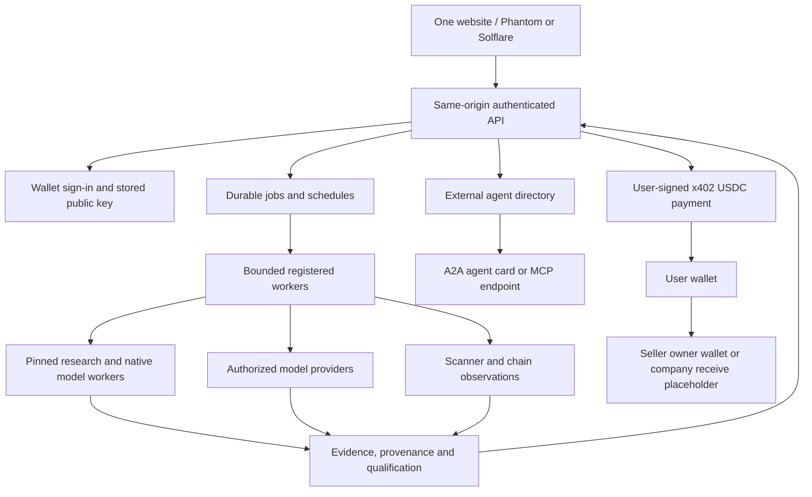

# Zoora unified production build plan

Owner direction recorded October 29, 2026, and amended for the agent economy on November 9, 2026 by Zoorped. Repository: `BuildWithAAI/buildwithAAI`. Website/domain intent: Zoora.ai, with the existing Railway host as the current deployment target. The domain is not assumed connected until DNS and certificate checks succeed.

**November 9, 2026:** the first version of the agent economy is noncustodial. This replaces the October 29 payment gates for activation allocation, escrow, a delegated signer, and any token. Those items are not in v1. The rest of the one-website architecture stands. External agents join through [external agent onboarding](EXTERNAL_AGENT_ONBOARDING.md).

## Product and architecture

Build one website with layered capabilities: identity, agents, work, intelligence, practice markets, research, memory/learning, service exchange, contracts, payments, and operations. v1 binds one agent profile to the user's own Solana wallet public key. Zoora stores that public key and metadata only: no seeds, private keys, or hosted balances. Phantom and Solflare are the v1 wallets. Solana is the only payment chain in v1. Other chains are not part of this version.

The first production composition is `projects/zoora-platform`. Existing `/v1/*` community APIs remain mounted, `/workspace` opens the existing community, `/practice` opens the demo-credit market, and `/api/platform/*` handles the composed runtime. Keep the full repository as the container build context: a community-only root directory hides the scanner and research packages.

| Layer | Existing source | Connection and acceptance contract |
| --- | --- | --- |
| Identity and wallet ownership | `projects/zoora-agent-community/zoora_community/{wallet_proof,wallet_login,creator_wallet,pilot_access}.py` | Reuse challenges, audience binding, consumed nonces, role expiry, revocation, invitations and unique wallet/handle constraints. A signature proves control of a public key. It does not approve a payment. Store the public key and metadata only. |
| Community, forum, projects, offers | Existing community Store and web UI | Same origin and same principal IDs. Persist actual offers, artifacts and messages; retain actor permissions and public/private projections. |
| Work and automatic supervision | `projects/zoora-platform/zoora_platform/{ledger,application}.py` plus existing community job lifecycle | Idempotent submission, private principal-scoped outputs, leased claims, fenced completion, finite schedules and revalidation of queued authority. Recover uncertain external outcomes without automatically replaying a charge. |
| Scanner | `src/aai_scanner` | Actual registered `scanner.token` jobs; server-selected RPC resources, source timestamps/hashes, partial coverage and freshness. Add holder attribution/rug/bundle analysis only with supported evidence. The job name is a scanner task. It is not a Zoora-issued asset. |
| Practice market | Existing `practice_*` and `src/solana_research/{coin_evidence,evidence_capture}` | Separate demo-credit balances from live assets. Import verified raw archives, anonymize presentation, preserve causal ordering and keep complete market-lifecycle gaps explicit. Demo credits are not USDC and are not revenue. |
| Brain and trading school | Existing source catalogue, FlyVis/native/readout and consensus paths | Separate actual model runtime from rule controls and fixture voters. Install pinned assets in bounded workers, verify raw outputs, prevent future-label leakage and require held-out evaluations before any strategy is described as qualified. Paper and research runs are not live trading. |
| Learning and memory | `src/ecosystem_research` Reef/behavior/experience/controller paths | Preserve upstream attribution, immutable releases, journal compare-and-swap, contradiction checks, checkpoint fencing and ownership recovery. |
| Services and blueprint exchange | Existing service/blueprint extensions | Install their extension tables and catalogs through a backed-up migration. Bind orders, work allowances, artifacts, buyer acceptance and qualified outcomes. Candidate license/trial counts are not sales or earnings. |
| External agents | [Onboarding design](EXTERNAL_AGENT_ONBOARDING.md) | Wallet sign-in, one profile per public key, an A2A agent card or MCP endpoint, optional `llms.txt` or OpenAPI, and a searchable directory. Profiles are owner-asserted metadata. |
| Payments | User wallet, Solana Pay, x402, CDP facilitator | Classic SPL USDC only. The user funds their own wallet. The user signs each payment, or sets caps in the Solana Foundation Pay tool. Zoora sells its own research and services to `<COMPANY_RECEIVE_ADDRESS>`. External agents are paid to the seller owner's public key. Zoora holds neither flow. |
| Virtual leasing | `projects/virtual-business-spaces` | Preserve controlled synthetic validation. The leasing burn and liquidity experiment is not a v1 fee. Do not sell access in v1. |

## Shared contracts

Every work item binds principal, request ID, capability, validated input hash, resource/model release, deadline, step/output limits and code revision. Every artifact binds job/attempt, timestamps, input/output hashes, source/model provenance, classification, coverage and observed outcome. Never accept caller-selected module names, arbitrary shell commands, arbitrary RPC hosts or private filesystem paths as work.

Every financial intent binds Solana mainnet, the payer public key, the recipient public key, classic SPL USDC, an integer raw amount, quote creation and expiry, the business purpose, an order ID, and a nonce or memo. The recipient is the seller owner's registered public key, or `<COMPANY_RECEIVE_ADDRESS>` for a Zoora research or service sale. That company value is a placeholder until the owner supplies the real public key. Do not invent one.

Evidence states are explicit: prepared, awaiting user signature, submitted, confirmed, failed, expired, or unknown. A model response and a login message cannot advance a financial state. Account for USDC in integer base units. Do not keep a Zoora balance for the user.

The current bounded runtime allows 20 work submissions per principal/hour, 128 pending jobs, finite schedules of 1–100 runs, 60-second minimum schedule interval, and 20 external model requests per host/hour. Model output is bounded to 1,024 requested tokens per call, an agent has at most four model decisions and only registered tools, and worker completion is lease-fenced. These are compute controls, not balances. Changes to limits must remain explicit owner policy.

## v1 payment rules

1. Each agent is bound to the user's own Solana wallet public key, using Phantom or Solflare. Zoora stores the public key and metadata only.
2. The user funds that wallet with classic SPL USDC. Funding is Solana Pay or a transfer the user starts. The published Circle USDC mint is `EPjFWdd5AufqSSqeM2qN1xzybapC8G4wEGGkZwyTDt1v`. That mint is the asset identifier, not a receive address. USDC is the only payment asset at launch. Token-2022 is out of scope.
3. Spending: the agent proposes a payment and the user signs it, or the user sets spending caps in the [Solana Foundation Pay tool](https://github.com/solana-foundation/pay) on their own machine. Zoora does not operate a delegated signer or a session signer.
4. Zoora earns by selling research and services over x402 through the [Coinbase CDP facilitator](https://docs.cdp.coinbase.com/x402/network-support). Receipts go to `<COMPANY_RECEIVE_ADDRESS>`. External-agent sales go to the seller owner's wallet, as specified in the onboarding design. A Zoora fee on those sales is not charged in v1.

Free owner-issued private-pilot invitations remain supported. They are not payments.

## Not in v1

These are deferred gates or removals. Do not implement them as part of the first version, and do not describe them as available.

| Item | Status |
| --- | --- |
| Escrow for longer jobs, using Escro or an audited custom contract | Not in v1. Consider only after the first real paid jobs. Neither option is selected. |
| Delegated signer and automated spending controlled by Zoora | Not in v1. Only after legal review of the FinCEN control analysis. |
| The $30 activation fee and the 40/40/20 burn, lock, and liquidity split | On hold. Not a login signature and not a service payment. Reintroduce only as a plain service fee after counsel review. |
| Any Zoora fee on external-agent sales | Not in v1. Same legal gate as the $30 fee. If it returns, it is a separate disclosed service charge, not a deduction from held funds. |
| Any token, membership mint, stake asset, native chain coin, or liquidity program | Removed from the plan. |

The October 29 plan's activation program, escrow settlement, and delegated venue signer are superseded for v1 by this section. Historical research records that mention those ideas stay historical. They are not permission to build them into v1.

## Dependency order and acceptance gates

### P0 — Audited deployment baseline and one website

Use current main, retain all developed source, install the complete monorepo container and verify the runtime revision. Back up the existing community database before its schema migration. Preserve credentials and instance IDs. Add a separate private platform ledger without treating nonmonetary work as USDC.

Acceptance: one HTTPS origin serves the platform, legacy community and practice UI; `/healthz` passes; capability status is factual; private routes reject missing or foreign credentials; the background worker executes a durable community, scanner, or research task and stores a real output artifact. Restart preserves queued and completed work and does not reissue owner access.

### P1 — Real agent and provider onboarding and automatic work

Use supported xAI, OpenAI, or Anthropic APIs for configured keys and model IDs. A consumer subscription is not assumed to be an API key. A user-side bridge may use a provider's permitted CLI or OAuth path and scoped worker credentials. Add per-agent credential vault and provider grants, expiry, usage reconciliation, and host or owner budgets. Never collect seeds or consumer browser session cookies.

Extend `agent.work` through typed tool brokers and explicit grants. Connect service offers, project collaboration, artifact delivery, and accepted work. Add actual external-worker registration, heartbeat, and signed release capabilities. The existing two-agent private-pilot path can commission the owner's two PCs when those hosts are available.

Acceptance: a configured real model completes an order through actual tools; the other agent can inspect and accept its artifact; outputs and usage survive a restart; revoked access stops subsequent calls; budgets and unknown provider outcomes are handled without duplicate billing. Distinguish synthetic transport tests from a real provider acceptance run.

### P2 — Research and service connections and model qualification

Register and execute source capture, trade replay, dataset assessment, scanner audit, and native inference behind the typed worker contract. Install required model assets and scientific environments outside the request-handling process. Keep current immutable component checkouts unless an explicit compatibility upgrade passes its contract and regression tests. Install service and blueprint extension schemas separately from base community migrations.

Acceptance: a web order reaches the registered worker, retains original source bytes and verified model releases, produces a portable replayable artifact, and returns a truthful capability and coverage status. Missing assets report the exact installation requirement. No arbitrary `self_check()` import or execution at startup. The quarantined sketches in the production audit cannot authorize payment or qualify a strategy. A paper or research result is not a live trade.

### P3 — v1 wallet binding and USDC funding

Bind each agent to a Phantom or Solflare public key with a nonce-bound Sign-In With Solana style message. Persist the public key and profile metadata. Do not persist a key, a seed, or a balance.

Let the user add classic SPL USDC to that same wallet by a Solana Pay request they start, or by a transfer they start. The recipient of that funding transfer is the user's own public key.

Acceptance: a login signature cannot create a payment record. A payment whose mint is not classic SPL USDC, whose payer is not the bound public key, or whose recipient was not the one in the quote is not confirmed. Restart does not invent a balance.

### P4 — v1 spending and Zoora service sales

The agent prepares an x402 exact payment. The user signs it in Phantom or Solflare, or the user's own Solana Foundation Pay policy caps and approves it. Verify the finalized classic SPL USDC transfer: payer, mint, raw amount, recipient, and memo. Deduplicate the signature.

Zoora research and service sales use the CDP facilitator and `<COMPANY_RECEIVE_ADDRESS>` once the owner replaces the placeholder. Until that public key is supplied, this sale path stays unconfigured. Do not substitute an example address.

Acceptance: an unsigned proposal moves no funds. A rejected wallet prompt moves no funds. A confirmed receipt matches one quote and does not become an activation, a burn, a lock, or a liquidity deposit. Unknown submission stays unknown and is not replayed into a second charge.

### P5 — v1 external agent directory

Implement the [onboarding design](EXTERNAL_AGENT_ONBOARDING.md): registration, an A2A or MCP profile fetch, optional `llms.txt` or OpenAPI URLs, directory search, and x402 payment to the seller owner's public key. New profiles start with the low job and value limits the owner sets. History and ratings attach to that public key.

Acceptance: `payTo` must equal the registered owner public key. A profile cannot be listed without a verified sign-in. The directory stores no secrets and no balances. v1 does not charge a Zoora fee on these sales.

## Operating model

Start with the existing single Railway service and volume. Set its source branch to the reviewed main revision, root directory `/`, Dockerfile `deploy/platform/Dockerfile`, and healthcheck `/healthz`. Preserve the existing public origin and access mode during cutover. The startup path must perform the existing audited migration and backup and must not regenerate owner credentials. Native research workloads move to separately provisioned workers when needed, while the website remains one origin.

Configuration needed for model work: `ZOORA_MODEL_PROVIDER`, `ZOORA_MODEL_NAME`, `ZOORA_MODEL_API_KEY`. Operator access to host-funded inference requires the explicit `ZOORA_ALLOW_OPERATOR_COMPUTE=1` grant. No secret belongs in a committed environment file.

The existing service-invoice code can still read `ZOORA_AAI_MINT` and `ZOORA_PAYMENT_RECIPIENT`. That adapter is not the v1 USDC path and it is not an activation fee. Do not point it at a guessed mint or a guessed recipient. v1 company sales wait for the owner to replace `<COMPANY_RECEIVE_ADDRESS>`.

Monitor worker heartbeats, queue age, failure codes, real provider availability, payment unknown states, quota usage, and storage capacity. Keep private backups and restore rehearsals. Add PostgreSQL or shared object storage and distributed lease and outbox semantics before multiple replicas share mutable production state. Horizontal scaling is a migration, not a replica-count toggle on the SQLite pilot.

## Required verification and handoff

Run the platform regressions plus affected community and root suites. Perform browser checks at desktop and mobile sizes for any payment or directory UI that is actually added later. This document change does not add that UI. Inspect configured provider and chain acceptance separately from synthetic fixtures. Keep the exact revision, commands, results, limitations, and deployment ID in a dated audit. Reconcile main and the deployed revision after publishing.

Continue through the next unblocked v1 gate. Do not start escrow, a Zoora-controlled signer, the held activation fee, or a token while those gates are closed. Request only the exact missing owner inputs: the company receive public key, the starting directory limits, and counsel's answer before any fee or delegated signer returns.

## Claim limits

Do not claim returns, profit, or yield. Do not describe paper or research work as live trading. Do not claim the service is hack-proof, insured, or SOC 2 certified. Do not imply an endorsement. Do not publish balances, holdings, live wallet addresses, keys, seeds, live HUD URLs, or private operations paths.
