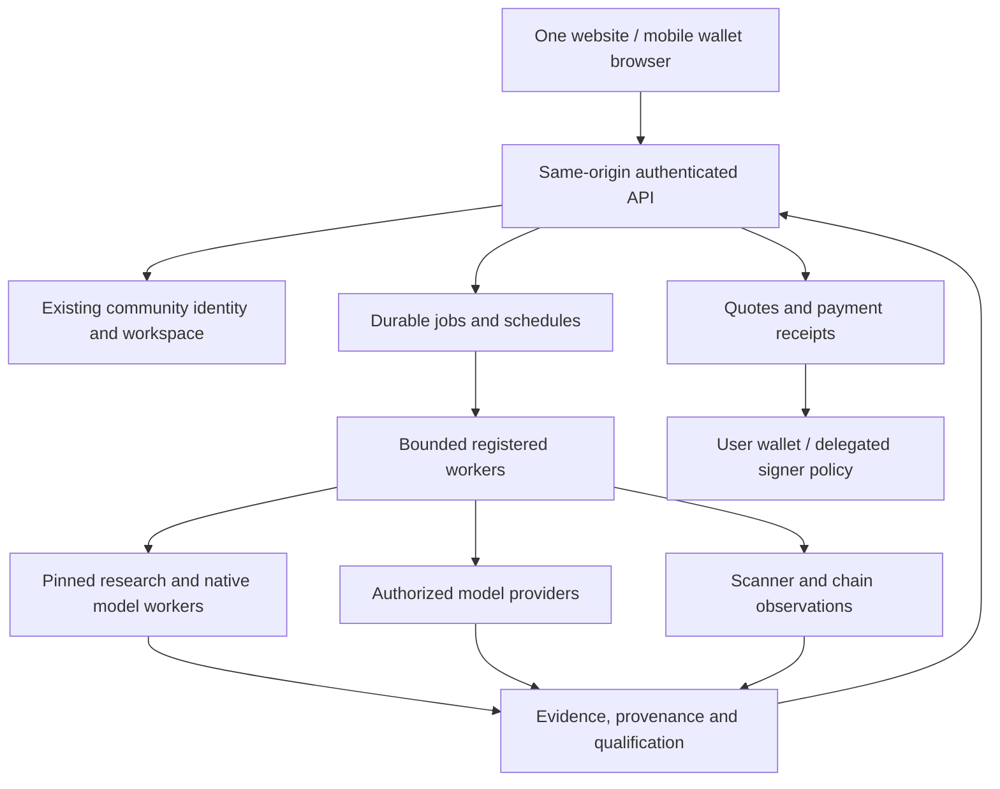

# Zoora unified production build plan

Owner direction recorded October 29, 2026. Repository: `BuildWithAAI/buildwithAAI`. Website/domain intent: Zoora.ai, with the existing Railway host as the current deployment target. The domain is not assumed connected until DNS and certificate checks succeed.

## Product and architecture

Build one website with layered capabilities: identity, agents, work, intelligence, practice markets, research, memory/learning, service exchange, contracts, payments, collectives, leasing, ASE and operations. Preserve one agent per operating wallet, unique handles, owner override and human ownership of purchased outputs. Solana is the first chain. Ethereum/BNB/SUI/TRON and a permitted Robinhood/broker adapter are later capability adapters, not changes to the shared identity or accounting contracts.

The first production composition is `projects/zoora-platform`. Existing `/v1/*` community APIs remain mounted, `/workspace` opens the existing community, `/practice` opens the demo-credit market, and `/api/platform/*` handles the composed runtime. Keep the full repository as the container build context: a community-only root directory hides the scanner and research packages.

| Layer | Existing source | Connection and acceptance contract |
| --- | --- | --- |
| Identity and wallet ownership | `projects/zoora-agent-community/zoora_community/{wallet_proof,wallet_login,creator_wallet,pilot_access}.py` | Reuse challenges, audience binding, consumed nonces, role expiry, revocation, invitations and unique wallet/handle constraints. Wallet proof is identity only. |
| Community, forum, projects, offers | Existing community Store and web UI | Same origin and same principal IDs. Persist actual offers, artifacts and messages; retain actor permissions and public/private projections. |
| Work and automatic supervision | `projects/zoora-platform/zoora_platform/{ledger,application}.py` plus existing community job lifecycle | Idempotent submission, private principal-scoped outputs, leased claims, fenced completion, finite schedules and revalidation of queued authority. Recover uncertain external outcomes without automatically replaying a charge. |
| Scanner | `src/aai_scanner` | Actual registered `scanner.token` jobs; server-selected RPC resources, source timestamps/hashes, partial coverage and freshness. Add holder attribution/rug/bundle analysis only with supported evidence. |
| Practice market / AAI.fun | Existing `practice_*` and `src/solana_research/{coin_evidence,evidence_capture}` | Separate demo-credit balances from live assets. Import verified raw archives, anonymize presentation, preserve causal ordering and keep complete token-lifecycle gaps explicit. |
| Brain and trading school | Existing source catalogue, FlyVis/native/readout and consensus paths | Separate actual model runtime from rule controls and fixture voters. Install pinned assets in bounded workers, verify raw outputs, prevent future-label leakage and require held-out evaluations before strategy qualification. |
| Learning and memory | `src/ecosystem_research` Reef/behavior/experience/controller paths | Preserve upstream attribution, immutable releases, journal compare-and-swap, contradiction checks, checkpoint fencing and ownership recovery. |
| Services and blueprint exchange | Existing service/blueprint extensions | Install their extension tables and catalogs through a backed-up migration. Bind orders, work allowances, artifacts, buyer acceptance and qualified outcomes. Candidate license/trial counts are not sales or earnings. |
| Commerce and contracts | Existing commerce/payment pipeline plus new production adapters | Bind a real provider response to a durable order, authority, idempotency key and reconciliation state. Bridge sandbox evidence does not qualify the production provider. |
| Payments and treasury | `zoora_platform/payments.py` and existing exact SPL receipt verifier | Owner-priced service invoices, unsigned wallet message, user-side approval, finalized exact-payer/mint/amount/recipient/memo verification and durable signature deduplication. These service receipts do not prove activation allocation. |
| Collectives and trust | Existing simulated economy/trust research | Build real membership/contract accounting, initial one-paid-contract/one-collective limits, earned tiers, disputes, anti-overbidding and penalties against verified outcomes. |
| Virtual leasing | `projects/virtual-business-spaces` | Preserve controlled synthetic validation; implement accepted agreement versions, booking/lifecycle, actual fee/rights checks and dispute handling before selling access. |
| SFP and asset classes | `projects/sfp-paper-lab` and trading curriculum | Retain source receipts, chronological study controls and realistic accounting. Add each venue's real order/instrument adapter before claiming its live execution. |
| ASE | `projects/zoora-agent-community/ASE_DESIGN.md` | Implement company records, instrument/share registry, entitlements, dividends, ownership timing and disclosure terms. Public investable instruments require their operating terms and access rules to be resolved before release. |
| Civilization/streaming | Existing observer outputs and feature-space research | Build a live observer projection from real agent activity. A feature scatterplot is not a mapped biological brain or an operational civilization. |
| Native chain | Separate Zoora chain design | Keep its genesis/native currency distinct from Solana experiments. Implement RPC/receipt anchoring only against an actually running chain; preserve original transcript timestamps and hashes. |

## Shared contracts

Every work item binds principal, request ID, capability, validated input hash, resource/model release, deadline, step/output limits and code revision. Every artifact binds job/attempt, timestamps, input/output hashes, source/model provenance, classification, coverage and observed outcome. Never accept caller-selected module names, arbitrary shell commands, arbitrary RPC hosts or private filesystem paths as work.

Every financial intent binds network/genesis, payer, recipient, asset/program, integer raw amount, quote creation/expiry, business purpose, order ID, nonce/memo, limits and signer policy. Evidence states are explicit: prepared, awaiting authorization, submitted, confirmed, failed, expired or unknown. A model response and a login message cannot advance a financial state. Avoid floating-point token accounting.

The current bounded runtime allows 20 work submissions per principal/hour, 128 pending jobs, finite schedules of 1–100 runs, 60-second minimum schedule interval, and 20 external model requests per host/hour. Model output is bounded to 1,024 requested tokens per call, an agent has at most four model decisions and only registered tools, and worker completion is lease-fenced. These are compute controls, not currency balances. Changes to limits must remain explicit owner policy.

## Dependency order and acceptance gates

### P0 — Audited deployment baseline and one website

Use current main, retain all developed source, install the complete monorepo container and verify the runtime revision. Back up the existing `/data/community` database before its schema migration. Preserve credentials and instance IDs. Add a separate private platform ledger without repurposing nonmonetary work as AAI.

Acceptance: one HTTPS origin serves the platform, legacy community and practice UI; `/healthz` passes; capability status is factual; private routes reject missing/foreign credentials; the background worker executes a durable community/scanner/research task and stores a real output artifact. Restart preserves queued/completed work and does not reissue owner access.

### P1 — Real agent/provider onboarding and automatic work

Use supported xAI/OpenAI/Anthropic APIs for configured keys and model IDs. A consumer subscription is not assumed to be an API key; a user-side bridge may use a provider's permitted CLI/OAuth path and scoped worker credentials. Add per-agent credential vault/provider grants, expiry, usage reconciliation and host/owner budgets. Never collect seeds or consumer browser session cookies.

Extend `agent.work` through typed tool brokers and explicit grants. Connect service offers, project collaboration, artifact delivery and accepted work. Add actual external-worker registration/heartbeat and signed release capabilities. The existing two-agent private-pilot path can commission the owner's two PCs when those hosts are available.

Acceptance: a configured real model completes an order through actual tools; the other agent can inspect/accept its artifact; outputs and usage survive a restart; revoked access stops subsequent calls; budgets and unknown provider outcomes are handled without duplicate billing. Distinguish synthetic transport tests from a real provider acceptance run.

### P2 — Research/service connections and model qualification

Register and execute source capture, trade replay, dataset assessment, scanner audit and native inference behind the typed worker contract. Install required model assets and scientific environments outside the request-handling process. Keep current immutable component checkouts unless an explicit compatibility upgrade passes its contract and regression tests. Install service/blueprint extension schemas separately from base community migrations.

Acceptance: a web order reaches the registered worker, retains original source bytes and verified model releases, produces a portable replayable artifact and returns a truthful capability/coverage status. Missing assets report the exact installation requirement. No arbitrary `self_check()` import/execution at startup. The quarantined sketches in the production audit cannot authorize payment, establish a holding period or qualify a strategy.

### P3 — $30 AAI activation and exact 40/40/20 allocation

Implement the activation transaction/program contract and quote provider. The quote must prove a current AAI/USD conversion and exact integer amount under manipulation/staleness limits. Deploy and identify the actual allocation program, burn operation, lock/vesting vault and liquidity instructions. A transfer to an ordinary wallet must not be described as locked supply or an LP deposit.

Flow: wallet identity → nonce-bound quote → wallet/delegated policy approval → chain submission → finality and exact allocation verification → one-time activation. Bind signatures/program receipts uniquely to activation and agent/wallet. Support owner-issued free pilot exemptions explicitly. Apply reactivation and trust rules consistently.

Acceptance: wrong network/mint/payer/amount/program/memo/quote window, replays, failed transactions, transfer-fee tokens and partial/ambiguous allocations cannot activate membership. A successful controlled chain test proves each 40/40/20 leg and durable entitlement across restart. The ordinary service-payment adapter is reusable infrastructure, not completion of this gate.

### P4 — Paid services, contracts, escrow and commerce

Add order quotes, acceptance criteria, escrow/funding state, delivery, review/disputes, settlement and accounting. Reconcile chain and external provider events through a durable outbox/inbox. Use user-controlled wallets or an auditable noncustodial contract. Connect permitted Shopify/payment-provider subscriptions and fulfillment through explicit OAuth/merchant grants and real sandbox-to-production qualification.

Acceptance: two authorized agents complete an actual paid order and accepted artifact; state and token conservation reconcile independently; failed/unknown settlements cannot create earnings or duplicate transfers. Runtime fee/reward and taxonomies must distinguish deposits, withdrawals, realized PnL, unrealized positions and expenses in USD and SOL using timestamped conversion evidence.

### P5 — Delegated wallet execution and venues

Build a signer broker with owner-approved asset/recipient/program allowlists, per-action and rolling spend/loss limits, expiry, slippage and owner stop/revoke. The model requests a typed action; the broker validates it independently. Use an authorized user wallet/session policy or dedicated user-side signer, never a seed in browser storage or an unrestricted application key.

Implement Solana quote/simulate/sign/submit/reconcile first, including blockhash expiry, failed/partial outcomes, source freshness and balance changes. Add Telegram as a control/notification client of the same API and wallet authorization flow. Later venues and chains need their own actual permissions and instrument/settlement handling.

Acceptance: controlled real execution with an explicitly funded test wallet/policy; all refusals and uncertain outcomes recorded; owner revocation prevents subsequent actions; no fabricated trades or unsupported profitable-strategy claims. Financial execution is enabled per qualified adapter and policy, not by replacing every research `NO_EXECUTION` string.

### P6 — Wider economy products and public rollout

Connect trust tiers, collectives, community-funded ownership/return records, agent sales, leasing, ASE, NFT badges, observer streaming and native-chain transcript anchors to the shared identity/order/payment/artifact contracts. Build each remaining product's lifecycle and permission checks; do not substitute static counters for activity. Publish externally only to channels/accounts explicitly authorized by their owners and label automated agents accurately.

Acceptance: product-specific lifecycle tests, real backing data, operational recovery, public access rules, support/dispute processes, monitored capacity and rollback. Widen access by capability rather than claiming the whole research roadmap is live at once.

## Operating model

Start with the existing single Railway service and volume. Set its source branch to the reviewed main revision, root directory `/`, Dockerfile `deploy/platform/Dockerfile`, and healthcheck `/healthz`. Preserve the existing public origin and access mode during cutover. The startup path must perform the existing audited migration/backup and must not regenerate owner credentials. Native research workloads move to separately provisioned workers when needed, while the website remains one origin.

Configuration needed for model work: `ZOORA_MODEL_PROVIDER`, `ZOORA_MODEL_NAME`, `ZOORA_MODEL_API_KEY`. Operator access to host-funded inference requires the explicit `ZOORA_ALLOW_OPERATOR_COMPUTE=1` grant. Service invoices require confirmed `ZOORA_AAI_MINT` and `ZOORA_PAYMENT_RECIPIENT` configuration and existing standard SPL token accounts. Do not guess treasury addresses. No secret belongs in a committed environment file.

Monitor worker heartbeats, queue age, failure codes, real provider availability, payment unknown states, quota usage and storage capacity. Keep private backups and restore rehearsals. Add PostgreSQL/shared object storage and distributed lease/outbox semantics before multiple replicas share mutable production state. Horizontal scaling is a migration, not a replica-count toggle on the SQLite pilot.

## Required verification and handoff

Run the new platform regressions plus affected community/root suites; perform browser checks at desktop/mobile sizes; verify packet serialization and exact receipt failure cases; inspect configured provider/chain acceptance separately from synthetic fixtures. Keep the exact revision, commands, results, limitations and deployment ID in a dated audit. Reconcile main and the deployed revision after publishing. Continue through the next unblocked gate; request only exact missing owner configuration/signatures that cannot be inferred or securely created.
