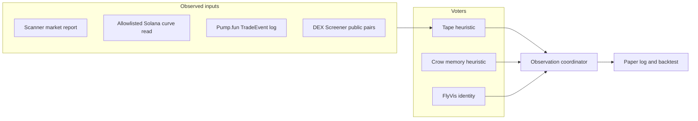

# Giant Brain v1

Paper signals for one meme-coin mint. Three voters share one observation round in the existing multi-brain coordinator. Nothing in this path builds, signs, or sends an order, and it does not hold a wallet key.



The coordinator's research signal stays `ABSTAIN` while FlyVis has no market readout. The numeric fused score is only the mean of heuristic ballots that actually voted, with confidence reduced by every brain that abstained.

## What each brain is

| Brain | What runs | What it is not |
| --- | --- | --- |
| Tape | Paper-long support from observed return, buy/sell flow, and liquidity change | A fixed score, and not a claim of an edge |
| Crow | Nearest past feature vector whose later return was recorded by the paper log | A crow connectome or a biological model. None is in this repo |
| FlyVis | Pinned connectome and checkpoint digests from the FlyVis reference | A market forecast. The native runtime is not executed here, and there is no calibrated readout, so the voter abstains |

## Data sources

| Source | Status | Key |
| --- | --- | --- |
| Caller-supplied scanner market report (`price_usd`, `liquidity_usd`, 24h buys/sells) | Live shape, already parsed by `src/aai_scanner/market.py` and the scanner feed | None for a report you already captured |
| Allowlisted Solana RPC `getAccountInfo` / `getTransaction` on `api.mainnet-beta.solana.com` and `api.mainnet.solana.com` | Live when you run a capture. Unit tests do not call it | None. `GIANT_BRAIN_RPC_URL` is accepted only when it is one of those two URLs |
| Pump.fun `TradeEvent` logs (`6EF8rrecthR5Dkzon8Nwu78hRvfCKubJ14M5uBEwF6P`) | Decoder is real. A capture still has to be run on a host | None on the public RPC |
| DEX Screener `api.dexscreener.com` via `live_dex_observation` | Optional live read, no key | None. Failure returns `DEX_UNAVAILABLE` |
| Helius or any other keyed RPC | Not used | `HELIUS_API_KEY` is ignored. A key in the URL would leave the allowlist |
| FlyVis forward pass | Missing in this process | The pinned CPU workflow is separate |
| Crow connectome | Missing | Do not relabel the memory heuristic as biology |
| Wallet signer, venue order API | Absent on purpose | Paper mode only |

An account snapshot with one price does not invent a return. Flow and liquidity change stay missing until both sides of the comparison are present.

## How to run

From the repository root, with no network:

```bash
python -m unittest tests.test_giant_brain tests.test_audit_regressions -v
python scripts/run_giant_brain.py --status
```

One captured observation, still paper:

```bash
python scripts/run_giant_brain.py \
  --observation observation.json \
  --paper-log paper.jsonl \
  --now-ms 1700000000000
```

`observation.json` is either a flat row (`mint`, `pool`, `price_quote_per_base`, `previous_price`, flow, liquidity) or `{"kind":"scanner_market","market":{...}}`, `{"kind":"curve_snapshots","current":{...},"previous":{...}}`, or `{"kind":"pump_trades","events":[...]}`.

A paper backtest appends hypothetical pnl and, when the tape had all three directional features, writes the later return into crow memory:

```bash
python scripts/run_giant_brain.py \
  --tape observations.json \
  --paper-log paper.jsonl \
  --memory crow.jsonl
```

Optional public DEX read, still no order:

```python
from multi_brain_research.market_sources import live_dex_observation
from multi_brain_research.giant_brain import fuse
observed = live_dex_observation("So11111111111111111111111111111111111111112")
```

Host capture of one mint stays read-only. `RPC_URL` must be an allowlisted public endpoint:

```bash
RPC_URL=https://api.mainnet-beta.solana.com CAPTURE_OUT=captures \
  python -m multi_brain_research.host_capture
```

Run that with `PYTHONPATH=src python -m multi_brain_research.host_capture`.

## Safety that this change locks in

- `receipt_bridge` rejects a missing pin and the placeholder hashes `"a"*64` and `"0"*64`.
- The loopback TLS private key is generated at test time and is not in git.
- `live_curve`, `curve_read`, `host_capture`, and `hold_check` share one client that refuses any endpoint outside the public-mainnet allowlist before it opens a socket. Redirects are refused.
- `host_capture` keeps a row when the transaction log contains a pump.fun trade for that mint and the curve account is in the transaction. A log without that event is omitted.

## Zoora Authenticated Community on `f30eff0`

[Run 40963120801](https://github.com/BuildWithAAI/buildwithAAI/actions/runs/40963120801) failed one job: Windows, Python 3.13, optimized unittest. `test_real_registered_agents_share_one_budget_across_database_connections` raised `STORAGE_UNAVAILABLE` while eight connections wrote one commerce book. The non-optimized Windows run and the other platforms passed. `store.call` waited 3 seconds for the DELETE-journal lock and then reported the database as down. The busy timeout is now 15 seconds. That failure is not a brain-connector defect. Later `main` commit `0b3cb93` did not re-run this workflow because its path filter did not include the community tree.

## Next steps for a later self-improvement run

1. Run the pinned FlyVis worker on a real encoded tape and store the activity export. Teach this voter to read that export. Do not invent a fly score in this process.
2. Capture more than the Anything AI curve: `host_capture` already takes a mint and curve. Keep dead coins in the set the capture plan requires, and point the paper backtest at those JSONL files.
3. Schedule a paper pass over scanner reports. Compare tape-only pnl with tape-plus-crow-recall on a later window that was not used to fill memory.
4. Publish the paper log's hit rate, abstention rate, and pnl-before-fees. Fees stay unapplied until a capture actually contains `fee_bps` for that fill. Do not treat the heuristic as calibrated.
5. Leave order entry, wallet keys, and keyed RPC URLs out until a separate signer and reconciliation design exists. A login signature is not permission to trade.
6. If a crow connectome or other animal model is added, give it its own module id and pins. Do not rename `crow_memory_v1`.
