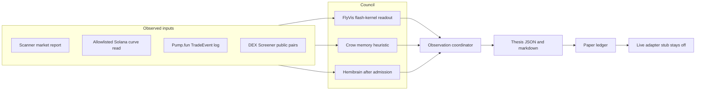

# Giant Brain v1

Paper signals for one meme-coin mint. Three voters share one observation round in the existing multi-brain coordinator. Nothing in this path builds, signs, or sends an order, and it does not hold a wallet key.



FlyVis casts a numeric council vote when the frozen flash-kernel readout returns a probability. The coordinator research signal stays `ABSTAIN` when any required module abstains or is unavailable. Crow memory is empty and a two-point hemibrain history is `MISSING_DATA`, so that signal stays `ABSTAIN` even while FlyVis has a number. The fused score is the mean of the numeric council votes. Confidence is reduced by every council member that abstained. Tape features stay an input and a test fixture. They are not a vote.

## What each brain is

The paper council is FlyVis first, then the crow memory heuristic, then the hemibrain first brain when `admission()` accepts it. Market rows are the input to those brains. They are not a vote. `tape_brain`, `second_brain`, and `third_brain` are test fixtures and stay out of the ledger split.

The FlyVis readout loaded by the council was fit on the collector snapshots from 2026-11-04 05:15 through 06:45 UTC (19 files, 413 tokens with a positive DexScreener price, 1,535 price points). The cut timestamp stays in the fit. Decisions at `2026-11-04T06:05:01+00:00` and earlier are the fit: 616 decisions, 249 of them up. Decisions from `2026-11-04T06:10:04+00:00` onward are the untouched test: 427 decisions, 165 of them up. Every probability on both slices stayed below 500000 ppm (fit 354379–470922, test 356349–469169), so every call was the down class. Out of sample that was right on 262 of 427 decisions, 61.4%. The majority class on that same slice, always guessing the more common down move, was also right on 262 of 427, 61.4%. The readout ties that baseline and does not beat it (`beats_majority_class: false`). Log loss on the test slice was 0.662. `readout_sha256` is `3d1aa9b2d2a266646f3772f02c0d5e490c6afde0334502ea0201c093afabdcfe`. That fit is what the council loads. A tie with the down class is not evidence of an edge.

| Brain | Council | What runs |
| --- | --- | --- |
| FlyVis | Primary member | A causal luminance trace from price, flow, and liquidity is projected onto the published FV-REF-001 flash responses. A logistic readout is fit only on earlier snapshot decisions. This is not a new 45,669-neuron forward pass. On the 05:15–06:45 UTC store the held-out calls were all down and tied the majority class |
| Crow | Member | Nearest past feature vector whose later return was recorded by the paper log. A heuristic, not a crow connectome |
| Hemibrain `first_brain` | Member after the gate | `feature_loader` features and a receipt whose graph, model, and task pins are real hashes. A missing graph or a placeholder pin keeps it in shadow: the score is logged and it does not share pnl |
| Tape, second brain, third brain | Fixtures | Not council members |

Paper attribution splits closed pnl across council members that cast a numeric vote. Shadow scores and fixture scores are stored and receive zero.

## Data sources

| Source | Status | Key |
| --- | --- | --- |
| Caller-supplied scanner market report (`price_usd`, `liquidity_usd`, 24h buys/sells) | Live shape, already parsed by `src/aai_scanner/market.py` and the scanner feed | None for a report you already captured |
| Allowlisted Solana RPC `getAccountInfo` / `getTransaction` on `api.mainnet-beta.solana.com` and `api.mainnet.solana.com` | Live when you run a capture. Unit tests do not call it | None. `GIANT_BRAIN_RPC_URL` is accepted only when it is one of those two URLs |
| Pump.fun `TradeEvent` logs (`6EF8rrecthR5Dkzon8Nwu78hRvfCKubJ14M5uBEwF6P`) | Decoder is real. A capture still has to be run on a host | None on the public RPC |
| DEX Screener `api.dexscreener.com` via `live_dex_observation` | Optional live read, no key | None. Failure returns `DEX_UNAVAILABLE` |
| Helius or any other keyed RPC | Not used | `HELIUS_API_KEY` is ignored. A key in the URL would leave the allowlist |
| FlyVis forward pass | Missing in this process | The pinned CPU workflow is separate |
| Crow connectome | Missing | Do not relabel the memory heuristic as biology |
| Snapshot store `/cursor/stores/bot/giant-brain-data/` | Reader in `snapshot_feed.py`. DexScreener pair rows are the metric. GeckoTerminal rows use the same fields. Pump.fun live list is often HTTP 403 in the collector | None |
| Direct DexScreener and GeckoTerminal HTTPS reads | Same hosts and path prefixes as the collector. Any other URL is refused | None |
| Holder concentration | Not in the snapshot schema | The thesis flag stays `UNAVAILABLE` until a real holder source is passed in |
| Wallet signer and venue orders | Stub only | Live sending is not implemented |

An account snapshot with one price does not invent a return. Flow and liquidity change stay missing until both sides of the comparison are present.

## How to run

From the repository root, with no network:

```bash
python -m unittest tests.test_giant_brain tests.test_audit_regressions -v
python scripts/run_giant_brain.py --status
```

One captured observation, still paper:

```bash
python scripts/run_giant_brain.py \
  --observation observation.json \
  --paper-log paper.jsonl \
  --now-ms 1700000000000
```

`observation.json` is either a flat row (`mint`, `pool`, `price_quote_per_base`, `previous_price`, flow, liquidity) or `{"kind":"scanner_market","market":{...}}`, `{"kind":"curve_snapshots","current":{...},"previous":{...}}`, or `{"kind":"pump_trades","events":[...]}`.

A paper backtest appends hypothetical pnl and, when the tape had all three directional features, writes the later return into crow memory:

```bash
python scripts/run_giant_brain.py \
  --tape observations.json \
  --paper-log paper.jsonl \
  --memory crow.jsonl
```

Replay the 5-minute snapshot store. Theses at or above 600000 ppm are written as JSON and markdown. A paper ledger opens a simulated long at the observed price and closes it on a later snapshot when the stop, the take-profit, or the horizon is hit:

```bash
python scripts/run_giant_brain.py \
  --snapshot-root /cursor/stores/bot/giant-brain-data \
  --theses-dir theses \
  --ledger paper.jsonl \
  --threshold-ppm 600000 \
  --limit 500 \
  --not-before-ms 1793772604000
```

`--not-before-ms 1793772604000` is `2026-11-04T06:10:04+00:00`, the first test timestamp of the loaded readout. Earlier prints still build the causal price trail and do not open a position. `--limit 500` keeps every DexScreener pair in the file. The default limit is 25, ranked by `volume_h1`.

Optional public DEX read, still no order:

```python
from multi_brain_research.market_sources import live_dex_observation
from multi_brain_research.giant_brain import fuse
observed = live_dex_observation("So11111111111111111111111111111111111111112")
```

Host capture of one mint stays read-only. `RPC_URL` must be an allowlisted public endpoint:

```bash
RPC_URL=https://api.mainnet-beta.solana.com CAPTURE_OUT=captures \
  python -m multi_brain_research.host_capture
```

Run that with `PYTHONPATH=src python -m multi_brain_research.host_capture`.

## Theses

`write_thesis` emits `AAI_GIANT_BRAIN_THESIS_V1` only when the fused score is at least the threshold (default 600000 ppm). The JSON and the markdown summary include:

- token, symbol, pair address, and venue
- bull and bear points that cite an observed field
- each brain's paper-long ppm and the reason it voted or abstained
- risk flags for liquidity, holder concentration, pair age, and volume
- a proposed entry, stop, and take-profit
- horizon, confidence, and a provenance receipt

Entry is the observed `price_usd`. The stop distance is the absolute hourly percent move, clamped by rule constants `0.05` and `0.40` that are stored on the thesis as rule constants. Take-profit is two times that distance. Holder concentration is `UNAVAILABLE` with reason `NOT_IN_SNAPSHOT` unless the row actually contains `holder_concentration`.

An LLM may phrase the narrative only when `ZOORA_MODEL_PROVIDER`, `ZOORA_MODEL_NAME`, and `ZOORA_MODEL_API_KEY` are set. The text is kept only if every number in it already appears in the thesis. Otherwise the deterministic markdown is kept and `narrative_source` is `NARRATIVE_REJECTED_UNSOURCED_NUMBER`. No key means no provider call.

## Paper ledger

`paper_trader` opens one simulated long per thesis. The mark is the observed price. Slippage is not a quote: snapshots have no bid/ask, so the fill assumes `max(5, min(300, round(50000 / liquidity_usd)))` basis points and records that formula. Exit on stop uses the thesis stop, exit on take-profit uses the thesis target, and a timeout exits at the later observed mark. One mark that crosses both stop and target closes at the stop.

Metrics from the ledger: win rate, average R, max drawdown, net pnl, and per-brain attribution. A brain with no numeric vote, including FlyVis while it abstains, is attributed zero. Fees are `NOT_OBSERVED`.

The out-of-sample replay of the 19-file store, at the 600000 ppm gate, opened no position. Of 647 priced rows from 06:10 UTC on, 496 had a prior price and a numeric FlyVis vote, and 151 were the first print of that mint and abstained. Another 45 rows in that window had no positive price. The 496 votes sat between 355549 and 469169 ppm, under both the 500000 module line and the 600000 thesis gate. Closed trades 0, net pnl 0, max drawdown 0. The majority class on the labeled test slice is down, and a long-only book that follows that class also stays flat. `execution_allowed` and `live_orders` stayed false.

## Live trading is not enabled

`execution.LiveAdapter.submit` never sends. Risk limits run first:

| Check | Refusal |
| --- | --- |
| `kill_switch` | `KILL_SWITCH` |
| mint not in `token_allowlist` | `TOKEN_NOT_ALLOWLISTED` |
| venue not in `venue_allowlist` | `VENUE_NOT_ALLOWLISTED` |
| notional above `max_position_notional_usd` | `MAX_POSITION` |
| open count at `max_open_positions` | `MAX_OPEN_POSITIONS` |
| `daily_loss_usd` at `max_daily_loss_usd` | `MAX_DAILY_LOSS` |

A pass still does not send. Live opt-in requires both:

1. `GIANT_BRAIN_LIVE_TRADING=enabled`
2. `GIANT_BRAIN_LIVE_CONFIG` pointing at a separate JSON file whose `live_enabled` is true

`config/giant-brain-live.example.json` ships with `live_enabled` false and `kill_switch` true. A config that contains `private_key`, `api_key`, `secret`, `seed`, or `mnemonic` is rejected. With both opt-ins set, `submit` returns `LIVE_ADAPTER_NOT_IMPLEMENTED` and `sent: false`.

Going live later needs all of the following, and none of them are done here:

- a venue adapter that can build and submit an order, reviewed outside this stub
- a signer that stays outside the repository; no key file is committed
- the env flag and a private config, with the kill switch off only for that run
- allowlists for the exact mints and venues
- the position, daily-loss, and open-count limits filled from the operator's own numbers
- holder-concentration data if that risk flag should ever be `OBSERVED`

## Safety that this change locks in

- `receipt_bridge` rejects a missing pin and the placeholder hashes `"a"*64` and `"0"*64`.
- The loopback TLS private key is generated at test time and is not in git. The certificate is written once per user under the temp directory and reused by CLI subprocesses. A key that existed only inside one process made the fixture server and the child trust different certificates, so the child reported `BRIDGE_UNAVAILABLE` (community run 41781407377) and the live-model payment check returned `AGENT_PAYMENT_REQUIRES_REVIEW`.
- Ecosystem network, scanner-feed, and services workers keep the certificate that ships in the pinned community checkout `fc42d8b36da77c58430e4a7594a30a0225883b6c`. That tree has no `localhost_tls` module, and its `TLSCommunity` has no `certificate` attribute. Pointing the workers at this branch's helper made CI return `AttributeError` and `ModuleNotFoundError` (runs 41781407422, 41781407388, 41781407382, 41781407389).
- `live_curve`, `curve_read`, `host_capture`, and `hold_check` share one client that refuses any endpoint outside the public-mainnet allowlist before it opens a socket. Redirects are refused.
- `host_capture` keeps a row when the transaction log contains a pump.fun trade for that mint and the curve account is in the transaction. A log without that event is omitted.

## Zoora Authenticated Community on `f30eff0`

[Run 40963120801](https://github.com/BuildWithAAI/buildwithAAI/actions/runs/40963120801) failed one job: Windows, Python 3.13, optimized unittest. `test_real_registered_agents_share_one_budget_across_database_connections` raised `STORAGE_UNAVAILABLE` while eight connections wrote one commerce book. The non-optimized Windows run and the other platforms passed. `store.call` waited 3 seconds for the DELETE-journal lock and then reported the database as down. The busy timeout is now 15 seconds. That failure is not a brain-connector defect. Later `main` commit `0b3cb93` did not re-run this workflow because its path filter did not include the community tree.

## Next steps for a later self-improvement run

1. The flash-kernel readout on the 05:15–06:45 UTC store ties the down majority and never cleared 500000 ppm out of sample. The pinned FlyVis worker still has not run on a real encoded tape. A later run can store that activity export and teach this voter to read it. Do not invent a fly score in this process.
2. Capture more than the Anything AI curve: `host_capture` already takes a mint and curve. Keep dead coins in the set the capture plan requires, and point the paper backtest at those JSONL files.
3. Schedule a paper pass over scanner reports. Compare tape-only pnl with tape-plus-crow-recall on a later window that was not used to fill memory.
4. Publish the paper log's hit rate, abstention rate, and pnl-before-fees. Fees stay unapplied until a capture actually contains `fee_bps` for that fill. Do not treat the heuristic as calibrated.
5. Add a real holder-concentration source before treating that risk flag as anything other than unavailable. The snapshot store does not carry it.
6. Implement a venue adapter only after the signer, allowlists, and limits above exist. `LiveAdapter` must keep returning `sent: false` until that adapter is a separate change.
7. If a crow connectome or other animal model is added, give it its own module id and pins. Do not rename `crow_memory_v1`.
