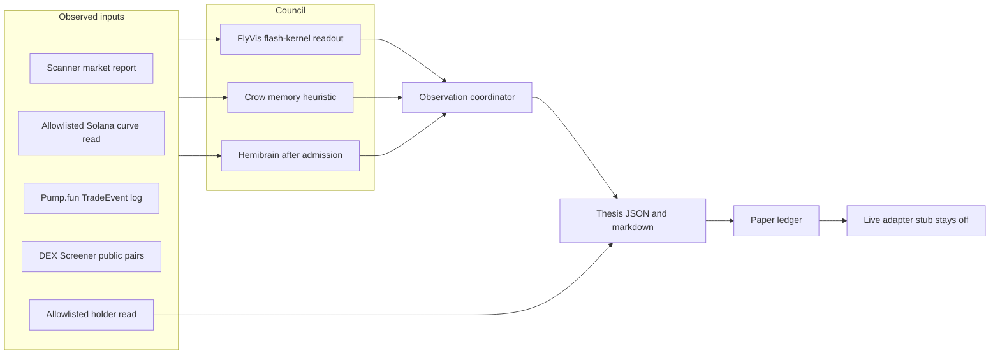

# Giant Brain v1

Paper signals for one meme-coin mint. Three voters share one observation round in the existing multi-brain coordinator. Nothing in this path builds, signs, or sends an order, and it does not hold a wallet key.



FlyVis casts a numeric council vote when the frozen flash-kernel readout returns a probability. The coordinator research signal stays `ABSTAIN` when any required module abstains or is unavailable. Crow memory is empty and a two-point hemibrain history is `MISSING_DATA`, so that signal stays `ABSTAIN` even while FlyVis has a number. The fused score is the mean of the numeric council votes. Confidence is reduced by every council member that abstained. Tape features stay an input and a test fixture. They are not a vote. A holder-concentration read is also an input, and only when its `fetched_at_ms` is at or before the decision. It is not a vote and it does not change the fused score.

## What each brain is

The paper council is FlyVis first, then the crow memory heuristic, then the hemibrain first brain when `admission()` accepts it. Market rows are the input to those brains. They are not a vote. `tape_brain`, `second_brain`, and `third_brain` are test fixtures and stay out of the ledger split.

The FlyVis readout loaded by the council was fit on the collector snapshots from 2026-11-04 05:15 through 06:45 UTC (19 files, 413 tokens with a positive DexScreener price, 1,535 price points). The cut timestamp stays in the fit. Decisions at `2026-11-04T06:05:01+00:00` and earlier are the fit: 616 decisions, 249 of them up. Decisions from `2026-11-04T06:10:04+00:00` onward are the untouched test: 427 decisions, 165 of them up. Every probability on both slices stayed below 500000 ppm (fit 354379–470922, test 356349–469169), so every call was the down class. Out of sample that was right on 262 of 427 decisions, 61.4%. The majority class on that same slice, always guessing the more common down move, was also right on 262 of 427, 61.4%. The readout ties that baseline and does not beat it (`beats_majority_class: false`). Log loss on the test slice was 0.662. `readout_sha256` is `3d1aa9b2d2a266646f3772f02c0d5e490c6afde0334502ea0201c093afabdcfe`. That fit is what the council loads. A tie with the down class is not evidence of an edge.

| Brain | Council | What runs |
| --- | --- | --- |
| FlyVis | Primary member | A causal luminance trace from price, flow, and liquidity is projected onto the published FV-REF-001 flash responses. A logistic readout is fit only on earlier snapshot decisions. This is not a new 45,669-neuron forward pass. On the 05:15–06:45 UTC store the held-out calls were all down and tied the majority class |
| Crow | Member | Nearest past feature vector whose recorded outcome window ended at or before the decision. A row with no `outcome_end_ms` is not used. A heuristic, not a crow connectome |
| Hemibrain `first_brain` | Member after the gate | `feature_loader` features and a receipt whose graph, model, and task pins are real hashes. A missing graph or a placeholder pin keeps it in shadow: the score is logged and it does not share pnl |
| Tape, second brain, third brain | Fixtures | Not council members |

Paper attribution splits closed pnl across council members that cast a numeric vote. Shadow scores and fixture scores are stored and receive zero.

## Data sources

| Source | Status | Key |
| --- | --- | --- |
| Caller-supplied scanner market report (`price_usd`, `liquidity_usd`, 24h buys/sells) | Live shape, already parsed by `src/aai_scanner/market.py` and the scanner feed | None for a report you already captured |
| Allowlisted Solana RPC `getAccountInfo`, `getTransaction`, `getTokenSupply`, `getTokenLargestAccounts`, and `getMultipleAccounts` on `api.mainnet-beta.solana.com` and `api.mainnet.solana.com` | Live when you run a capture. Unit tests do not call it | None. `GIANT_BRAIN_RPC_URL` is accepted only when it is one of those two URLs |
| Pump.fun `TradeEvent` logs (`6EF8rrecthR5Dkzon8Nwu78hRvfCKubJ14M5uBEwF6P`) | Decoder is real. A capture still has to be run on a host | None on the public RPC |
| DEX Screener `api.dexscreener.com` via `live_dex_observation` | Optional live read, no key | None. Failure returns `DEX_UNAVAILABLE` |
| Helius or any other keyed RPC | Not used | `HELIUS_API_KEY` is ignored. A key in the URL would leave the allowlist |
| FlyVis forward pass | Missing in this process | The pinned CPU workflow is separate |
| Crow connectome | Missing | Do not relabel the memory heuristic as biology |
| Snapshot store `/cursor/stores/bot/giant-brain-data/` | Reader in `snapshot_feed.py`. DexScreener pair rows are the metric. GeckoTerminal rows use the same fields. Pump.fun live list is often HTTP 403 in the collector | None |
| Direct DexScreener and GeckoTerminal HTTPS reads | Same hosts and path prefixes as the collector, plus `GET /api/v2/networks/solana/pools/{pool}/ohlcv/minute`. Any other URL is refused | None |
| Pool minute candles | Public GeckoTerminal OHLCV. Rows are `[unix_seconds, open, high, low, close, volume]`, newest first. Stored as JSONL. Unit tests use the recorded responses under `tests/fixtures/giant-brain-ohlcv/` | None. Five reads on 2026-11-04 returned HTTP 200. No `Retry-After` header was present |
| Holder concentration | Live read in `holder_concentration.py` through the shared allowlisted client. Not stored in the snapshot files. A replay with no attached read stays `UNAVAILABLE` / `NOT_IN_SNAPSHOT` | None. Same two public hosts. On 2026-11-04 `getTokenLargestAccounts` returned HTTP 429, so no share was stored |
| Wallet signer and venue orders | Stub only | Live sending is not implemented |

An account snapshot with one price does not invent a return. Flow and liquidity change stay missing until both sides of the comparison are present.

## How to run

From the repository root, with no network:

```bash
python -m unittest tests.test_giant_brain tests.test_audit_regressions -v
python scripts/run_giant_brain.py --status
```

One captured observation, still paper:

```bash
python scripts/run_giant_brain.py \
  --observation observation.json \
  --paper-log paper.jsonl \
  --now-ms 1700000000000
```

`observation.json` is either a flat row (`mint`, `pool`, `price_quote_per_base`, `previous_price`, flow, liquidity) or `{"kind":"scanner_market","market":{...}}`, `{"kind":"curve_snapshots","current":{...},"previous":{...}}`, or `{"kind":"pump_trades","events":[...]}`.

A paper backtest appends hypothetical pnl and, when the tape had all three directional features, writes the later return into crow memory. The row stores `outcome_start_ms` at that decision and `outcome_end_ms` at the next decision, which is when the return was observed. Recall at time T skips a row whose `outcome_end_ms` is missing or later than T:

```bash
python scripts/run_giant_brain.py \
  --tape observations.json \
  --paper-log paper.jsonl \
  --memory crow.jsonl
```

Replay the 5-minute snapshot store. Theses at or above 600000 ppm are written as JSON and markdown. A paper ledger opens a simulated long at the observed price and closes it on a later snapshot when the stop, the take-profit, or the horizon is hit:

```bash
python scripts/run_giant_brain.py \
  --snapshot-root /cursor/stores/bot/giant-brain-data \
  --theses-dir theses \
  --ledger paper.jsonl \
  --threshold-ppm 600000 \
  --limit 500 \
  --not-before-ms 1793772604000
```

`--not-before-ms 1793772604000` is `2026-11-04T06:10:04+00:00`, the first test timestamp of the loaded readout. Earlier prints still build the causal price trail and do not open a position. `--limit 500` keeps every DexScreener pair in the file. The default limit is 25, ranked by `volume_h1`. `--candle-dir` points at JSONL files named `{pair_address}.jsonl`. A missing file leaves that mark on the snapshot price.

Snapshot files are read in UTC day order, then the `HHMM` stamp. A `.jsonl` and a `.jsonl.gz` for the same day and stamp are one snapshot, and the plain file is kept. Gzipped files are not replayed after every plain file.

The walk-forward below fills crow memory only from snapshots before the longest gap, then scores the later snapshots twice:

```bash
PYTHONPATH=src python scripts/run_giant_brain.py \
  --walk-forward \
  --snapshot-root /cursor/stores/bot/giant-brain-data \
  --work-dir walk-forward \
  --limit 25 \
  --threshold-ppm 600000 \
  --candle-dir research/giant-brain/ohlcv
```

One pool's minute candles, still no order:

```python
from multi_brain_research.pool_ohlcv import fetch_ohlcv
page = fetch_ohlcv(pair, before_timestamp=1793777600, limit=20)
```

Optional public DEX read, still no order:

```python
from multi_brain_research.market_sources import live_dex_observation
from multi_brain_research.giant_brain import fuse
observed = live_dex_observation("So11111111111111111111111111111111111111112")
```

Host capture of one mint stays read-only. `RPC_URL` must be an allowlisted public endpoint:

```bash
RPC_URL=https://api.mainnet-beta.solana.com CAPTURE_OUT=captures \
  python -m multi_brain_research.host_capture
```

Run that with `PYTHONPATH=src python -m multi_brain_research.host_capture`.

One holder read, still paper. The result is attached to the observation and to the thesis record. Unit tests pass a recorded payload and do not open a socket.

```python
from multi_brain_research.holder_concentration import live_read
read = live_read(mint, "https://api.mainnet-beta.solana.com", pair_address=pair)
```

`getTokenSupply` and `getTokenLargestAccounts` use commitment `finalized`. `getMultipleAccounts` is called only after both succeed, to read the token account and then the owner account. A pool vault is labeled only when the token account's owner equals the observed pair address. A bonding-curve vault is labeled only when that owner's program is `6EF8rrecthR5Dkzon8Nwu78hRvfCKubJ14M5uBEwF6P`. Anything else is `UNCLASSIFIED`. Amounts are the RPC `amount` strings. `uiAmount` is ignored.

On 2026-11-04 a direct `getTokenSupply` for icapy (`5fgJwPNtsohc1FwjkjvmVWoXTbSzD8Z3zzbcuXdepump`) against `https://api.mainnet-beta.solana.com` returned HTTP 200. The body was `result.context.slot` 465228433 and `result.value.amount` `"967911401689546"` with `decimals` 6. `uiAmount` was also present and was not used as the balance. The following `getTokenLargestAccounts` call returned HTTP 429. `Retry-After` was 10. The body was a JSON-RPC error, code 429, message `Too many requests for a specific RPC call`.

`live_read` was then run on that same mint, the top pair in `snapshots/2026-11-04/0815.jsonl`, three times across the two allowlisted hosts, and twice more after a three-minute pause with no other RPC calls. All five largest-accounts calls were HTTP 429 with the same code, message, and `Retry-After`. Each `live_read` had already received a supply slot (465233877 and 465234082 on the later calls) and stored that slot. It stored no supply amount and no share. Succeeded concentration reads: 0. Top-10 share distribution: not observed. Further mints were not called. The limiter is on the method, and another mint would have been the same call. A successful largest-accounts row was not returned, so this run did not confirm that row's field names against a live payload. The parser accepts the `address`, `amount`, and `decimals` object the scanner already reads. A different shape stays `RPC_SHAPE` and still has no share.

## Theses

`write_thesis` emits `AAI_GIANT_BRAIN_THESIS_V1` only when the fused score is at least the threshold (default 600000 ppm). The JSON and the markdown summary include:

- token, symbol, pair address, and venue
- bull and bear points that cite an observed field
- each brain's paper-long ppm and the reason it voted or abstained
- risk flags for liquidity, holder concentration, pair age, and volume
- a proposed entry, stop, and take-profit
- horizon, confidence, and a provenance receipt

Entry is the observed `price_usd`. The stop distance is the absolute hourly percent move, clamped by rule constants `0.05` and `0.40` that are stored on the thesis as rule constants. Take-profit is two times that distance. Holder concentration is `UNAVAILABLE` with reason `NOT_IN_SNAPSHOT` unless the row carries a holder read whose `fetched_at_ms` is at or before `now_ms`. A successful read is `CLEAR` when the compared top-10 share is under the stored rule `rule_top10_share_ppm` of 500000, and `RAISED` at or above it. 500000 ppm is 50% of supply, the same threshold `ACCOUNT_CONCENTRATION` already uses in the scanner. It is a rule constant, not a number fit on this sample. The compared share excludes a token account only when its owner equals the observed pair (`POOL_VAULT`) or that owner's program is the published pump.fun program (`BONDING_CURVE`). Every other account stays `UNCLASSIFIED` and remains inside the share. If the owner read did not run, the flag uses the raw top 10 and `exclusion_applied` is false. Shares are integer parts per million of total supply. The flag stores the RPC endpoint, the supply slot, the largest-accounts slot, and `fetched_at_ms`. A failed or rate-limited read stays `UNAVAILABLE` with that reason and does not carry a share.

An LLM may phrase the narrative only when `ZOORA_MODEL_PROVIDER`, `ZOORA_MODEL_NAME`, and `ZOORA_MODEL_API_KEY` are set. The text is kept only if every number in it already appears in the thesis. Otherwise the deterministic markdown is kept and `narrative_source` is `NARRATIVE_REJECTED_UNSOURCED_NUMBER`. No key means no provider call.

## Paper ledger

`paper_trader` opens one simulated long per thesis. The default `exit_policy` for a new position is `ladder_e`. `single_target` is still available and is what the replays earlier in this note used.

`single_target` marks the observed price. Slippage is not a quote: snapshots have no bid/ask, so the fill assumes `max(5, min(300, round(50000 / liquidity_usd)))` basis points and records `fill_model` `ASSUMED_FROM_OBSERVED_LIQUIDITY`. Exit on stop uses the thesis stop, exit on take-profit uses the thesis target, and a timeout exits at the later observed mark. One snapshot mark that crosses both stop and target closes at the stop. Fees on that pnl stay `NOT_OBSERVED`. The close also stores `pnl_after_costs_usd`, which restates the same raw entry and exit with a 1% fee and 0.5% slippage on the buy and on the sell. That restatement is not the fill the position used.

When minute candles are supplied to `single_target`, a candle counts only if it starts at or after the open and ends at or before the decision. The walk is oldest first. A low at or under the stop closes at the stop. A high at or over the target closes at the target. A candle that prints both closes at the stop. `TIMEOUT` is used only when at least one candle sat inside the hold and neither level printed. No candle inside the hold is `PATH_UNOBSERVED`, not a timeout. Fees stay `NOT_OBSERVED`.

Metrics from the ledger: win rate, average R, max drawdown, net pnl, and per-brain attribution. A brain with no numeric vote, including FlyVis while it abstains, is attributed zero. Fees are `NOT_OBSERVED`.

The out-of-sample replay of the 19-file store, at the 600000 ppm gate, opened no position. Of 647 priced rows from 06:10 UTC on, 496 had a prior price and a numeric FlyVis vote, and 151 were the first print of that mint and abstained. Another 45 rows in that window had no positive price. The 496 votes sat between 355549 and 469169 ppm, under both the 500000 module line and the 600000 thesis gate. Closed trades 0, net pnl 0, max drawdown 0. The majority class on the labeled test slice is down, and a long-only book that follows that class also stays flat. `execution_allowed` and `live_orders` stayed false.

The same replay was run again on the store as it stood at 2026-11-04 08:15 UTC: 37 snapshot files, 05:15 through 08:15. The readout was not refit. The gate stayed 600000 ppm, the limit stayed 500, and `--not-before-ms` stayed 1793772604000 (`2026-11-04T06:10:04+00:00`). Of 2145 priced rows at or after that cut, 1653 had a numeric FlyVis vote between 350049 and 469336 ppm, and 492 were the first print of that mint and abstained. No row with a prior price abstained. The fused score matched the FlyVis number on every one of those 1653 votes, because crow memory was empty and the hemibrain vote was not numeric. None of the 1653 votes reached 500000 ppm, and none reached the 600000 thesis gate. Theses opened 0. Closed trades 0, so win rate and average R are not defined. Pnl before fees is 0. Fees are `NOT_OBSERVED`. Max drawdown is 0. The replay counter `skipped` was 174, which is rows it could not mark, not the abstention count. Abstention rate on the priced rows is 492/2145. `execution_allowed` and `live_orders` stayed false.

## Paper log

`publish_snapshot_log` appends one paper-log row per collected DexScreener pair print, one mint at a time, and `summary` publishes the log. A row counts as an abstention when `coordinator_signal` is `ABSTAIN` or `fused_score_ppm` is not an integer. A hit is a paper long whose next print of that same mint is a higher price. The hit rate is undefined when the log has no paper long. `pnl_before_fees` is the sum of `paper_pnl_per_unit`. That sum does not subtract a fee. A fee is subtracted only for a paper long whose own capture has an integer `fee_bps` from 0 through 10000. Flat rows keep the fee unapplied. `calibrated` is false.

On 2026-11-04 this was run on `/cursor/stores/bot/giant-brain-data/` as it stood with snapshot files `0515.jsonl` through `1045.jsonl`. Pump.fun was not read. The log had 1238 mints and 5218 rows. No pair row contained `fee_bps`.

| | |
| --- | --- |
| Rows | 5218 |
| Abstained | 5218 |
| Abstention rate | 5218/5218 |
| Numeric fused scores | 3980, from 349876 to 473420 ppm |
| Scores at or above 500000 ppm | 0 |
| Paper longs | 0 |
| Hits | 0 |
| Hit rate | not defined |
| Priced rows | 3980 |
| Pnl before fees | 0 |
| Fees | `NOT_APPLIED` |
| `calibrated` | false |
| `execution_allowed` / `live_orders` | false / false |

The coordinator signal was `ABSTAIN` on every row. Hemibrain was `MISSING_DATA` on all 5218. Crow was `CROW_MEMORY_EMPTY` on 2947 and `CROW_FEATURES_INCOMPLETE` on 2271. This publish does not load `brain-runs/crow_memory.jsonl`. FlyVis was `FLASH_KERNEL_READOUT` on 3980 rows and `STIMULUS_UNAVAILABLE` on the 1238 first prints. None of the numeric scores reached 500000 ppm, so the book stayed flat. This run did not rewrite the thesis ledger.

The thesis replay was run again on the store at 2026-11-04 12:15 UTC: 78 snapshot files, 05:15 through 12:15. Same frozen readout, same gate, same cut. Of 5574 priced rows at or after the cut, 4309 had a numeric FlyVis vote between 349876 and 473420 ppm, and 1265 were the first print of that mint and abstained. No row with a prior price abstained. None of the 4309 votes reached 500000 ppm or the 600000 thesis gate. Theses opened 0. Closed trades 0, so win rate and average R are not defined. Pnl before fees is 0. Fees are `NOT_OBSERVED`. `skipped` was 258. Abstention rate is 1265/5574. `execution_allowed` and `live_orders` stayed false. This book still has no position for a candle to mark.

The box runner's ledger at `brain-runs/paper_ledger.jsonl` is a different book. Crow recall was filled, so five theses cleared the gate and every close was `TIMEOUT` on the next snapshot mark. Re-marking those five with the recorded minute candles, without changing the open fill, left every close a `TIMEOUT` with path `CANDLES_OBSERVED_NO_HIT`. Each hold contained 4 in-window candles, except AMD, which contained 9 because its snapshot close was ten minutes after the open. None of those candles printed the stop or the target, so the exit stayed the snapshot mark and the pnl did not change.

| Symbol | In-window low | In-window high | Stop | Target | Reason |
| --- | --- | --- | --- | --- | --- |
| VETO | 0.00032516050568076247 | 0.0003743731996786626 | 0.00028028962 | 0.00046512076 | TIMEOUT |
| AMD | 0.0010615591642848272 | 0.001190447782084824 | 0.0009906138 | 0.0013847724 | TIMEOUT |
| CHATBLT | 6.798351061692613e-05 | 0.00010622796102687535 | 3.940799999999999e-05 | 0.000118224 | TIMEOUT |
| CHILLCATS 11:15 | 5.4032217916739883e-05 | 8.087084197354375e-05 | 4.5407999999999996e-05 | 0.000136224 | TIMEOUT |
| CHILLCATS 11:35 | 5.109124701210193e-05 | 6.238081351405711e-05 | 2.8913999999999998e-05 | 8.6742e-05 | TIMEOUT |

Target hits 0 of 5. Stop hits 0 of 5. Win rate, counting a positive pnl, is 0.8. Average R is 0.5036687400802997. Pnl before fees is 83.53868127795457. Fees are `NOT_OBSERVED`. Those three figures match the snapshot-only closes, because the path check did not move the exit. The candle bodies are `tests/fixtures/giant-brain-ohlcv/*.json` and the parsed JSONL is `research/giant-brain/ohlcv/`.

## Walk-forward

Recall at decision time T uses a memory row only when `outcome_end_ms` is an integer at or before T. A row with no end time is skipped, so `brain-runs/crow_memory.jsonl` is not a source for this pass: that file has no `outcome_end_ms`. The pass writes a new memory from the snapshot store. A row is written only after the next price of that mint is known, and only when that window ends before the holdout.

The holdout is the first snapshot after the longest gap. On this store the gap is 27302000 ms, from `snapshots/2026-11-04/1425.jsonl` at `2026-11-04T14:25:01+00:00` to `snapshots/2026-11-04/2200.jsonl` at `2026-11-04T22:00:03+00:00`. The directory had 110 snapshot files, `0515.jsonl` through `2235.jsonl`. Fill files: 102. Memory rows: 4339, every one with an `outcome_end_ms`. The latest end is `2026-11-04T14:25:01+00:00`. Holdout files: 8, `2200.jsonl` through `2235.jsonl`. Those eight files were not used to write memory.

The book uses the box runner's paper rules: top 25 pairs by `volume_h1`, thesis gate 600000 ppm, a 12-minute break starts a new price tail, the tail keeps 48 points, and FlyVis abstains until the tail has 3 points. Notional is 100 paper USD. The machine-readable result is `research/giant-brain/walk_forward_2026-11-04.json`.

GATO's minute page was fetched from GeckoTerminal at `2026-11-04T22:39:35Z`. The read returned status `OBSERVED`, 30 candles, and no `Retry-After`. The parsed file is `research/giant-brain/ohlcv/5E3dXLXGwmTDCokA51WYYaKttjFZBwqCoyUHBUi5gt2m.jsonl`. No other holdout pair opened a position, so no other page was requested.

Win rate is the count of closed trades with positive pnl divided by the count of closed trades. Average R is the mean of `r_multiple` on those closes. Both are undefined when nothing closed. Pnl before fees is the sum of `pnl_usd`. A fee is not subtracted.

| | With crow memory | Without crow memory |
| --- | --- | --- |
| Theses | 1 | 0 |
| Closed trades | 1 | 0 |
| Still open | 0 | 0 |
| Win rate | 1.0 (1 of 1) | not defined |
| Average R | 0.10955760395103686 | not defined |
| Pnl before fees | 0.5757024869207977 | 0 |
| Fees | `NOT_OBSERVED` | `NOT_OBSERVED` |

The close is GATO, thesis `55f3bf13a2baef95f257b426ec14d83df07b4c9e26bb49cd9bce97f6c4179312`, opened `2026-11-04T22:05:01+00:00` and closed on the `2026-11-04T22:10:01+00:00` snapshot. Crow was the only numeric vote, at 611986 ppm, and that was the fused score. FlyVis was `STIMULUS_UNAVAILABLE` and hemibrain was `MISSING_DATA`. Four minute candles sat inside the hold. Their low was 0.010326421393398493 and their high was 0.010541931867983977. The stop was 0.00981594 and the target was 0.011418119999999999. Neither printed. The reason is `TIMEOUT` and the path is `CANDLES_OBSERVED_NO_HIT`. The exit stayed the snapshot mark, so the pnl and R are the same figures a snapshot-only close produces. `execution_allowed` and `live_orders` stayed false.

The 4-of-5 result does not hold on these hours. Those five closes opened from 07:25 through 11:35 UTC, and that stretch was used to fill memory. The held-out book is one timeout. Its pnl before fees is 0.5757024869207977.

## Ladder exit

`ladder_e` is strategy E from the 2026-11-03 one-minute-candle exit research. A new paper position stores these fields:

| Field | Meaning |
| --- | --- |
| `exit_policy` | `ladder_e` or `single_target` |
| `fill_model` | `FEE_1PCT_SLIP_0_5PCT` on the ladder. `ASSUMED_FROM_OBSERVED_LIQUIDITY` on the single target |
| `price_path` | `MINUTE_CANDLE` when a new in-window minute candle was applied, otherwise `SNAPSHOT_MARK` |
| `entry_price_usd` | Observed mark. Rungs and the stop are multiples of this mark |
| `entry_fill_usd` | Mark times `(1 + slippage_rate) * (1 + fee_rate)` |
| `fee_rate` | `0.01` |
| `slippage_rate` | `0.005` |
| `tp_levels` | List of `{multiple, fraction, filled_at, fill_price}`. The rungs are 2.0 for 0.50 and 4.0 for 0.25. `filled_at` and `fill_price` stay null until that rung prints |
| `trail_pct` | `0.20` when `instant_graduation` is true, otherwise `0.40` |
| `stop_multiple` | `0.5`, the -50% stop, used only before the first rung |
| `running_high` | Highest price seen after the open |
| `trail_stop_usd` | `running_high * (1 - trail_pct)` after the first rung, otherwise null |
| `realized_partial_pnl_usd` | Sum of rung pnls after the fee and the slippage. The final leg is separate |
| `remaining_fraction` | Starts at 1. The last 0.25 is the trail, not a rung |
| `graduation` | `INSTANT`, `STANDARD`, or `NOT_OBSERVED` |
| `instant_graduation` | The boolean on the snapshot row, or null when the row does not carry it |
| `horizon_ms` | `172800000`, 48 hours |
| `pnl_after_costs_usd` | On a `CLOSE`, the position pnl after the 1% fee and 0.5% slippage |
| `partial_pnl_usd` | On a `PARTIAL`, that rung's pnl after those costs |
| `exit_fill_usd` | Raw price times `(1 - slippage_rate) * (1 - fee_rate)` |

A minute candle is used when one starts at or after the open and ends at or before the decision, and its start is at or after `last_mark_ms`. Inside that candle the low is tested before the high. The low can stop the position or hit the trail. The high can fill the next rung and raise `running_high`. A trail created by that high does not use the same candle's low. When no new candle is in the window, the snapshot mark is the low and the high. The -50% stop applies only while the 2x rung is unfilled. After that rung, the trail covers whatever fraction is still held. A `CLOSE` reason is `STOP`, `TRAIL`, or `TIMEOUT`. A rung that does not finish the position is a `PARTIAL`. `execution_allowed` and `live_orders` stay false.

The collector snapshots do not carry `instant_graduation`, so this run's ladder uses `graduation` `NOT_OBSERVED` and `trail_pct` 0.40.

The same walk-forward was run again with both policies. Memory was still filled only before the gap: 4339 rows, latest end `2026-11-04T14:25:01+00:00`. The directory then had 114 files, `0515.jsonl` through `2255.jsonl`, and 12 holdout files from `2200.jsonl` through `2255.jsonl`. The gap was still 27302000 ms. GATO's recorded minute page was supplied. The machine-readable result is `research/giant-brain/walk_forward_policies_2026-11-04.json`.

Win rate after costs counts a closed trade as a win when `pnl_after_costs_usd` is positive. Average win is the mean of those positive values. Average loss is the mean of the negative values, so it is negative when it is defined. The P/L ratio is average win divided by the absolute average loss. The profit factor is the sum of the positive values divided by the absolute sum of the negative values. Each of those is undefined when its inputs are missing. A profit factor of 0 means every closed pnl after costs was a loss.

| | `single_target`, with crow | `single_target`, without crow | `ladder_e`, with crow | `ladder_e`, without crow |
| --- | --- | --- | --- | --- |
| Theses | 1 | 0 | 1 | 0 |
| Closed trades | 1 | 0 | 0 | 0 |
| Still open | 0 | 0 | 1 | 0 |
| Win rate after costs | 0.0 | not defined | not defined | not defined |
| Average win | not defined | not defined | not defined | not defined |
| Average loss | -2.299179950441493 | not defined | not defined | not defined |
| P/L ratio | not defined | not defined | not defined | not defined |
| Profit factor | 0.0 | not defined | not defined | not defined |
| Pnl after modeled costs | -2.299179950441493 | not defined | not defined | not defined |

The single-target close is the same GATO timeout as the earlier walk-forward, thesis `55f3bf13a2baef95f257b426ec14d83df07b4c9e26bb49cd9bce97f6c4179312`. Its liquidity-slippage pnl, with fees `NOT_OBSERVED`, is still 0.5757024869207977. Restated with the 1% fee and 0.5% slippage on the buy and the sell, `pnl_after_costs_usd` is -2.299179950441493. That is one loss, so the average win and the P/L ratio are not defined, and the profit factor is 0.0.

The ladder opened that same GATO position at `2026-11-04T22:05:01+00:00` and had not closed it by `2026-11-04T22:55:01+00:00`. `remaining_fraction` was 1. `running_high` was 0.01094. The -50% stop is 0.005175 and the 2x rung is 0.0207. Neither printed. The first three marks used minute candles. Later marks had no new candle in the recorded page, so they used the snapshot price. The 48-hour horizon had not arrived, so there is no closed trade and the after-cost totals are not defined.

## Live trading is not enabled

`execution.LiveAdapter.submit` never sends. Risk limits run first:

| Check | Refusal |
| --- | --- |
| `kill_switch` | `KILL_SWITCH` |
| mint not in `token_allowlist` | `TOKEN_NOT_ALLOWLISTED` |
| venue not in `venue_allowlist` | `VENUE_NOT_ALLOWLISTED` |
| notional above `max_position_notional_usd` | `MAX_POSITION` |
| open count at `max_open_positions` | `MAX_OPEN_POSITIONS` |
| `daily_loss_usd` at `max_daily_loss_usd` | `MAX_DAILY_LOSS` |

A pass still does not send. Live opt-in requires both:

1. `GIANT_BRAIN_LIVE_TRADING=enabled`
2. `GIANT_BRAIN_LIVE_CONFIG` pointing at a separate JSON file whose `live_enabled` is true

`config/giant-brain-live.example.json` ships with `live_enabled` false and `kill_switch` true. A config that contains `private_key`, `api_key`, `secret`, `seed`, or `mnemonic` is rejected. With both opt-ins set, `submit` returns `LIVE_ADAPTER_NOT_IMPLEMENTED` and `sent: false`.

Going live later needs all of the following, and none of them are done here:

- a venue adapter that can build and submit an order, reviewed outside this stub
- a signer that stays outside the repository; no key file is committed
- the env flag and a private config, with the kill switch off only for that run
- allowlists for the exact mints and venues
- the position, daily-loss, and open-count limits filled from the operator's own numbers
- a holder-concentration read, if that risk flag should be `CLEAR` or `RAISED` instead of `UNAVAILABLE`

## Safety that this change locks in

- `receipt_bridge` rejects a missing pin and the placeholder hashes `"a"*64` and `"0"*64`.
- The loopback TLS private key is generated at test time and is not in git. The certificate is written once per user under the temp directory and reused by CLI subprocesses. A key that existed only inside one process made the fixture server and the child trust different certificates, so the child reported `BRIDGE_UNAVAILABLE` (community run 41781407377) and the live-model payment check returned `AGENT_PAYMENT_REQUIRES_REVIEW`.
- Ecosystem network, scanner-feed, and services workers keep the certificate that ships in the pinned community checkout `fc42d8b36da77c58430e4a7594a30a0225883b6c`. That tree has no `localhost_tls` module, and its `TLSCommunity` has no `certificate` attribute. Pointing the workers at this branch's helper made CI return `AttributeError` and `ModuleNotFoundError` (runs 41781407422, 41781407388, 41781407382, 41781407389).
- `live_curve`, `curve_read`, `host_capture`, `hold_check`, and `holder_concentration` share one client that refuses any endpoint outside the public-mainnet allowlist before it opens a socket. Redirects are refused.
- `host_capture` keeps a row when the transaction log contains a pump.fun trade for that mint and the curve account is in the transaction. A log without that event is omitted.

## Zoora Authenticated Community on `f30eff0`

[Run 40963120801](https://github.com/BuildWithAAI/buildwithAAI/actions/runs/40963120801) failed one job: Windows, Python 3.13, optimized unittest. `test_real_registered_agents_share_one_budget_across_database_connections` raised `STORAGE_UNAVAILABLE` while eight connections wrote one commerce book. The non-optimized Windows run and the other platforms passed. `store.call` waited 3 seconds for the DELETE-journal lock and then reported the database as down. The busy timeout is now 15 seconds. That failure is not a brain-connector defect. Later `main` commit `0b3cb93` did not re-run this workflow because its path filter did not include the community tree.

## Next steps for a later self-improvement run

1. The flash-kernel readout on the 05:15–06:45 UTC store ties the down majority and never cleared 500000 ppm out of sample. The pinned FlyVis worker still has not run on a real encoded tape. A later run can store that activity export and teach this voter to read it. Do not invent a fly score in this process.
2. Capture more than the Anything AI curve: `host_capture` already takes a mint and curve. Keep dead coins in the set the capture plan requires, and point the paper backtest at those JSONL files.
3. Done on 2026-11-04 for the snapshot store. Crow recall now requires `outcome_end_ms` at or before the decision. The walk-forward filled 4339 memory rows from `0515` through `1425` UTC and scored `2200` through `2235` UTC, which were not used to fill memory. With crow memory: 1 thesis, 1 closed trade, win rate 1.0, average R 0.10955760395103686, pnl before fees 0.5757024869207977. Without crow memory: 0 theses, 0 closed trades, so win rate and average R are not defined, and pnl before fees is 0. Fees are `NOT_OBSERVED`. The 4-of-5 morning book does not reappear on that holdout. See Walk-forward. The same holdout was scored again under `single_target` and `ladder_e`. See Ladder exit. A separate pass over scanner reports was not run.
4. Done on 2026-11-04. `publish_snapshot_log` on snapshots `0515` through `1045` UTC published abstention rate 5218/5218, an undefined hit rate (0 paper longs), and pnl before fees of 0. No capture contained `fee_bps`, so fees stayed unapplied. `calibrated` is false. See Paper log. The five box-runner closes were later re-marked with minute candles and stayed timeouts, because neither level printed. The partial minute at the open and at the decision is still outside that window.
5. Holder concentration now has a live reader. The snapshot files still do not carry it, and on 2026-11-04 the public `getTokenLargestAccounts` method returned HTTP 429, so this run stored no share. A later run can retry that method when the public quota answers, and can store the read beside the snapshot. Do not attach a later read to an earlier decision.
6. Implement a venue adapter only after the signer, allowlists, and limits above exist. `LiveAdapter` must keep returning `sent: false` until that adapter is a separate change.
7. If a crow connectome or other animal model is added, give it its own module id and pins. Do not rename `crow_memory_v1`.
