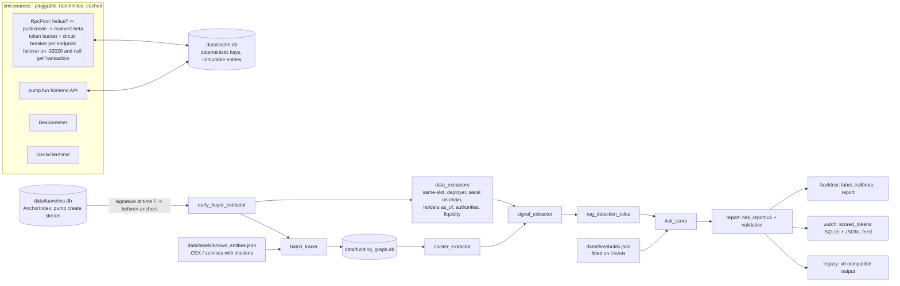

> **Pack note:** Distributed as research documentation. Measured results below and in `backtest/` are **backtests on historical public data**, not live trading performance. Not financial advice.

# solana-meme-risk

A read-only, point-in-time risk screen for new pump.fun tokens on Solana. It answers one question for a small
discretionary position (1-3% of bankroll): **SKIP / REDUCED (<=1%) / NORMAL (1-3%)**.

**It never trades, never signs a transaction and never reads, stores or uses a wallet key.** Data comes only from
free public endpoints. A `HELIUS_API_KEY` env var, if present, is added as the first RPC endpoint.

## Stable CLI contract (AAI Terminal adapter)
These two commands keep their arguments and JSON shapes at every commit (`tests/test_infra.py` checks this):

```bash
python -m risk health [--quick] [--mint M] [--no-tests]
python -m risk score <MINT> [-v] [--buyers N] [--hops N] [-o out.json]
```

**`health` JSON** (exit code 0 = overall pass, 1 = fail):
```json
{"overall": "pass|fail", "provider": "public-rpc|helius", "checked_at": 1793576645,
 "checks": [{"check": "rpc_reachable_latency", "pass": true, "required": true, "ms": 412, "detail": {...}}, ...]}
```
`overall` is `fail` only if a check with `required: true` fails. The v0 check names are kept: `rpc_reachable_latency`,
`pumpfun_latest_coins`, `pumpfun_coin_detail`, `pumpfun_user_created_coins`, `dexscreener_tokens`,
`solscan_public_api (optional, not used)`, `funding_graph_db_rw`, `cache_db_rw`, `import:<v0 module>`, `e2e_score`
(skipped by `--quick`). New checks: `rpc_endpoint:<name>` (optional), `rpc_pool_failover`,
`geckoterminal_token_pools (optional)`, `anchor_index_db_rw`, `labels_file`, `watch_db` (optional),
`import:smr.*`, `tests_quick` (runs the offline pytest suite, ~4 s). See `samples/healthcheck.json`.

**`score` JSON**: every v0 top-level key is kept with its v0 type: `mint, token, score, recommendation,
suggested_size (string), confidence (string), hard_flags, flags, reasons, small_size, rules, clusters, deployer,
serial_deployer, deployer_funder_serial, authorities, holders, same_slot, fresh_wallets, creation, early_buyers,
data_warnings, coverage, timings, generated_at, disclaimer`. Fields added (nothing removed or retyped):
`schema_compat, as_of, mode, raw_points, decision_reasons, suggested_size_detail, confidence_detail, market_gates,
model_version, orchestrator_summary, risk_report_v1`; `early_buyers[*].pct_supply_held_as_of`; `coverage.{hub_wallets_not_expanded,
trace_warnings, rpc_provider, rpc_stats}`. `risk_report_v1` is the full, schema-validated `risk_report.v1` document
(`smr/schemas/risk_report.v1.json`); `--format v1` prints only that, `--summary` prints only `orchestrator_summary`.
The old flat modules (`risk_score.py`, `healthcheck.py`, `batch_tracer.py`, ...) remain as import shims over `smr/`.

## Other commands
```bash
python -m risk score <MINT> --as-of launch        # point-in-time: score as of creation + 300 s (no lookahead)
python -m risk score <MINT> --as-of 1793421698    # any unix time
python -m risk watch --minutes 10 --parallel 2    # live: score new launches at creation + 300 s
python -m risk backtest sample|run|export|calibrate|report|all
python -m pytest -q                               # offline suite (replay fixtures, no network)
```

## Architecture


**Point-in-time scoring.** `getSignaturesForAddress(X, before=S)` returns only history strictly before signature S.
The AnchorIndex keeps the pump.fun mint-authority stream (~1,770 signatures/h) so any unix time maps to a
signature just before it. Every history query in a point-in-time run uses that anchor, and holdings at `as_of`
are rebuilt from transactions, not from current balances. Account state that has no history (mint
authorities, `getMultipleAccounts` program-owner checks) is read as it is now. That is a small lookahead and is
flagged in `data_coverage`.

## Rules (`smr/rug_detection_rules.py`)
| rule | max pts | fires when |
|---|---:|---|
| same_slot_bundle | 25 | non-creator wallets buy in the creation slot (heavy: >= N wallets or >= X% supply) |
| shared_funder_cluster | 30 | early buyers share a funder (CEX/known services never link); hard if the deployer's cluster holds >= high% |
| serial_deployer | 25 | deployer created >= N other coins in the prior 72 h (on-chain), more if their measured outcomes were bad |
| creator_holds | 20 | creator holds >= warn/high % of supply at as_of |
| early_concentration | 25 | top-10 holders (excluding curve/pool/programs) >= warn/high % of circulating supply |
| fresh_wallet_ratio | 20 | share of traced early buyers younger than the freshness window |
| fresh_deployer | 10 | deployer wallet younger than N hours at launch |
| creator_sold | 15 | creator sold >= 50/90 % of its own buy before as_of |
| authority_not_revoked | 40 (hard) | mint or freeze authority still set |

Decision: hard flag or score >= skip_score -> SKIP; score >= reduced_score -> REDUCED; low confidence -> REDUCED;
else NORMAL. In live mode, for tokens older than 1 h, liquidity and holder gates also apply.

## Measured results (2026-11-01, free public data, no API key)

**Backtest** (`backtest/REPORT.md`, `backtest/report.json`, `backtest/dataset.jsonl`)
- 324 pump.fun launches scored point-in-time at launch + 300 s (0 errors), 309 with a usable 24 h label. Launches came from 2026-10-31 10:27-21:36 UTC with at least 15 txs in the first 5 min.
- Label `bad24:v1` = 24 h price <= 0.5x entry, OR (not graduated AND <= 1.10x launch price AND <= 0.8x entry). Bad base rate is about 9%.
- Time-ordered split: 185 train, 124 test. The fitted thresholds were skip >= 70 and reduced >= 65.
- **Held-out AUC of raw points vs bad_24h is 0.47 (train 0.66), and balanced accuracy is 0.50. There is no demonstrated edge.**
  - The fitted thresholds are therefore *not deployed*: the gate needs held-out AUC >= 0.60.
  - The defaults (60/30) stay live, so roughly 70% of launches get SKIP and almost everything else gets REDUCED.
- Rules with consistent lift: early_concentration and creator_holds. Inverted lift: creator_sold and serial_deployer. See the interpretation in REPORT.md.

**Watch demo** (`samples/watch_demo_stats.json`)
- Run: `python -m risk watch --minutes 10 --parallel 2`. It took 12.6 min wall time including the drain and then stopped.
- 239 launches seen, 130 qualified and queued, 44 scored, 0 errors. Decisions: 25 SKIP, 19 REDUCED, 0 NORMAL.
- Per-token score time: p50 16 s, p95 76 s.
- Launch-to-decision: p50 13 min, p95 17 min. This is a backlog, because free RPC throughput is about 4 tokens/min at parallel 2.

**Cold-run timing** (324 backtest tokens, parallel 4, no warm cache): p50 19.7 s, p95 96.6 s, max 456 s.

## Runbook
- **Setup:** `python3 -m venv .venv && .venv/bin/pip install -r requirements.txt`, then `python -m risk health`.
- **Faster RPC:** `export HELIUS_API_KEY=...` (read only from the environment, never stored), or `SOLANA_RPC_URLS=url1,url2`.
- **Rate limits** (env): `SMR_PUBLICNODE_RPS` (default 25), `SMR_MAINNET_BETA_RPS` (3.5). On a 429 the whole endpoint pauses
  (`Retry-After`). Six consecutive failures open the circuit for 30 s, and calls go to the next endpoint.
- **Health fails:**
  - `rpc_*`: check the network or rotate the endpoint.
  - `pumpfun_*`: the unofficial API changed or Cloudflare is blocking it.
  - `tests_quick`: run `pytest -q` and read the failure.
- **Backtest from scratch** (needs launches that are 26-40 h old; see Limitations):
  `python -m risk backtest sample --n 1700 --min-age-h 26 --max-age-h 36`, then `run --parallel 4 --max-age-h 38`, then `calibrate`.
  `calibrate` writes `data/thresholds.json`, which every later score uses. The version shows in `model_version`.
- **Watch:** `python -m risk watch --minutes 10`. Results go to `data/watch/scored_tokens.db` (table `scored_tokens`) and
  `data/watch/feed-YYYYMMDD.jsonl` (rotated, `--keep-days`). Stats are in `data/watch/last_run_stats.json`. Ctrl-C/SIGTERM stops it cleanly.
- **New test fixture:** `python tools/record_fixture.py <MINT>` records every RPC/HTTP response into
  `tests/fixtures/<mint8>.replay.json.gz`. The replay test then runs fully offline.

## Limitations (read before relying on it)
- **No demonstrated predictive edge yet.** See `backtest/REPORT.md`: the held-out sample is small, the "bad" class is rare
  (most qualifying launches simply stop trading near their entry price), and the confidence intervals are wide.
- **Free RPC history window.** publicnode resolves `before` anchors and serves version-1 transactions only for about the
  last 40 h (measured 2026-11-01). Older history falls back to api.mainnet-beta at ~3.5 req/s, so point-in-time scoring of
  older launches is slow, and the backtest only covers launches 26-38 h old at run time. A paid RPC (Helius) removes this.
- **Hub wallets.** Wallets with very long histories (bots, aggregators) are not expanded. Their original funder is usually
  not found, so clustering under-detects on bot-heavy launches.
- **Holdings at as_of** are exact only when <= 800 transactions precede as_of. Beyond that, holder rules report no data
  and confidence drops.
- **pump.fun "Mayhem mode"** (CreateV2 + InitializeMayhemState; ~93% of creates in an early sample, but 37-56% of launches on 2026-11-03, see `tools/measure_mayhem.py`) mints a second 1e15
  tokens to a protocol agent (`BwWK17...`). That agent is treated as infrastructure. Curve prices can fall below the
  launch price.
- **Unofficial APIs.** The pump.fun frontend API is unofficial and can change. The serial-deployer rule no longer depends
  on it: it uses on-chain data.
- **Known-entity labels** are a short, cited list (`data/labels/known_entities.json`, verified with `tools/verify_labels.py`).
