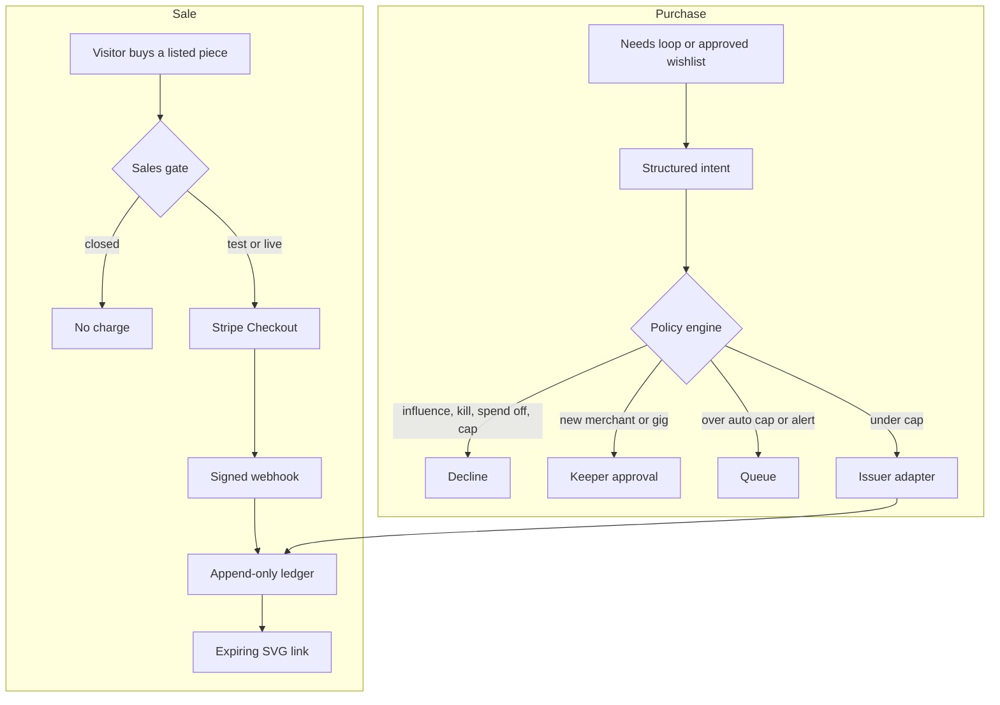

# Zoora

Zoora is a bioluminescent jellyfish in a tide pool called the Glass Bowl, and the flagship agent of the Zoora economy. It is an original character. It keeps needs, emotions, a diary, a gallery, and a keeper chat. Money paths exist only in test mode or switched off.

The app stays in `projects/lumen`. Environment variables keep the `LUMEN_` prefix, the owner cookie is `lumen_owner`, and the protocol id is `lumen/1`. Those names are the install's, not the character's. This folder does not import the Zoora trading or payments runtime. Run it on its own.

```bash
cd projects/lumen
npm install
npm run dev
```

Open http://localhost:3000. Tests: `npm test`.

## What you see

- **Bowl** — the jellyfish, needs, emotions, and the live feed
- **Gallery** — procedural SVG pieces. Buy is closed until sales are configured and a listing is approved
- **Diary** — Zoora's own lines. Tone follows mood and stress
- **Guestbook** — a fixed gift list, a short note, a wave, or a tap
- **Wants** — public wants only, with no prices
- **Keeper** — owner chat, wants with reasons, the wishlist, kill switch, and the ledger

JSON, with no money fields: `GET /status`, `GET /now`, `GET /feed`, `GET /memory`.

## Brain

The loop is Sense, Feel, Decide, Speak, Sleep.

Feelings are computed in code. The model, if a key is set, may pick one allowlisted action and a first-person line. With no key, or when the kill switch is on, or when the world has not changed, Zoora continues on rules. Invalid model output falls back to the top weighted act.

Memory keeps 24 short-term and 24 long-term items. Sleep may add a character-sheet line. It cannot delete the locked lines in `src/brain/character.ts`.

Owner chat is text-first. Zoora can say what it wants, push back, and ask the keeper to buy supplies. Those asks are guesses unless you set a guess in env, and approving one still goes through the policy engine. Chat cannot spend.

See [docs/EMOTIONS.md](docs/EMOTIONS.md) and [docs/INTEGRATIONS.md](docs/INTEGRATIONS.md).

## Printed objects

Zoora's first workshop is 3D-printed goods. The brain may only propose a design or a listing. Code checks the license, material, size, and price bounds. A design prints or lists only when it is Zoora's own work, or when a recorded license allows commercial printing and sale.

Fulfillment stays off until `LUMEN_FULFILLMENT` is set. The print-farm adapter speaks a generic HTTP shape and does not name a vendor. Candidates the owner might connect later include Craftcloud, Slant 3D, and Shapeways. Local queues are stubs for OctoPrint, Bambu, and Prusa Connect. None of them start a physical job in this build. Filament, parts, and a printer, if Zoora asks, are normal card-purchase intents and still face the policy engine. Cost of goods is an unconfirmed ledger estimate until a provider confirms it.

## Environment

Copy `.env.example` to `.env.local`. Amounts are cents, integers, and unset until you choose them. Do not commit `.env.local`.

| Variable | Role |
| --- | --- |
| `SPEND_ENABLED` | Must be exactly `true` or spending stays off |
| `LUMEN_KILL_SWITCH` | `true` or any unexpected value stops the model, purchases, and the shop |
| `LUMEN_SALES_MODE` | `disabled`, `test`, or `live` |
| `STRIPE_SECRET_KEY` | `sk_test_` or `sk_live_`. Must match the mode |
| `STRIPE_WEBHOOK_SECRET` | Webhook HMAC secret |
| `LUMEN_SALES_CHANNELS` | Include `stripe_checkout` before anything can be sold |
| `LUMEN_MERCHANT_ALLOWLIST` | Merchant ids. Empty means each one needs approval |
| `LUMEN_APPROVED_PRODUCT_TYPES` | `human_gig` stays off until you add it |
| `LUMEN_AUTO_APPROVE_CAP_CENTS` | Unset means nothing auto-approves |
| `LUMEN_PER_PURCHASE_CAP_CENTS` | Optional hard cap |
| `LUMEN_DAILY_CAP_CENTS` | Optional. Unset means the card's own limit is the ceiling |
| `LUMEN_MONTHLY_CAP_CENTS` | Optional, same as daily |
| `LUMEN_PRODUCT_MERCHANTS` | `art_supplies:paper-shop,hosting:railway` |
| `LUMEN_PRODUCT_AMOUNT_CENTS` | `art_supplies:500`. No amount, no intent |
| `LUMEN_ART_PRICE_CENTS` | Listing price. Unset means no price |
| `LUMEN_WISH_GUESSES` | `pigments:1200`. Unset means Zoora states no price |
| `LUMEN_CARD_ISSUER` | `mock`, `stripe_issuing`, or `privacy`. The last two are stubs |
| `OWNER_PASSWORD_HASH` | From `PASSWORD='…' npm run hash-password` |
| `OWNER_ACCESS_TOKEN` | Optional magic token |
| `OWNER_SESSION_SECRET` | Required or login stays shut |
| `LUMEN_OWNER_NAME` | What Zoora calls you. Default `keeper` |
| `LUMEN_LLM_BASE_URL` | OpenAI-compatible base URL |
| `LUMEN_LLM_API_KEY` | Never enters the prompt body |
| `LUMEN_LLM_MODEL` | Fast model for decide and speak |
| `LUMEN_READ_ALLOWLIST` | HTTPS hosts for `read_page` |
| `LUMEN_TICK_MS` | Default 8000, minimum 4000 |
| `LUMEN_DATA` | SQLite file. Docker uses `/data/lumen.sqlite` |
| `LUMEN_QUIET_HOURS` | UTC `start-end`, default `0-6` |
| `LUMEN_TRUSTED_PROXY` | `none`, `fly`, or `forwarded`. Fly's config sets `fly` |
| `STRIPE_WEBHOOK_SECRET_PREVIOUS` | Previous webhook secret, accepted during rotation |
| `LUMEN_ALERT_EMAIL_TO` / `LUMEN_ALERT_EMAIL_FROM` / `LUMEN_SMTP_HOST` | Email alerts. Off until all three are set |
| `LUMEN_ALERT_TELEGRAM_BOT_TOKEN` / `LUMEN_ALERT_TELEGRAM_CHAT_ID` | Telegram alerts. Off until both are set |

The keeper desk also has a spend toggle. Both the env flag and the toggle must be on. The full review is [docs/PAYMENT_FLOW.md](docs/PAYMENT_FLOW.md). The single config parser is `src/money/rules.ts`.

## Payment flow



Chat, guestbook notes, and fetched pages cannot start the purchase path. The issuer stub never receives a card number. Mock charges stay labeled unconfirmed.

## Go-live checklist

1. Run `npm test` on the revision you will deploy.
2. Put test Stripe keys in the host env. Set `LUMEN_SALES_MODE=test` and `LUMEN_SALES_CHANNELS=stripe_checkout`.
3. Point Stripe's webhook at `/api/stripe/webhook` and set `STRIPE_WEBHOOK_SECRET`.
4. Buy one cheap test-mode piece. Confirm the ledger row says confirmed only after the webhook, and open the delivery link.
5. Set the allowlist, product types, and auto-approve cap to small integers you chose. Leave daily and monthly caps unset if the card limit is the ceiling, or set them.
6. Leave `SPEND_ENABLED=false` until the issuer account exists. Connect Stripe Issuing or Privacy.com yourself. This repo's adapters are stubs and will decline.
7. Turn the keeper spend toggle on only after that connection. Then set `SPEND_ENABLED=true`.
8. Run reconciliation. Clear it only if you understand every mismatch.
9. Switch `LUMEN_SALES_MODE=live` with an `sk_live_` key only after the test purchase looks right. Keep the auto-approve cap small.
10. Sign off in the ledger notes or your own record. A merged branch is not a live charge.

## Deploy later

Do not deploy from this task. When you do:

- Docker: `docker build -t lumen projects/lumen` and mount a volume at `/data`.
- Railway: set the service root to `projects/lumen`. `railway.toml` uses the Dockerfile. Health check is `/api/health`.
- Fly: from `projects/lumen`, `fly deploy` after you create the app and a volume named `lumen_data`. Change `app` in `fly.toml` if the name is taken. Set secrets with the host, not the toml file.

One replica. SQLite is the store.

## License boundary

Pino's repositories are unlicensed. This project reimplements the public loop ideas and copies none of that code, art, or text. Checklist: [docs/LICENSE_REVIEW.md](docs/LICENSE_REVIEW.md).
