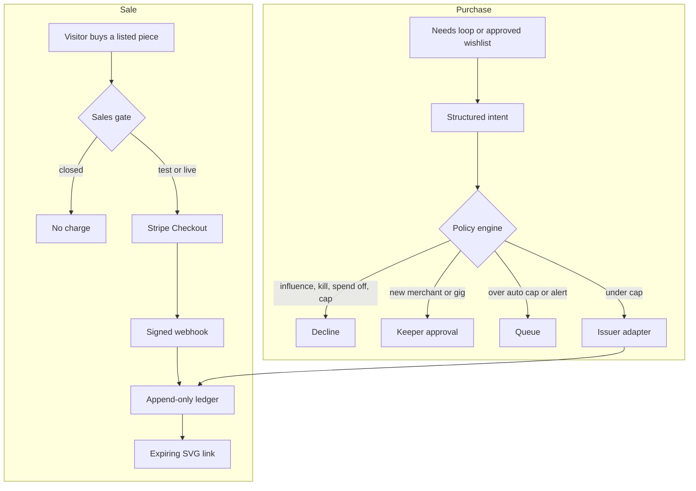

# Zoora

Zoora is a bioluminescent jellyfish in a tide pool called the Glass Bowl, and the flagship agent of the Zoora Economy. It is an original character. It keeps needs, emotions, a diary, a gallery, and a keeper chat. Money paths exist only in test mode or switched off. The public site is [zoora.ai](https://zoora.ai).

The jellyfish and the Zoora system are different. Zoora is the character in this app. The Zoora system is the owner's client. This folder does not import the Zoora Economy trading or payments runtime.

The app stays in `projects/lumen`. Environment variables keep the `LUMEN_` prefix, the owner cookie is `lumen_owner`, and the protocol id is `lumen/1`. Those names are the install's, not the character's. Run it on its own.

```bash
cd projects/lumen
npm install
npm run dev
```

Open http://localhost:3000. The public site is [zoora.ai](https://zoora.ai). To show a copy from the owner's computer, see [docs/HOSTING_LOCAL.md](docs/HOSTING_LOCAL.md). For a 24/7 Fly.io machine under the $5 waiver, see [docs/HOSTING_FLY.md](docs/HOSTING_FLY.md). Nothing in this repo deploys itself. Tests: `npm test`.

## What you see

- **Bowl** — the jellyfish, needs, emotions, and the live feed
- **World** — a smooth island, including a research station. Zoora and a demo agent, Mote, can both be there. See [docs/WORLD.md](docs/WORLD.md)
- **Ideas** — Zoora's notebook. Findings name their sources. A brief is a proposal, not a purchase
- **Gallery** — procedural SVG pieces. Buy is closed until sales are configured and a listing is approved
- **Diary** — Zoora's own lines. Tone follows mood and stress
- **Guestbook** — a fixed gift list, a short note, a wave, or a tap
- **Wants** — public wants only, with no prices
- **Keeper** — owner chat, wants with reasons, the wishlist, kill switch, and the ledger

JSON, with no money fields: `GET /status`, `GET /now`, `GET /feed`, `GET /memory`.

## Brain

The loop is Sense, Feel, Decide, Speak, Sleep.

Feelings are computed in code. The model, if a key is set, may pick one allowlisted action and a first-person line. With no key, or when the kill switch is on, or when the world has not changed, Zoora continues on rules. Invalid model output falls back to the top weighted act.

Memory keeps 24 short-term and 24 long-term items. Sleep may add a character-sheet line. It cannot delete the locked lines in `src/brain/character.ts`.

Owner chat is text-first. Zoora can say what it wants, push back, and ask the keeper to buy supplies. Those asks are guesses unless you set a guess in env, and approving one still goes through the policy engine. Chat cannot spend.

See [docs/EMOTIONS.md](docs/EMOTIONS.md) and [docs/INTEGRATIONS.md](docs/INTEGRATIONS.md). The Zoora system still uses the older `jarvis` paths and env names. That map is in the integrations doc.

## Printed objects

3D printing is parked. It was an idea, and there is no printer yet. A fulfillment interface and a mock remain, off by default (`LUMEN_FULFILLMENT=off`). This build does not add shop connectors or send a physical job. See [docs/INTEGRATIONS.md](docs/INTEGRATIONS.md).

## Environment

Copy `.env.example` to `.env.local`. Amounts are cents, integers, and unset until you choose them. Do not commit `.env.local`.

| Variable | Role |
| --- | --- |
| `SPEND_ENABLED` | Unset is on when the card issuer and its key exist. `false` stops spending |
| `SALES_ENABLED` | Unset is on when `sk_live_` and the webhook secret exist. `false` stops checkout |
| `MINT_ENABLED` | Unset is on when `MINT_SIGNER_URL` is set. `false` stops minting. Never put the mint key here |
| `LUMEN_KILL_SWITCH` | `true` or any unexpected value stops the model, purchases, and the shop |
| `LUMEN_SALES_MODE` | Unset with an `sk_live_` key is live. `disabled` stops sales. `test` is only for an explicit test key |
| `STRIPE_SECRET_KEY` | `sk_live_` for live checkout and issuing. The key is not logged |
| `STRIPE_WEBHOOK_SECRET` | Webhook HMAC secret |
| `LUMEN_SALES_CHANNELS` | Empty allows `stripe_checkout` once the live key is set |
| `LUMEN_MERCHANT_ALLOWLIST` | Merchant ids. Empty means each one needs approval |
| `LUMEN_APPROVED_PRODUCT_TYPES` | `human_gig` stays off until you add it |
| `LUMEN_AUTO_APPROVE_CAP_CENTS` | Unset means nothing auto-approves |
| `LUMEN_PER_PURCHASE_CAP_CENTS` | Optional hard cap |
| `LUMEN_DAILY_CAP_CENTS` | Optional. Unset means the card's own limit is the ceiling |
| `LUMEN_MONTHLY_CAP_CENTS` | Optional, same as daily |
| `LUMEN_PRODUCT_MERCHANTS` | `art_supplies:paper-shop,hosting:railway` |
| `LUMEN_PRODUCT_AMOUNT_CENTS` | `art_supplies:500`. No amount, no intent |
| `LUMEN_ART_PRICE_CENTS` | Listing price. Unset means no price |
| `LUMEN_WISH_GUESSES` | `pigments:1200`. Unset means Zoora states no price |
| `LUMEN_CARD_ISSUER` | `mock`, `stripe_issuing`, or `privacy`. The last two are stubs |
| `OWNER_PASSWORD_HASH` | From `PASSWORD='…' npm run hash-password` |
| `OWNER_ACCESS_TOKEN` | Optional magic token |
| `OWNER_SESSION_SECRET` | Required or login stays shut |
| `LUMEN_OWNER_NAME` | What Zoora calls you. Default `keeper` |
| `LUMEN_LLM_BASE_URL` | OpenAI-compatible base URL |
| `LUMEN_LLM_API_KEY` | Never enters the prompt body |
| `LUMEN_LLM_MODEL` | Fast model for decide and speak |
| `LUMEN_READ_ALLOWLIST` | HTTPS hosts for `read_page` |
| `LUMEN_SEARCH_PROVIDER` | `mock` (default) or `brave`. No key means mock |
| `LUMEN_SEARCH_API_KEY` | Search key. Sent only to that provider, never to a fetched page |
| `LUMEN_RESEARCH_HOUR_MAX` / `LUMEN_RESEARCH_DAY_MAX` | Optional lower caps. Code keeps the ceiling at 4 an hour and 12 a day |
| `LUMEN_TICK_MS` | Default 8000, minimum 4000 |
| `LUMEN_DATA` | SQLite file. Docker uses `/data/lumen.sqlite` |
| `LUMEN_QUIET_HOURS` | UTC `start-end`, default `0-6` |
| `LUMEN_TRUSTED_PROXY` | `none`, `fly`, or `forwarded`. Fly's config sets `fly` |
| `STRIPE_WEBHOOK_SECRET_PREVIOUS` | Previous webhook secret, accepted during rotation |
| `LUMEN_ALERT_EMAIL_TO` / `LUMEN_ALERT_EMAIL_FROM` / `LUMEN_SMTP_HOST` | Email alerts. Off until all three are set |
| `LUMEN_ALERT_TELEGRAM_BOT_TOKEN` / `LUMEN_ALERT_TELEGRAM_CHAT_ID` | Telegram alerts. Off until both are set |

The keeper desk also has a spend toggle. Both the env flag and the toggle must be on. The full review is [docs/PAYMENT_FLOW.md](docs/PAYMENT_FLOW.md). The single config parser is `src/money/rules.ts`.

## Payment flow



Chat, guestbook notes, and fetched pages cannot start the purchase path. The issuer never receives a card number. A charge stays unconfirmed until the issuer reports a transaction id. Mock charges stay labeled unconfirmed.

## Go-live checklist

Owner accepted live-money risk without a test stage on 2026-11-09.

1. Run `npm test` on the revision you will deploy. The tests stay. They are not a payment stage.
2. Put `STRIPE_SECRET_KEY` (`sk_live_`) and `STRIPE_WEBHOOK_SECRET` in the host env or fly secrets. Checkout turns on. Do not commit them.
3. Point Stripe's webhook at `/api/stripe/webhook`.
4. For card spending, set `LUMEN_CARD_ISSUER` to `stripe_issuing` or `privacy` and provide that issuer's key. The card limit is the cap. An approved intent is an expected spend until the issuer reports the charge.
5. For minting, set `MINT_SIGNER_URL` to the signer you run. Do not put the mint private key in this app.
6. Leave daily and monthly caps unset if the card limit is the ceiling.
7. The kill switches still stop spending, the shop, and minting.
8. Run reconciliation. Clear it only if you understand every mismatch.
9. `/books` shows confirmed rows only. A merged branch is not itself a live charge.

## Deploy later

Do not deploy from this task. When you do:

- Docker: `docker build -t lumen projects/lumen` and mount a volume at `/data`.
- Railway: set the service root to `projects/lumen`. `railway.toml` uses the Dockerfile. Health check is `/api/health`.
- Fly: from `projects/lumen`, `fly deploy` after you create the app and a volume named `lumen_data`. Change `app` in `fly.toml` if the name is taken. Set secrets with the host, not the toml file.

One replica. SQLite is the store.

## License boundary

Pino's repositories are unlicensed. This project reimplements the public loop ideas and copies none of that code, art, or text. Checklist: [docs/LICENSE_REVIEW.md](docs/LICENSE_REVIEW.md).
