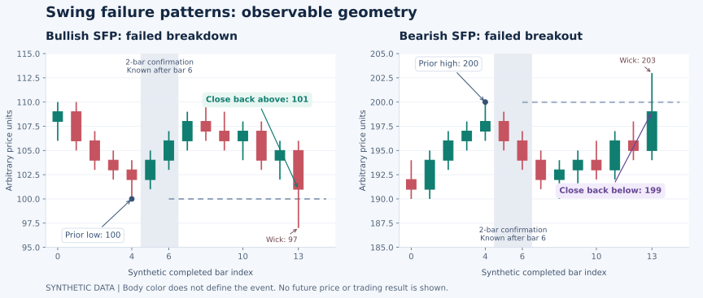

# BT-004 — Swing Failure Patterns: Research Dossier and Evaluation Protocol

**Date:** October 14, 2026. **Stage:** research specification; no detector, backtest, profitable strategy or execution system is delivered by this document.

This adds the founder's SFP research request to the existing [Solana Trading Lab](../projects/SOLANA_TRADING_LAB.md). [AAI-T-041](../tasks/BACKLOG.md#aai-t-041) tracks the remaining evidence and evaluation work. [BT-000](BIOLOGICAL_COMPUTE_PROTOCOL.md), [BT-001](DATA_MEASUREMENT_PROTOCOL.md) and [BT-002](SOLANA_GROUND_TRUTH_REPLAY.md) govern the experiment. The current boundary remains offline replay and paper simulation. The existing read-only replay work is a data foundation, not an SFP implementation or market-price performance dataset.

## Implementation follow-up — BT-005

The subsequent [offline paper lab](../projects/sfp-paper-lab/README.md) implements the causal detector, A/B/C long paper paths, cash and frozen trend baselines, input validation and report exports. Its engineered synthetic fixture tests timing, winning/losing/ambiguous paths and unresolved inventory. The subsequent [BT-006 study](../projects/sfp-paper-lab/STUDY.md) adds buy-and-hold and frozen training-density time controls, expanding chronological windows and explicit research screens. Actual quotes/fills, exact exposure matching, justified acceptance thresholds, selection adjustment and independently unseen evaluation remain unfinished. This research dossier is not a performance result.

## Research judgment

SFPs deserve a defined experiment as possible entry, exit and abstention features for a swing strategy. Their appeal is an identifiable failed attempt to move beyond a previously known price level. Whether that event predicts a useful multi-day move after costs remains unanswered for our market and rules.

The pattern, its proposed explanation and its trading outcome are different claims. We can calculate a wick crossing and a close back inside from suitable observations. That alone does not identify hidden stop orders, a trader's intention, manipulation, or a profitable reversal. The sources reviewed here describe the pattern and related mechanisms; they do not validate this proposed Solana strategy.

## 1. What the pattern means

The common price-based convention is:

| Event | Observable geometry | Hypothesis to test |
| --- | --- | --- |
| Bullish SFP | Price moves below a previous swing low, then the candle closes above that low | The attempted breakdown failed; a rebound may follow |
| Bearish SFP | Price moves above a previous swing high, then the candle closes below that high | The attempted breakout failed; a decline may follow |

LuxAlgo's own indicator description uses this wick-and-close convention and offers a later structure-confirmation level. Its explanation involving larger participants is an interpretation, not evidence about a specific candle. We use the observable geometry and test the interpretation separately. [S1]



Candle body color does not determine an SFP: the illustrated bullish event closes below its open, and its bearish mirror closes above its open. The figure illustrates geometry only. It is synthetic, has no future outcome, and is not a complete fixture for the 20-bar volatility or other eligibility rules below. The prior pivot is marked when it occurs; the shading shows the two later bars required to confirm it. A strategy cannot use the pivot before those bars are available.

Terms that must stay distinct:

- **False breakout:** a broad description of a break that fails; it can occur over several bars. Our primary SFP definition is a one-bar rejection of a previously known swing.
- **Liquidity sweep/stop run:** a proposed order-flow explanation. Candle data alone cannot establish whose orders were triggered.
- **Break-and-retest:** price may remain on the new side of a level after a genuine breakout. A return toward a level is not automatically an SFP.
- **RSI failure swing:** an oscillator pattern. Fidelity discusses failure swings on RSI; that is different from the price-level event studied here. An RSI filter would be another registered experiment. [S7]

## 2. What the evidence supports

| Source | Finding relevant to this research | Limit of the inference |
| --- | --- | --- |
| LuxAlgo's original SFP description [S1] | A usable industry convention and a possible later confirmation trigger | Educational/indicator description; it supplies no validated net performance for our rules |
| Osler, New York Fed [S2] | FX stop-loss clustering can contribute to self-reinforcing price cascades; reported effects were significant over hours rather than days | Supports a possible mechanism for acceleration, including continuation. It does not prove that a wick reversal identifies stops or starts a multi-day Solana swing |
| Lo, Mamaysky and Wang [S3] | Algorithmically specified patterns contained incremental information in the studied historical U.S. stock sample | Different patterns, market and period; incremental information is not proof of an executable SFP edge after our costs |
| TradingView documentation [S4] | Delayed pivots and values plotted into the past can mislead; unfinished higher-timeframe values can repaint | A warning about timing/implementation, not evidence that any pattern predicts returns |
| Bailey and collaborators [S5, S6] | Trying and selecting many strategies can inflate apparent performance; PBO and Deflated Sharpe address aspects of selection risk | These methods require appropriate assumptions and sufficient observations. Neither substitutes for a chronological unseen test or production controls |

This is a focused source review, not a systematic review of all SFP literature. No historical prices were collected and no trading-performance experiment was run for this addition. Win rate, expectancy, drawdown, sample adequacy and robustness remain **NOT MEASURED**.

## 3. Connection to our swing objective

A one-hour SFP is an event, not a holding-period guarantee. The research must establish whether it helps select entries for the larger move we want, whether it mostly predicts a short rebound, or whether it adds nothing after costs.

Keep three possible roles separate:

1. **Entry timing:** a bullish SFP during an already defined upward context may improve a pullback entry.
2. **Position management:** a bearish SFP may help time a reduction/exit of an existing long.
3. **Abstention:** an SFP against a proposed breakout may warn us to wait.

Solana spot does not make a bearish label an executable short. The first study may measure bearish forward-price outcomes, but a spot trade simulation can only sell inventory it actually holds. Borrowing, leverage, derivatives, funding and liquidation are separate research and policy decisions. They are excluded from the initial spot experiment.

Forex/XAUUSD replication belongs in the [XAUUSD EA Lab](../projects/XAUUSD_EA_LAB.md) under [AAI-T-024](../tasks/BACKLOG.md#aai-t-024). It must independently specify bid/ask data, broker symbol, contract size, pip/point convention, hours, timezone, commission and rollover. Solana results cannot validate that separate experiment. Compare outcomes in returns, volatility units and R; a fixed pip target is not a common unit across these markets.

## 4. Proposed first experiment — settings to freeze before replay

These settings are research proposals, not optimized parameters or an approved investment mandate. Changes create a new registered trial and cannot silently replace a losing result.

| Setting | Initial proposal |
| --- | --- |
| Scope | One Solana spot market; SOL/USDC is the proposed starting study. Exact mint pair, venue/pool, coverage and reuse permission remain to be verified |
| Price | A versioned trade-price series from the declared venue; executable quotes are separate observations. No synthetic cross-venue high/low |
| Candle / context | Closed 1-hour bars for the event; closed 4-hour bars for the optional trend filter; UTC boundaries |
| Swing | Strict pivot with two completed bars on each side; no equal-price plateau pivot |
| Level age | At most 168 completed 1-hour bars since the pivot |
| Volatility | Arithmetic mean of the last 20 available completed-bar true ranges; not an implicit platform ATR default |
| Minimum sweep | 0.05 times that prior-bar volatility estimate |
| Reclaim | Strict close on the original side of the swing level; equality does not qualify |
| Stop buffer | 0.10 times the prior-bar volatility estimate beyond the SFP extreme |
| Exit for the initial long simulation | Original stop, fixed gross 2R target, or 168 completed event bars after entry; whichever is observed first |
| Simulated exposure | One funded long position at a time, no leverage or borrowed short. Candidate limits: 0.10% simulated NAV risk per entry and a 0.50% daily loss circuit breaker |

The risk numbers are **SYNTHETIC simulation settings**, require a separately specified Risk Governor, and do not authorize use of customer funds or the proposed creator-fee account. A circuit breaker blocks new entries; it cannot guarantee a maximum loss when prices gap or exits are unavailable. If the required price/quote coverage is absent, record the gap and stop the performance study rather than assume a fill.

## 5. Exact event rules and timing

Let `O_t, H_t, L_t, C_t` denote observed/derived candle prices. For pivot bar `j`, a strict pivot low is below the lows of `j-2, j-1, j+1, j+2`; a strict pivot high is above the corresponding highs. The earliest confirmation requires all five bars and their actual availability times. The pivot is not available at `j` merely because a historical chart draws it there. [S4]

At the candidate bar's opening cutoff, select the most recent eligible confirmed pivot on each side. It must already be available, be within the age bound, and have no intervening completed close beyond its level on the breakout side. Snapshot its ID, confirmation time and lineage. Do not search older levels after seeing which one produces the best-looking rejection.

Define `A` as the mean of the 20 prior available true ranges, where each true range is the maximum of `H-L`, `abs(H-previous_close)` and `abs(L-previous_close)`. Require positive `A`, sufficient history and valid precision/coverage. Set `epsilon = 0.05*A`.

For selected low `P_low`, the initial bullish candidate requires all of:

```text
previous close > P_low
candidate open >= P_low
candidate low < P_low - epsilon
candidate close > P_low
candidate candle closed and available
```

For selected high `P_high`, the bearish mirror requires:

```text
previous close < P_high
candidate open <= P_high
candidate high > P_high + epsilon
candidate close < P_high
candidate candle closed and available
```

The open/previous-close restrictions deliberately exclude a multi-bar reclaim or a bar that opens beyond the level. Log those as different events; do not silently broaden this definition. An event that rejects both sides of a range is `AMBIGUOUS_TWO_SIDED` and abstains in the primary study.

Consume a selected level after its first qualifying candidate, even if entry later fails. Repeated retries of the same level are a separate experiment. Event evaluation can therefore account for every candidate, not just filled winners. Each variant processes the same immutable candidate stream before applying its own entry/filter rules.

`signal_available_time` is at least the latest availability of the candle, selected level and required features. Historical collection time is not a substitute for genuinely recorded historical availability. If ingestion timing is unknown, declare it unknown and use explicitly synthetic delay scenarios; do not describe that replay as measured latency.

## 6. Three separately registered entry variants

| Variant | Entry eligibility | Question |
| --- | --- | --- |
| A — Reclaim | First eligible executable quote after the closed SFP becomes available and the recorded decision latency passes | Does the basic event help after actual costs? |
| B — Trend-aligned reclaim | A, plus the last available closed 4-hour close above its 50-bar simple moving average, with that average above its preceding value, for a long | Does filtering for upward context improve the result relative to the same context without an SFP? |
| C — Structure confirmation | After the SFP, wait up to three completed 1-hour bars for a close above the frozen intervening high for a bullish event, or below the intervening low for a bearish event; use the next eligible quote | Does confirmation reduce false starts enough to compensate for later/worse entry and fewer fills? |

For C, freeze the bullish intervening high as the maximum high of bars `j+1` through `t-1`; the bearish low is the corresponding minimum low. Our exact window and delay rule are specified here rather than inherited from an indicator's display. A touch without a completed close does not confirm. Any observed crossing of the original buffered stop before entry invalidates the candidate. Do not let later confirmation rescue it.

Variants are tested separately; B+C combinations and volume/RSI/session additions are not part of the initial three. For bearish events, their directional study stays separate from an executable spot-short claim. A practical long-exit experiment must specify the existing inventory and compare against its original exit policy.

## 7. Stops, targets and the cost of being wrong

For a simulated bullish entry, the initial stop is `SFP_low - 0.10*A`. The bearish analytical mirror uses `SFP_high + 0.10*A`. These are proposed invalidation levels, not guaranteed execution prices. Skip an entry already invalidated, unavailable, unaffordable or incompatible with its risk budget.

For a long with entry `E` and stop level `S`, nominal unit price risk is `E-S`. Define the R denominator once at entry from the registered nominal risk; retain it for outcomes. Calculate position size subject to available cash, maximum exposure, anticipated costs and a gap/failed-exit stress budget. A realized stop can lose more than 1R. Partial exits, moving to breakeven and trailing rules are disabled in the first comparison.

**Synthetic arithmetic example:** a prior low at 100 is crossed to 97 and the bar closes at 101. Assume `A=10` solely for this example, a later executable entry of 102 and a buffered stop of 96. Nominal price risk is 6; a gross 2R target is 114. Neither the entry nor target is a reported market outcome. The mirror uses prior high 200, wick 203, close 199, analytical entry 198, stop 204 and target 186; it does not authorize a short.

If a simplified experiment has gross winners of 2R, gross losses of 1R and average round-trip cost of `c` R per completed trade, then:

```text
expected net R = p*2 - (1-p)*1 - c
break-even p = (1+c)/3
```

At an assumed `c=0.10R`, the break-even rate is about 36.7%, rather than the zero-cost 33.3%. This is arithmetic, not an estimated SFP win rate. Actual payoff distributions, gaps, failed attempts and variable costs require the full simulation. A visually tight stop may make costs large relative to R.

## 8. Solana execution and price-data constraints

1. **Venue and identity:** preserve mint addresses, pool/venue, token decimals, price direction and quote unit. Treat USDC as a quote asset; any USD valuation needs a separate point-in-time conversion. Do not merge venue extremes into a candle no trader could execute.
2. **Trade reconstruction:** define how successful swaps become economic trades, aggregate multi-leg routes once, remove duplicate observations, and retain failed transactions without treating them as completed volume. Inspect sampling gaps, precision, stale prices and token/pool lifecycle changes.
3. **Executable price:** candle extremes and a mid/last trade are not guaranteed bid/ask or route outputs. A delayed quote depends on trade size and available liquidity. A current quote cannot recreate an old quote or pool state.
4. **Costs:** model venue/pool fees, price impact, slippage, network/priority fees and failed attempts with separate provenance. Jupiter documents the dependence of slippage on volatility, size relative to liquidity and quote-to-execution time. [S8]
5. **Failure accounting:** Solana's fee documentation says transaction fees are charged even when execution fails. A simulation must distinguish a charged failed execution from an unsent/rejected/unlanded attempt; record uncertain states and possible costs rather than assign zero by default. No transactions are submitted by this research. [S9]
6. **Exit availability:** pooled liquidity can change while a position is held. A stop is a decision trigger, not evidence of available liquidity at that price. Report missing/rejected exits and conservative valuation scenarios, including severe loss, rather than quietly drop the position.
7. **Commitment and revisions:** preserve commitment, slot/order where known, ingestion delays and revised candle versions under BT-001/002. A later corrected/finalized record must not replace what a prior decision could know.

A raw block fixture can validate parsing/replay without establishing all these market/execution fields. A small hand-selected chain window, or today's prices, cannot establish the historical performance of a swing strategy.

## 9. Proposed filters — hypotheses, not confirmations of profit

Record these for later study without adding them all to the first trial:

- Sweep depth divided by prior volatility; reclaim distance and close location within the candle.
- Range-edge versus trend-pullback context, prior touches, level age and distance to an opposing known level.
- Later structure/displacement and the extra price/cost paid for waiting.
- Venue-specific executed volume and its coverage. Volume beyond a level requires suitably ordered intrabar trades; total candle volume alone cannot supply it.
- Quote depth, price impact, spread/route uncertainty and quote staleness.
- Time of day and event context from data actually available at the decision. A 24/7 crypto study must not inherit a Forex London/New York session rule without a new definition and test.

Danger cases include strong continuation, repeated whipsaws, a thin-pool outlier wick, both sides swept, missing history, stale quotes and an attractive gross result erased by costs. An apparent institutional explanation, many indicators agreeing, or a large historical move is not an independent validation filter.

## 10. Measurement record

Retain BT-001's time, unit, classification, source-version, quality and lineage fields. Add a proposed SFP feature namespace; these fields are not currently collected merely because they are listed.

| Proposed field | Classification and rule |
| --- | --- |
| `SFP-001 direction` | DERIVED; bullish/bearish/ambiguous from the frozen rule version |
| `SFP-002 reference` | DERIVED; pivot ID, price, event time, confirmation and availability times |
| `SFP-003 level_snapshot` | DERIVED; hash of eligible levels selected at the opening cutoff |
| `SFP-004 sweep_depth` | DERIVED; absolute quote/base price and ratio to prior `A` |
| `SFP-005 reclaim_distance` | DERIVED; signed distance from close to selected level |
| `SFP-006 context` | DERIVED; frozen higher-timeframe inputs and filter result |
| `SFP-007 signal_available_time` | DERIVED; latest required-input availability, with missing timing explicit |
| `SFP-008 confirmation` | DERIVED; fixed level, deadline, invalidation and actual availability |
| `SFP-009 execution_evidence` | OBSERVED for recorded quotes/results; SYNTHETIC for assumed fills/costs, kept separate |
| `SFP-010 abstention_reason` | DERIVED; missing/stale data, ambiguous sides, risk rejection, unavailable execution, unsupported action |
| `SFP-011 forward_outcomes` | LABEL; later returns, MAE/MFE and stop/target/time outcomes, unavailable to the decision |
| `SFP-012 stop_run_explanation` | INFERRED if estimated; unknown otherwise. Never relabel as directly observed from OHLC |

An SFP flag is not a calibrated probability of profit. Keep future labels outside the feature snapshot. Store candidate, decision, attempted fill, position and outcome as different records so skipped/failed cases remain visible.

## 11. Evaluation plan

**First: validate geometry and causality.** Build future detector fixtures for bullish/bearish geometry, exact equality, late pivot availability, unfinished candles, duplicate bars, missing windows, plateaus, gaps, two-sided rejection, repeated levels, expiration, precision and cross-venue disagreement. This document supplies the acceptance specification; it does not deliver those tests or a detector.

**Second: run an event study.** Measure forward outcomes at 1, 4, 24 and 168 event-bar horizons, MAE/MFE and conditional distributions. Compare with matched nonsignal timestamps using only previously known trend, volatility and liquidity context. Do not condition controls on future outcomes. Outcomes crossing a split boundary must be purged/handled explicitly. Correlation remains a predictive finding rather than proof of stop-running causation.

**Third: run the costed spot simulation.** Compare A/B/C with no trade/cash, long buy-and-hold over the same declared funded window, a separately frozen trend-only/pullback baseline, and seeded matched-time entries with comparable holding/risk/exposure limits. Freeze the exact benchmark triggers before accessing evaluation data; unresolved benchmark settings block the performance study. Include an ablation that removes the SFP condition from B, so an upward market is not misreported as an SFP contribution.

Execution requires ordered intrabar data where path affects outcomes. If entry/stop/target ordering cannot be established, mark `PATH_AMBIGUOUS`; report a conservative bound and ambiguous-case rate. An OHLC-only favourable ordering is not an executable result. A stop-only conservative bound does not become measured execution either.

**Fourth: test chronological generalization.** Choose calendar train/validation/test windows based on available coverage before scoring strategy results. Use expanding/rolling walk-forward evaluation and keep a last period untouched. Purge overlapping outcome/position intervals and apply an embargo whose length is justified by actual maximum label/holding overlap; a generic random split is unsuitable. Make any label horizon or holding-period change a new trial.

Maintain a trial ledger covering all variants, assets, timeframes, filters, exits and discarded changes. Report multiple-testing/PBO/Deflated-Sharpe analyses only with documented assumptions, effective trial/dependence treatment and sufficient sample sizes. PBO's resampling diagnostic is complementary to chronological testing, not permission to mix future features into the past. Use time/block-aware uncertainty estimates for clustered signals. If there are too few independent episodes, label the result **UNDERPOWERED**. [S5, S6]

**Fifth: conduct an unseen offline forward simulation.** Feed only newly available or separately reserved observations through frozen rules, with no order submission or broker/wallet integration. Record abstention, delayed/rejected fills, costs, restart/duplicate handling and risk-budget decisions. Architecture acceptance and any execution policy change remain separate.

## 12. Report and decision criteria

Report coverage and its gaps, candidate and filled counts, missed/invalidated entries, exposure, holding time, turnover, gross/net expectancy in R and quote units, win rate with uncertainty, drawdown, MAE/MFE, loss tails and concentration by market/time/regime. Include paper accounting for cash, inventory and available exit liquidity. Report missing/path-ambiguous outcomes and cost assumptions beside returns.

Continuation requires reproducible point-in-time data, frozen rules, a measurable incremental result against the appropriate baselines, uncertainty that supports the claimed effect, acceptable stress outcomes under the separately specified risk budget, and sufficient unseen observations. Exact numerical go/no-go thresholds and minimum independent sample sizes must be registered before testing; they are unresolved here.

Cost increases, decision delay, nearby parameter changes and different market conditions must be tested without cherry-picking the winner. Reject or revise the hypothesis if the result disappears after costs, depends on a few outliers, fails unseen periods, lacks executable coverage, or cannot be distinguished from its simpler baseline. A negative result completes useful research.

## 13. Work now added to the research queue

[AAI-T-041](../tasks/BACKLOG.md#aai-t-041) covers this dossier and the remaining specification/evidence work:

1. Verify the chosen market's price/quote history, terms and replay coverage; resolve the benchmark and risk specifications.
2. Freeze the causal swing/SFP rules, variants, classification schema and numerical evaluation gates.
3. After separate research review accepts implementation scope, specify/build small synthetic detector fixtures and a blinded annotation set.
4. Perform event, costed replay and unseen offline-forward studies; publish losses, uncertainty, gaps and failed hypotheses.

Source review and a protocol are available in this revision. Detection software, a suitable historical market dataset, performance measurements, a profitable release and funded execution remain unfinished. No paid provider, wallet connection, order submission, fee-account access or token/economic change is introduced.

## Source register

All links were checked October 14, 2026. These are original research/author pages or first-party documentation/education. The summaries above are original paraphrases. No indicator code, dataset or third-party figure is copied, and no commercial-use permission is inferred. Material AI assistance: source discovery, synthesis, formal research rules, synthetic illustration and document drafting.

| ID | Source | Role and limitation |
| --- | --- | --- |
| S1 | [LuxAlgo — Swing Failure Pattern (SFP), original TradingView indicator description](https://www.tradingview.com/script/YmWELClV-Swing-Failure-Pattern-SFP-LuxAlgo/) | Pattern convention and confirmation concept; vendor education, not independent strategy-performance validation |
| S2 | [Carol L. Osler — Stop-Loss Orders and Price Cascades in Currency Markets, NY Fed Staff Report 150](https://www.newyorkfed.org/research/staff_reports/sr150.html) | FX mechanism evidence; report 2002, published version 2005; does not validate Solana SFP reversal |
| S3 | [Andrew W. Lo, Harry Mamaysky and Jiang Wang — Foundations of Technical Analysis, author-hosted abstract](https://www.mit.edu/~alo/Papers/techanal.html) | Journal of Finance 2000; algorithmic pattern research in U.S. equities, not this SFP experiment |
| S4 | [TradingView Pine Script — Repainting](https://www.tradingview.com/pine-script-docs/concepts/repainting/) | Pivot/higher-timeframe timing and backdated displays |
| S5 | [Bailey, Borwein, Lopez de Prado and Zhu — The Probability of Backtest Overfitting, author-hosted preprint](https://www.davidhbailey.com/dhbpapers/backtest-prob.pdf) | Selection-risk and PBO methodology; assumptions/sample adequacy must be assessed |
| S6 | [Bailey and Lopez de Prado — The Deflated Sharpe Ratio, author-hosted paper](https://www.davidhbailey.com/dhbpapers/deflated-sharpe.pdf) | Multiple-trial selection and non-normal-return adjustment; not a standalone release gate |
| S7 | [Fidelity — Relative Strength Index](https://www.fidelity.com/learning-center/trading-investing/technical-analysis/technical-indicator-guide/RSI) | Distinguishes oscillator failure swings from price events; educational source |
| S8 | [Jupiter — Slippage Estimation](https://developers.jup.ag/docs/swap/advanced/slippage) | Quote-to-fill and liquidity/size dependence; current API documentation cannot supply historical fills |
| S9 | [Solana — Fee Structure](https://solana.com/docs/core/fees/fee-structure) | Network fee components and charged failed execution; recheck protocol semantics before any implementation |

