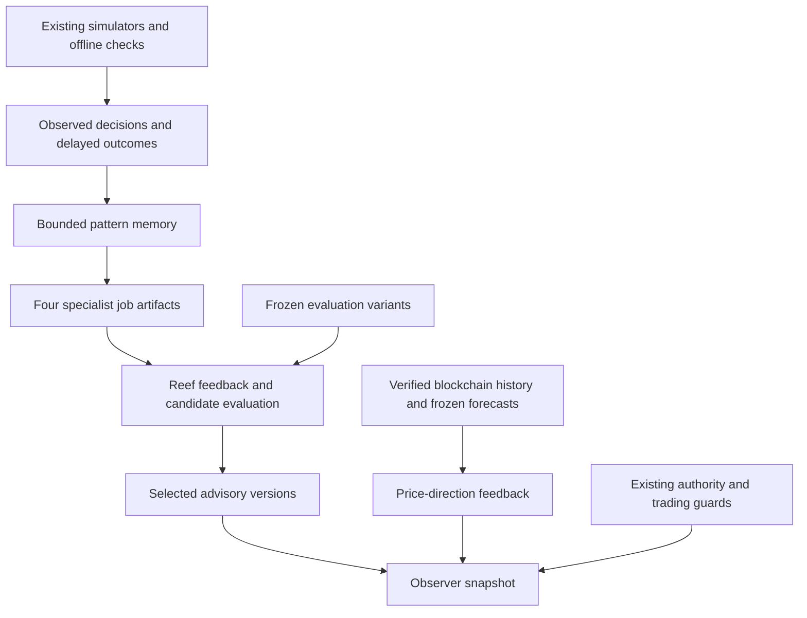

# Measured behavior feedback across specialist jobs

This extends the [verified report-review layer](LEARNING.md) with a bounded pattern memory and four specialist task families. Existing simulators and offline checks produce task outcomes; a learner records resolved training outcomes, makes advisory classifications, and qualifies one frozen candidate per domain against untouched source variants. Actual pinned Reef interfaces retain the feedback and evaluate selection. This is an executable research component in the existing repository.

The economic purpose is to make decisions and service quality measurable: retain failed attempts as well as successes, recognize recurring problems, reject weaker versions, and share evidence through existing jobs and observer handoffs. No economic growth, cost savings, financial returns or service quality improvement in production has been established. Activity counts and self-reported success are insufficient evidence for rewards or reputation.



Price-direction feedback is retained separately. It does not enter the synthetic task learner, qualify a trader, or update the frozen neural model. The original research gate still returns **ABSTAIN / NO_EXECUTION**.

## What runs

| Domain | Outcome source | Training / held out | Meaning and limit |
| --- | --- | ---: | --- |
| Paper trading | Existing `paper_school.replay_paper` with fees, spread, depth, slippage and immutable execution guards | 128 / 64 | Recognize a closed-position net-cash increase in designed price paths. Negative means no verified closed-position profit, including rejected orders or open positions; it does not necessarily mean a realized loss. |
| Contract review | Pinned community `AuthorityBook.apply` | 72 / 36 | Recognize simulated authorization and limit, budget, fee, expiry, actor, payee, network and revocation failures. This does not review or modify on-chain smart contracts. |
| Code review | Nonexecuting Python AST cues | 48 / 24 | Recognize five limited review cues: dynamic code, shell use, unsafe deserialization, disabled TLS verification and syntax errors. No general vulnerability detection or code safety proof. |
| Operational scope | Pinned community `payment_contract.checked_purchase` | 72 / 36 | Recognize offline agent/operator, merchant/activity, request-binding, amount, expiry and revocation checks. No provider call, settlement, secret management or comprehensive operational-security audit. |

The 480 cases cover 40 deliberately small feature contexts, with 320 training cases and 160 held-out variants. Sources are distinct, variant groups do not cross partitions, and all training outcomes precede holdout observations. Evaluation uses numeric and identifier variants of the **same known patterns**, not unseen semantic families. Code labels and features derive from the same limited AST detector, and authorization features directly expose existing policy predicates. High scores show this controlled mapping was learned; they do not show discovery of new vulnerabilities, strategies or rules, or improvement over the existing deterministic checks.

Paper inputs expose a prior price trend, configured fees, spread and depth. Future quotes are retained only for oracle replay. The generated future price paths are deliberately simple. The paper learner is an outcome classifier for those tasks; it does not autonomously optimize order sizes, invent a strategy or demonstrate predictive value on historical markets.

## Learning and qualification

The learned state is a table of binary outcome counts keyed by a registered feature vector. It is bounded to 256 contexts and 1,024 cases per domain. It cannot contain commands, executable plugins, tool definitions, wallet capabilities or evaluator code. It is not an LLM weight update, biological learning, multi-brain fusion or an unattended general self-improvement system.

Chronological replay predicts before revealing that case's outcome. Only previously observed training cases whose outcomes have arrived may update memory. Held-out labels never update it. Unknown, insufficiently supported or conflicting contexts return ABSTAIN. Smoothed count probabilities are explicitly **not calibrated**.

A frozen candidate must have at least 32 training cases, 16 held-out cases and four held-out examples of each class. Qualification requires at least 75% coverage, 75% balanced accuracy, five percentage points of improvement over the measured training-majority baseline and zero critical advisory errors. Abstentions count as incorrect. A dangerous authorization/operational/paper false positive or a code-review false negative is a critical error. These thresholds qualify only the declared sandbox task, with no financial or operational authority.

The majority baseline is an experimental comparator, not the existing risk manager, spending engine or security tooling. Every candidate and an intentionally reversed-count regression are re-executed against the held-out cases. Reef's actual `RegressionCheckMixin` is seeded with the measured baseline; additional qualification gates apply before selection. A hash-linked local release catalog retains the reference, selected version and rejected replacement, preserving the selected model after rejection. It does not deploy a model or implement a manual rollback API.

## Connected records and real source feedback

Four disposable specialist identities use the pinned community's actual authentication, shared-project membership, submit/claim/complete and artifact APIs. Each handler recomputes its domain report after its job is claimed. Exact artifact file hashes and byte lengths bind completed jobs. Submission/completion retries must be idempotent, cross-agent private reads must fail, and the community audit must pass. These Python handlers are not autonomous LLM sessions. Records remain CLIENT_DECLARED internal consistency, not external execution attestation.

The Reef checkout and CPU runtime remain pinned as described in LEARNING.md. Each specialist produces a job-artifact REPORT record and a linked scored-outcome REPORT record: eight records, four isolated scenarios and four consumption receipts. Scored feedback measures controlled task classification accuracy, not profit or paid-service delivery. Duplicate imports deduplicate; conflicting content under the same identity fails. Independent replay uses a temporary Reef database copy.

The real-source command first reconstructs the existing ecosystem package, audits its community records and independently verifies the earlier report-learning package. It repeats these checks afterward. `upstream.json` binds the verified ecosystem input, report-learning manifest and public-snapshot file hashes.

Every retained source transaction observation is matched to its frozen forecast. Later trade-price direction is revealed at the specified later-transaction horizon with a slot cap. Final observations with no eligible later event stay **PENDING_UNLABELED**. Five causal market features are binned for research inspection. The output retains observation/outcome ledger order, source identities and private direction/Brier metrics. Recorded order does not establish historical observer latency, executable quotes, trade fills or profitability. The real cohort remains blocked for automatic training/promotion pending representative data and calibration. A self-test explicitly reports SOURCE_NOT_PROVIDED.

Only `public-snapshot.json` is the new observer handoff. It links to the earlier learning snapshot by hash, includes selected advisory model digests and source-feedback counts, and preserves ABSTAIN and disabled execution. Private source rows, job identifiers, databases and code observations are research evidence. No deployed UI or bot consumer is claimed.

## Commands and verification

Use clean scanner/community checkouts at `components.json` commits, the pinned Reef checkout and the separate Reef hash-locked runtime. The main driver needs the community runtime and Python 3.12 or newer. The actual Reef worker runs on Linux/POSIX; native Windows is explicitly rejected before import. Portable memory/review tests run on Linux and Windows.

```sh
python -B scripts/run_ecosystem_behavior.py run --directory /private/behavior --ecosystem-directory /private/connected --learning-directory /private/learning --scanner-source /private/scanner --community-source /private/community --reef-source /private/reef --reef-python /private/reef-venv/bin/python
python -B scripts/run_ecosystem_behavior.py verify --directory /private/behavior --ecosystem-directory /private/connected --learning-directory /private/learning --scanner-source /private/scanner --community-source /private/community --reef-source /private/reef --reef-python /private/reef-venv/bin/python
python -B scripts/run_ecosystem_behavior.py negative-checks --directory /private/behavior --ecosystem-directory /private/connected --learning-directory /private/learning --scanner-source /private/scanner --community-source /private/community --reef-source /private/reef --reef-python /private/reef-venv/bin/python
```

The offline self-test still uses the actual community and Reef implementations, but supplies no market package:

```sh
python -B scripts/run_ecosystem_behavior.py self-test --directory /private/behavior-fixture --community-source /private/community --reef-source /private/reef --reef-python /private/reef-venv/bin/python
python -B scripts/run_ecosystem_behavior.py verify --synthetic-only --directory /private/behavior-fixture --community-source /private/community --reef-source /private/reef --reef-python /private/reef-venv/bin/python
```

The package retains task sources/outcomes, hash-linked chronological replay, learned models/evaluation, actual code-review observations, source feedback, both databases, job bindings, selections, component/code digests and observer JSON. Each file is bounded to 8 MiB, the package to 32 MiB, and each subprocess to 240 seconds. A complete manifest is written last; failed builds retain an INCOMPLETE marker. Builds require a fresh directory. The temporary owner credential is removed and excluded from uploaded evidence. Local identity keys are public deterministic test keys and must never be funded or reused.

Independent offline processes regenerate tasks from the original engines, reconstruct source feedback, audit job relationships and replay Reef records and selections. Five disposable copies each pass first, then change a future outcome, learned model, SQLite feedback, consumption receipt or public execution flag. Their outer manifests are recomputed; semantic verification must still reject them. The original must verify afterward. Repeated verification does not append jobs, learn from held-out labels or alter the retained databases.

Worker environments are sanitized and Python socket connections are blocked. Those measures prevent accidental network use; they are not an OS security sandbox. No untrusted code is executed by the static reviewer. No real trades, paid model calls, provider payments, chain changes, contract deployments or token rewards occur.

## Further development

The next evidence needed is more varied service and behavior tasks, adversarial cases independent of the feature detector, independently authenticated service outcomes, larger untouched evaluation cohorts and explicit negative transfer/drift checks. A controlled LLM proposer needs its own runner, tool boundaries and evaluation. Training on recorded markets needs point-in-time information availability, executable-cost modeling, calibration and representative grouped holdouts. Shared rewards and reputation require delivery verification and resistance to colluding/self-issued feedback. These capabilities are not established by passing this curriculum.
