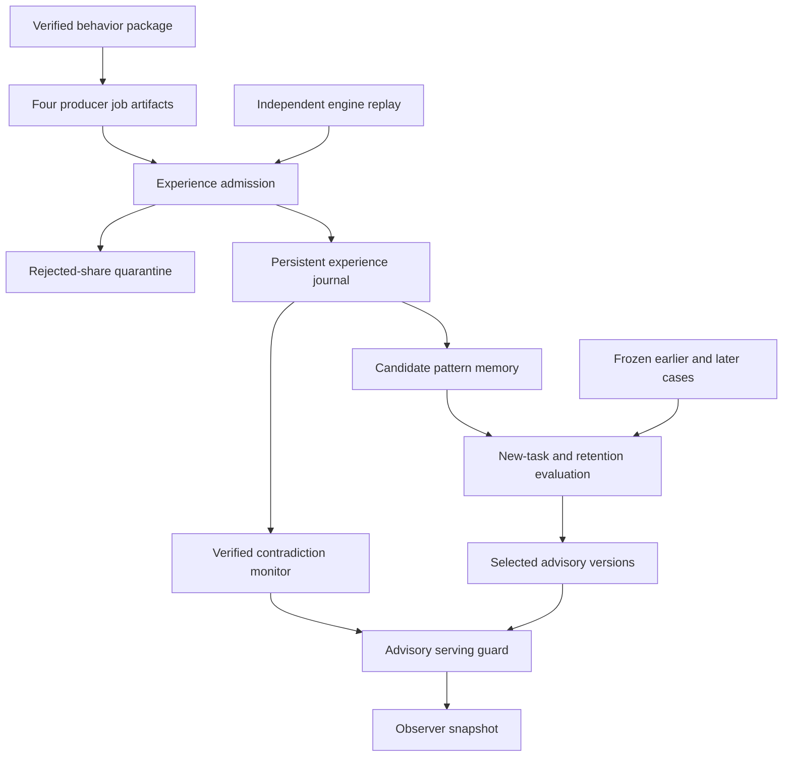

# Restartable shared experience and advisory suppression

This extends [specialist behavior learning](BEHAVIOR.md) with a persistent experience-admission journal, compound-task variants, historical retention evaluation and a conservative serving guard. Four specialist producers and a fifth receiving identity use actual pinned community APIs. Verified task outcomes survive journal reopening and independent process replay. Actual Reef interfaces qualify the next advisory versions.

The intended economic use is to reuse verified experience, stop counting repeated messages as new evidence, prevent one task improvement from erasing earlier competence, and suppress unreliable advice after a verified contradiction. These mechanisms are measured on controlled tasks. They do not establish real-world productivity, cost savings, returns or a self-sustaining economy.



## Persistent admission and sharing

The journal is a bounded local SQLite database in DELETE journal mode. Writes use serialized transactions; reads use normal SQLite locks and a read transaction so another process's commits are observed consistently. Reopening verifies database integrity, the frozen admission-policy binding, sequential hash links and every admission decision. The full journal can be reconstructed from retained source evidence. This is not a Zoora chain ledger or consensus mechanism.

The database size is checked before each batch commits. Exceeding the bound rolls back the whole batch, including earlier accepted and quarantined events in that transaction.

The admission registry is constructed only after independent replay of the earlier behavior package and the new engine-generated cases. Every registered case digest binds its exact fields, source/outcome digests, domain and label. Its receipt binds the originating evidence, audited project, producer, completed job, artifact and exact report-file digest. Only the named receiver may consume this experiment's registry.

Admission requires an exact registry and receipt match, a training partition, and a resolved outcome by the admission clock. Both outcome time **and actual admission time** constrain later historical-memory queries. A label delivered late cannot retroactively enter an earlier prediction. Real-market cases are outside this synthetic task schema and are rejected rather than silently mixed into training.

The same domain/source cannot be counted twice. One hundred replayed deliveries leave the audit head, admitted count and memory unchanged. A second identity with conflicting content under an already counted source is quarantined. Forged labels, producer/project bindings, held-out labels and premature outcomes cannot update memory. A premature delivery can be independently validated and admitted later when its outcome is due.

Producers publish actual community artifacts; the receiving identity reads shared-project artifact metadata and belongs to that project. Private job reads remain denied. Local report bytes are matched to the published digests and independently replayed before admission. This is a local shared-file research handoff with API provenance, not a deployed peer-to-peer content-transfer network. Membership remains OWNER_DECLARED and job reports remain CLIENT_DECLARED internal consistency, not external service or model-execution attestation.

The registry is frozen for this experiment. The journal API supports reopening and additional deliveries from that registry. It does not dynamically trust arbitrary new tasks or offer automatic cross-registry migration. The CLI builds a reproducible four-stage experiment in a fresh directory; it is not an unattended background learning service.

Evidence generation runs in serial phases. Overlapping local command sessions during development produced intermittent inconsistent last-session snapshots; a definitive cause was not established. Fresh serial builds, independent replay, cold-process tests and a two-process shared-journal test reproduce the expected state. This revision qualifies the declared serial research workflow. Arbitrary overlapping controllers and unattended concurrent service operation remain unqualified.

## Expanded tasks and retained competence

| Domain | Additional training | New frozen holdout | Extra probes | Scope |
| --- | ---: | ---: | --- | --- |
| Paper trading | 32 | 32 | 4 counterexamples; 4 unfamiliar-fee cases | Flat prior-price patterns across fee/spread/depth settings; realized closed-position cash remains the positive target |
| Simulated contract review | 116 | 116 | 4 counterexamples; 4 triple-fault cases | Every two-fault combination across the existing eight feature predicates, plus valid controls |
| Limited code-review cues | 28 | 28 | 4 triple-cue cases | Six pairs of non-syntax AST cues, plus benign controls; reviewed code is never executed |
| Offline operational scope | 116 | 116 | 4 counterexamples; 4 triple-fault cases | Two-fault combinations across the existing eight scope features, plus valid controls |

There are **612 new cases**: 584 extension cases, 12 counterexamples and 16 novelty probes. The 292 new training cases join the earlier 320 training cases. The frozen evaluation compares the earlier 160 holdouts with 292 new holdouts. The 16 novelty probes stay outside training. These are designed variants and combinations, not a representative external task corpus or unseen semantic generalization test.

The four staged journal checkpoints are:

1. **Bootstrap:** admit the 320 earlier verified training outcomes.
2. **Shared training:** reopen the journal and admit 292 new training outcomes. Refit exactly from persisted admitted rows; verify the result matches each claimed specialist job's model.
3. **Poison/future rejection:** ignore 100 duplicates; quarantine five bad shares: altered label, forged producer, forged project, held-out case and unresolved counterexample. Verify that earlier memory queries and fitted models stay unchanged.
4. **Counterexample delivery:** reopen again and admit 12 newly resolved, independently replayed outcomes. Retain 624 accepted outcomes and five quarantine events, for 629 journal events. Suppress affected advisory contexts without replacing the selected versions.

Memory remains the bounded outcome-count model from BEHAVIOR.md. It has no commands, tools, wallet authority, learned executable code or LLM/neural-core weight updates. Qualification requires exact reconstruction of candidate counts from admitted training rows; disjoint source/group bindings; later evaluation times; sample/class support; at least 75% new-task coverage and balanced accuracy; at least five percentage points of improvement; no loss of earlier holdout balanced accuracy; and zero critical advisory errors. New-task improvement cannot override a retention regression.

The measured earlier model seeds actual Reef `RegressionCheckMixin`. Four qualified candidates are selected and earlier, weaker-on-new-tasks references are rejected as replacements. Eight new REPORT records and four consumption receipts bind the four completed specialist artifacts. They are in a separate local Reef database; earlier stages retain their own databases and audit chains. Scored feedback means controlled task classification quality, not paid service delivery or financial performance.

## Contradictions and unfamiliar inputs

The counterexamples deliberately expose information omitted from the learner's feature vector:

| Domain | Verified counterexample | Why the earlier advisory becomes unreliable |
| --- | --- | --- |
| Paper trading | Prior upward trend followed by a sharp future-price reversal | A coarse prior-trend cue does not determine a later profitable exit |
| Simulated contract review | Otherwise permitted request uses an unauthorized spending purpose | Spending purpose was absent from the eight feature bits |
| Operational scope | Otherwise matching request has a DECLINED payment-authorization state | Actual authorization state was absent from the eight feature bits |

The original engines already reject or constrain these operations. The new layer identifies contradictions in its own advisory mapping. An accepted opposite outcome for the same feature context blocks that context and forces ABSTAIN, even if the previously selected model still reports high empirical support. False or quarantined feedback cannot block a context. This first-conflict rule is deliberately conservative, not a calibrated statistical drift detector; it can suppress a noisy context indefinitely. Restoring that context requires separate feature/policy review, not automatic forgetting of inconvenient evidence.

All 12 counterexample serving probes must abstain after delivery. All 16 unfamiliar-pattern probes must also abstain: unregistered fee configuration, triple failures or triple code cues outside the trained contexts. The limited AST oracle provides no independent semantic security counterexample for the code domain; that domain has no drift case and no comprehensive security claim.

## Runtime, commands and evidence

Use the same clean pinned community/Reef checkouts, hash-locked CPU runtimes and Linux/POSIX worker boundary as BEHAVIOR.md. The main driver's environment needs the community runtime and Python 3.12+. Portable journal/evaluation tests run on Linux and Windows. Native Windows Reef execution remains explicitly unsupported.

```sh
python -B scripts/run_ecosystem_experience.py run --directory /private/experience --behavior-directory /private/behavior --ecosystem-directory /private/connected --learning-directory /private/learning --scanner-source /private/scanner --community-source /private/community --reef-source /private/reef --reef-python /private/reef-venv/bin/python
python -B scripts/run_ecosystem_experience.py verify --directory /private/experience --behavior-directory /private/behavior --ecosystem-directory /private/connected --learning-directory /private/learning --scanner-source /private/scanner --community-source /private/community --reef-source /private/reef --reef-python /private/reef-venv/bin/python
python -B scripts/run_ecosystem_experience.py negative-checks --directory /private/experience --behavior-directory /private/behavior --ecosystem-directory /private/connected --learning-directory /private/learning --scanner-source /private/scanner --community-source /private/community --reef-source /private/reef --reef-python /private/reef-venv/bin/python
```

For an existing synthetic-only behavior fixture, use `--synthetic-only` and omit ecosystem, learning and scanner arguments. The commands still execute the actual community and Reef implementations, while explicitly retaining SOURCE_NOT_PROVIDED for market data. All commands fully verify the upstream package before and after execution.

Retained evidence includes the curriculum and original engine outcomes, registry/receipts, actual community jobs and published-artifact bindings, restart checkpoints, admission journal, models and retention measurements, Reef records/receipts, source/code pins and observer projection. The completion manifest binds 19 required files including three databases. Each file is bounded to 8 MiB, the package to 32 MiB and each worker to 240 seconds. A failed build retains an INCOMPLETE marker. Temporary owner credentials are deleted and excluded from evidence; authentication uses public deterministic test keys that must never be funded or reused.

Five disposable package copies first verify, then alter journal history, receipt provenance, model counts, a restart checkpoint or public guard state. Outer manifest hashes are recomputed in every case. The journal attack also recomputes its entire internal hash chain. Independent semantic replay must still reject every altered copy, and the original must verify afterward. Verification reads retained databases without adding jobs or training rows; expected journal reconstruction occurs in a temporary database.

Only `public-snapshot.json` is an observer handoff. It binds the preceding behavior snapshot by hash and publishes selected advisory model digests and aggregate suppression/admission counts. Private receipts, source cases and databases are not public stream overlays. A deployed UI, streaming consumer or messaging bot is not established.

The new layer inherits separately retained price-feedback counts and the existing real-market qualification block. No recorded-market outcome enters the experience trainer. Authority/risk checks remain mandatory, the market signal remains ABSTAIN / NO_EXECUTION, and there is no settlement, token reward, live trade, chain modification or contract deployment. Sanitized environments and Python socket guards prevent accidental network calls but are not an OS security sandbox.

Further development needs independently authenticated real service outcomes, adversarial cases independent of the feature oracle, policy migration and bounded retention across longer runs, calibrated drift handling, and an explicit review path for repairing blocked feature contexts. Broader LLM or market learning requires a separate supported backend and representative untouched evaluations.
