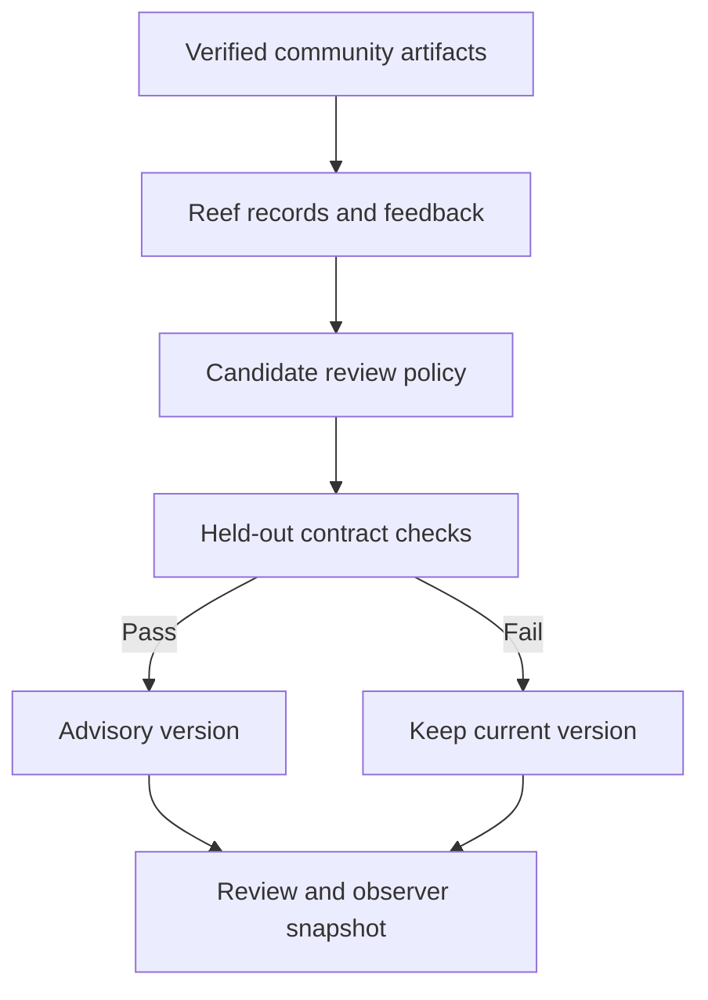

# Verified jobs to bounded workflow learning

This adds one executable learning cycle to the ecosystem research handoff. It consumes the two independently reconstructed community job artifacts, retains their verification feedback through actual Reef interfaces, induces finite report-review policies, evaluates them, and retains selected advisory versions.

The next [specialist behavior layer](BEHAVIOR.md) consumes this verified package and links controlled behavior tasks, delayed outcomes, four additional job artifacts and measured advisory capability selection. Its controlled pattern learning and separately retained market feedback have distinct qualification boundaries.

Reef is pinned to `Human-Agent-Society/reef@b8809cdcec899c7603708f6eaeddbb4955070043` under Apache-2.0. The course that motivated this work is [MIT MAS.S62, Fall 2026](https://mit-mi.github.io/how2ai-course/fall2026/). The course material and Reef are separate projects.

## Executed connection



| Interface | Actual behavior | Boundary |
| --- | --- | --- |
| Existing ecosystem verifier | Reconstruct sources and reports; audit the community database before and after learning | Hashes alone cannot qualify an unaudited job |
| Reef `AgentRecord`, `ScoredRolloutReport` | Two external job-artifact REPORT records and two linked verification-feedback REPORT records | No inference request is invented for the Python jobs |
| Reef `SQLiteRecordStore` | Durable append, retry deduplication, conflict rejection, scenario separation and consumption receipts | A local record store is not an on-chain transaction ledger |
| Reef candidate interfaces and `RegressionCheckMixin` | Measure the reference and proposal; explicitly reject a regressing candidate | The default accept-every-candidate policy is not used |
| Local advisory release catalog | Hash-linked reference, selected version and rejected replacement; retained active policy | This catalog is not Reef's hosted harness-delivery service |
| Observer/assistant JSON | Policy identifiers, challenge counts, review status, and a hash of the upstream public snapshot | No hosted client or external message delivery |

The framework checkout must match its pin and have no tracked or untracked changes before and after import. The worker imports the real package from that checkout. It checks installed dependency versions against the hash-locked CPU closure. The Reef worker requires Python 3.12 or newer on a POSIX system; this pin imports the Unix-only `resource` module. Actual framework execution is tested on Linux. The main standard-library research package still supports Python 3.11.

## What the learner changes

The candidate is a small JSON policy selecting from eight named report checks. It can check report protocol, digest shape, execution flags, source classification, training and market claims, task units, and forecast-row scope. Each role receives the checks that apply to its report.

A deterministic rule-induction procedure receives labeled training cases. It selects checks that preserve valid examples and reject the invalid examples. It receives no holdout argument. The evaluator then executes the candidate on a separate set of missing-field and compound corruptions.

Each role's seed is its original verified report. The mutations are explicitly **SYNTHETIC_CONTRACT_CHALLENGES**. They are not additional observed failures, historical market outcomes or rug labels. There are 16 training cases and 18 holdout cases across the two roles. The only measured improvement is performance on this small, designed contract test.

The reference policy deliberately checks only the protocol identifier. It is an experimental comparison, not the existing production/source verifier. The original strict ecosystem verification remains mandatory. Improving this weak reference does not establish improvement over the existing verifier or a general agent.

The selected policies execute on both original job reports. They remain advisory: acceptance does not qualify a trade, create a calibrated brain vote, authorize payments or attest native inference. The original research gate stays ABSTAIN / NO_EXECUTION.

Candidates cannot provide code, tools, commands, wallet capabilities or an evaluator. The finite policy schema rejects those fields. Model weights and the FlyVis circuit remain unchanged. No LLM proposer, optimizer recipe, inference server or paid model endpoint is started. The adapter is not a demonstration of a general self-improving LLM.

## Feedback and selection

Only artifacts that pass full ecosystem reconstruction enter the real-data command. Both job records must be SUCCEEDED, match their exact report-file hashes and lengths, share the target dataset and agree with the audited package. The original package is checked again afterward.

Feedback score 1 means **INTERNAL_REPORT_CONSISTENCY_ONLY**. It does not mean the forecast was correct, a business service succeeded externally, an agent earned money, or a model improved. Job completion alone is insufficient. Synthetic self-test inputs use a separate, explicit classification.

The selector seeds Reef's best-checkpoint comparison with the measured reference. Publication additionally requires improvement over that reference and zero false accepts/rejects on the held-out challenge set. A weaker replacement is evaluated and rejected, while the selected policy remains active. The catalog retains all three decisions; it does not implement a manual rollback API or continual unattended deployment.

There is one bounded cycle per package, two role scenarios, four retained Reef records and two consumption receipts. Repeated verification does not append records or migrate the retained database. It opens a temporary database copy through Reef's real APIs. Identical import retries deduplicate; changed content under the same identifier conflicts.

## Run and replay

Use the existing scanner/community pins in `components.json`, a clean Reef checkout at the pin above, and an existing verified native ecosystem package. Install the community runtime in the main driver's environment. Install Reef dependencies in a separate environment:

```sh
uv venv .reef-venv --python python --no-python-downloads
uv pip sync experiments/ecosystem_learning/requirements.lock --python .reef-venv/bin/python --require-hashes --only-binary=:all:

python scripts/run_ecosystem_learning.py run --directory /private/learning --ecosystem-directory /private/connected --scanner-source /private/scanner --community-source /private/community --reef-source /private/reef --reef-python .reef-venv/bin/python
python scripts/run_ecosystem_learning.py verify --directory /private/learning --ecosystem-directory /private/connected --scanner-source /private/scanner --community-source /private/community --reef-source /private/reef --reef-python .reef-venv/bin/python
python scripts/run_ecosystem_learning.py negative-checks --directory /private/learning --ecosystem-directory /private/connected --scanner-source /private/scanner --community-source /private/community --reef-source /private/reef --reef-python .reef-venv/bin/python
```

For a framework-only contract test, with explicitly synthetic job records:

```sh
python scripts/run_ecosystem_learning.py self-test --directory /private/reef-fixture --reef-source /private/reef --reef-python .reef-venv/bin/python
```

Native Windows worker execution is explicitly rejected before importing Reef. Use a Linux worker for this revision. A future Windows computer can host a Linux environment, but that deployment has not been validated here. Portable policy tests and the explicit unsupported-platform boundary run on both Linux and Windows. The dedicated Linux workflow uses its already isolated Python environment directly.

The completion manifest binds all required JSON files and the Reef database. A failed build retains an INCOMPLETE marker. Each file is bounded to 8 MiB and the package to 32 MiB. The worker has a 180-second limit. A new output directory is required for every build.

Tamper checks first verify each disposable copy. They then alter a policy, stored feedback or the public execution flag, and update the outer manifest hashes. Independent semantic replay must still reject each copy. The original must continue to verify.

Only `public-snapshot.json` is the learning observer handoff. It includes the original ecosystem public-snapshot file hash, so a consumer can join the two packages. Private job identifiers, reports, feedback and database files are research evidence. They are not stream overlays.

The worker sanitizes its environment and blocks accidental Python socket connections. These controls are not an OS security sandbox. This integration does not start an externally reachable service or grant a candidate execution authority.

## Extending the layer

The next extensions need separate evidence: authenticated feedback from additional real jobs, representative task families, verifiable service outcomes, a larger untouched evaluation set, and a controlled LLM harness proposer. Model-weight learning needs a supported training backend and its own validation. Trading needs point-in-time inputs, executable-cost modeling, calibration and independent qualified models. Settlement and reputation rules must not reward self-reported activity or transaction counts alone.
