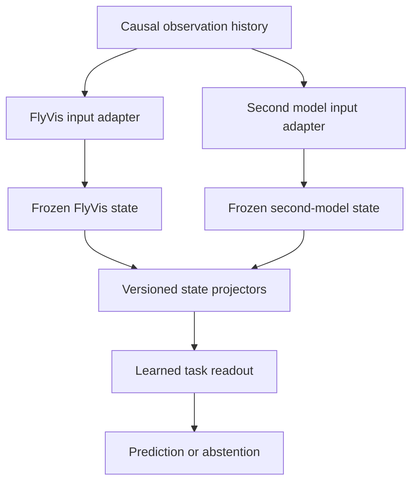

# Multi-brain fusion research: from separate models to a connected hybrid

Research checkpoint: 2026-10-20. Status: DESIGN AND SOURCE REVIEW; no new model execution or training.

This records the founder's direction to advance the multi-brain system through research before a funded launch or physical pilot. BRAIN on Solana paired with AAI remains a candidate, subject to exact-mint/platform eligibility. A token launch is not a prerequisite for this research and supplies no evidence of model capability. No token, pool, wallet transaction, paid compute service or hardware purchase is created by this checkpoint.

The goal is a persistent software system that accepts observations, maintains explicit model state, produces measured outputs and can later improve through controlled training. In this document "connected" means a specified computational interface between models. It does not imply a newly discovered biological connection, an entire animal mind or demonstrated financial skill.

## 1. What already exists, and the exact missing work

The source baseline is research PR #56, commit a5dc52b550712a470ccd1208e79c08b145e65e2b, stacked on coordinator PR #54 and FlyVis reference PR #53.

| Existing component | Evidence already recorded | Does not establish |
| --- | --- | --- |
| Shared observation contracts | Immutable measurements, causal snapshot hashes, source/time/missingness fields and typed model receipts | An encoder, a trained forecast, authentic worker identity or a trusted live clock |
| Observation coordinator | Full configured roster; same pair, snapshot, task and horizon; stale/duplicate/uncertain evidence rejected; abstention and NO_EXECUTION | That the configured species are running, their errors are independent or unanimous predictions are profitable |
| FlyVis model 000 reference | Published pretrained visual model; 45,669 modeled neurons and 1,513,231 modeled connections; retained 22/24 polarity result | A complete fly brain, a market encoder, a market readout or trading accuracy |
| Trading school | Curriculum, public practice, evaluation bindings and paper replay | Weight updates or independent competence in a biological network |
| Paper worker and cohort observer | Separate draft PRs #58 and #59 provide an instruction-following local-model paper workflow and final-account accounting | A biological runtime adapter, learned fusion or connection to this research branch |

The research and community/practice stacks remain separate draft branches. This proposal does not merge them or change any existing readiness gate. The missing implementation is model-specific causal encoding, observable state extraction, task-specific readouts, calibration, fusion evaluation and eventually a supervised runtime.

## 2. Three different meanings of "multi-brain"

| Level | Connection | Independence and attribution | Proposed sequence |
| --- | --- | --- | --- |
| Independent committee | Each model receives the same observed history through its own encoder and returns its own prediction | No peer outputs before each decision is sealed. Different hashes are not proof of independent errors | First integrated baseline; connects to the existing coordinator |
| Learned latent fusion | A projector compresses each module's activity into a bounded representation; a small learned readout combines them | Predictions share a learned combiner. The combiner is a separate learned model, not an extra independent voter | After single-module characterization |
| Coupled recurrent hybrid | Learned connectors send prior-step activity back into module adapters, allowing future state to depend on other modules | This is ONE synthetic composite system with dependent internal components | Later research experiment, only after uncoupled fusion works |

The third level is closest to the founder's "Frankenstein" idea. There is no need to pretend incompatible neuron IDs, spatial scales or model weights can simply be joined. We can engineer and train interfaces, and then measure whether those interfaces help. The engineering feasibility is a proposal; an advantage for this project has not been demonstrated.

## 3. Model selection and source reality

The earlier [source audit](../OPEN_MODEL_SCIENTIFIC_AUDIT_20261020.md) already distinguishes fly, tadpole, cat and macaque models. Its unresolved rights/runtime findings are carried forward rather than silently cleared.

| Candidate | Actual model type and scope | Selection status |
| --- | --- | --- |
| FlyVis | Connectome-constrained fly visual-system network trained for optic flow; the existing reference is reproduced | Preferred first module. Market adaptation and validation remain absent |
| Mouse FNN / MICrONS digital twin | Recurrent ANN fitted to visual-cortex neural responses, with a perspective transform, behavioral modulation, core and readout | New second-module candidate for a source/runtime study. It is not a whole mouse brain or a direct copy of all measured synapses |
| Tadpole CNS, ModelDB 267146 | Modeled hindbrain/spinal circuitry for touch-triggered swimming | Retain; explicit reuse grant and legacy NEURON/Python compatibility remain unresolved |
| Cat LSV1M | Layer 4 and layer 2/3 V1 model | Retain for later; source audit reports a substantial published compute setup and separately licensed framework |
| Macaque multi-area model | Regional visual-cortex/resting-state model | Retain; noncommercial source terms and full-scale compute remain barriers to this project's intended commercial integration |
| Crow/raven | This review located crow atlas and task-recording sources | No selected, licensed, reproduced executable whole-brain candidate. This limited search does not prove none exists anywhere |

Species are identifiers for provenance. No source here establishes "fly reflexes", "crow planning" or "monkey reasoning" as market-specific computational advantages.

### Newly inspected mouse candidate

At cajal/fnn commit 8f34c6753bd818c8fcd1daa91499a057252bea7e:

- The code LICENSE and project metadata state MIT.
- README documents a released CvT-LSTM MICrONS digital twin, CPU-only support and a GPU recommendation. CPU support is an author statement, not our measured runtime.
- The acquisition and prediction notebooks document a weights/data download and video-response workflow.
- fnn/microns/build.py specifies four streams, a perspective transform and recurrent/modulatory components.
- fnn/microns/load.py calls torch.load with map_location="cpu" but no explicit weights_only argument. Its project requirement is torch>=2.0; loading defaults therefore depend on the selected PyTorch version.
- Separate checkpoint/data terms, exact weight-file hashes, archive sizes, compatible environment, bounded CPU memory/time and our reference reproduction remain unresolved. No checkpoint, image archive or model weights were downloaded.

The original Nature paper has an April 2026 author correction [S3]. Among the clarifications, the implemented system uses a four-head ensemble with shared elements. Preserve that configuration when reproducing it; its four internal heads cannot be relabeled as four independently validated animal models. Source files inspected in this checkpoint and their GitHub-reported blob identifiers are retained in research-spec.json. They were not independently rehashed locally.

### Newer anatomy is a separate candidate

Google Research reported a complete male fly brain/CNS mapping in September 2026 [S8]. That is a useful follow-up source, not an automatic upgrade of the existing FlyVis checkpoint. Different specimen, release, anatomy and source rights require a new record, compatible model and reference evaluation. This checkpoint does not download or approve that dataset.

## 4. Scientific basis and its limits

Connectome-based reservoir computing offers an existing framework in which structured recurrent dynamics transform a time-varying input and a trained readout extracts a task output [S4]. The conn2res toolbox supports multiple connectivity sources and dynamics. It supplies a methodological starting point, not pre-trained trading skill.

The 2026 hierarchical-modular reservoir work and its author code/release [S5] provide an additional architecture reference for modular recurrent networks. The author repository was reviewed at the README/project level; its full simulation, dependency fork, dataset rights and paper-to-release equivalence have not been reproduced here.

Our proposal extrapolates these methods to heterogeneous modules. None of the cited papers validates this particular cross-species combination, BRAIN/AAI economics or a Solana trading strategy.

## 5. Proposed architecture

The shared data contract remains the existing Snapshot. The model sees information available at or before the decision time, with history and missingness explicitly recorded. Market outcomes remain labels outside the inference process.

This is the proposed latent-fusion path, not a representation of a running service.

### 5.1 Input adapters

For each model, record input shape, units, sampling, preprocessing version and allowable history. A market-to-image encoding is a designed transformation, not a natural biological stimulus. Test at least a direct numerical baseline so a chart renderer cannot obtain unearned credit.

Fit normalization only on the training partition. Do not rescale each chart using its future maximum, select a visual window after seeing the outcome, or fill a missing measurement with information published later. Show warm-up, clipping and missing-value masks explicitly.

A model that expects eye position or locomotion needs an explicit policy for absent channels. Fixed or inferred substitutes are synthetic assumptions, must be disclosed and ablated, and must not be described as observed mouse behavior. Unsupported input or domain shift should produce abstention.

### 5.2 State extraction and projectors

Initially freeze upstream model weights. Select documented output/state locations and an explicit temporal reduction. Retain a mapping from each exported value to source component, cell-type/channel selection and time window.

A small linear projector is the first candidate bridge. A 16- or 32-dimensional bottleneck can be considered for a bounded pilot, but this is an engineering budget choice, not a measured optimum. Record projector parameters, dtype, ordering and hash. Compare with concatenation, fixed random projections and a direct feature readout.

Do not assume neuron 17 in one model corresponds to neuron 17 in another. Different scales, activation statistics, signs, temporal dynamics and coordinate systems require separate transforms. A numerical match in dimensionality is not biological homology.

### 5.3 Readouts, objectives and learning

A readout maps measured activity to the chosen task. An external instruction-following agent can manage experiments and explain retained outputs, but does not turn into a fly or mouse network and cannot substitute a prose thesis for training.

Begin with a frozen-core linear/logistic readout; compare a small nonlinear readout only under a separate registered configuration. Train on the training partition, select settings on validation data, fit probability calibration separately under a documented scheme, and evaluate the locked system on untouched data.

End-to-end fine-tuning changes the model being evaluated. If pursued later, preserve its checkpoint, training objective and biological-reference regression results separately from the unmodified scientific model.

### 5.4 Recurrent connectors: a later experiment

For the coupled design, use a one-observation delay. A schematic is:

    h_i[t] = F_i(h_i[t-1], E_i(history_through_t), C_i(z[t-1]))
    z[t] = G(P_1(h_1[t]), ..., P_n(h_n[t]), missingness)
    output[t] = R(z[t])

F_i denotes a source-specific runtime; E_i, P_i, C_i, G and R are explicit engineering choices. This is a research equation, not an implementation or proof of stability.

The feedback port must be deliberately defined in the adapter or a separately versioned model modification. Do not write arbitrary tensors into undocumented neural state. Source modules use their own validated numerical step sizes; market timestamps, simulation steps and host receipt times are different clocks.

Record reset/warm-up policy, connector gains, clipping, finite-value checks, maximum steps and a stop condition. Test oscillation, saturation, missing modules and delayed inputs. Zero coupling should recover the uncoupled reference within a tolerance registered before evaluation.

A system in this mode is ONE composite ModuleSpec for any future outer coordinator. Include all component graphs, checkpoints, encoders, state interfaces, projectors, fusion/readout and calibration in its identity. Do not register each feedback-dependent component as another independent vote. The source catalog and readiness policy would need a reviewed extension; this document supplies none.

## 6. Proposed adapter contract

This is a design contract, not a new implemented API.

| Operation | Required behavior |
| --- | --- |
| describe | Return exact source/asset/environment identities, expected inputs, model type, state dimensions and supported numerical clocks |
| reset | Start from a pinned initial state/seed and record warm-up policy; no silent cross-trial memory |
| observe | Consume only the retained causal prefix; reject schema/source/time mismatches |
| encode | Preserve values, units, lineage, masks and transformation identity |
| advance | Run a bounded number of source-runtime steps and retain timing/resource outcomes |
| export_state | Return finite, bounded numerical activity with component/time/state provenance |
| predict | Return existing ModuleOutput-compatible values only for a registered task/readout/calibration; otherwise abstain |
| checkpoint | Serialize state with model/encoder/sequence identity and an integrity pin; restored state must not mix episodes or software versions |
| stop | Finish without authorizing an order or mutating the owner's risk policy |

Keep process boundaries around incompatible runtimes. A controller can schedule them sequentially on one PC before a later two-PC transport trial. Multiple computers are a deployment choice, not a scientific requirement for a multi-module network. No claim is made that the user's hardware can fit every candidate.

Receipt time must be assigned by the observing controller. Model-reported timestamps, hashes and species names are assertions without independent attestation. A future remote transport requires authenticated identities and replay protection; a chat room is not the canonical numerical channel.

## 7. Evaluation that can reject the idea

These are requirements for later registrations, not completed or preregistered model experiments. Dataset IDs/hashes, exact targets and thresholds remain unset; do not call the plan ready for training until they are selected and frozen.

### Separate the scientific questions

1. Does each source model reproduce its scoped scientific reference?
2. Does a specific causal encoding/readout carry useful information for the chosen task?
3. Does simple output fusion improve on the strongest single module?
4. Does latent fusion add value beyond simple fusion and an ordinary equal-budget network?
5. Does delayed coupling add value beyond the uncoupled system without destabilizing it?
6. If a market task is studied, does any improvement survive data and execution costs?

A delayed-memory or temporal signal task is a possible inexpensive interface benchmark. Success would establish behavior on that task only. It would not establish market skill or general intelligence.

### Controls and ablations

Compare cash/no action for paper outcomes; direct linear/logistic features; an appropriate ordinary temporal network; each individual source model; simple mean/voting; independent late fusion; latent fusion; and delayed coupling.

For topology claims include degree-matched rewiring/edge controls and random-weight controls where scientifically meaningful. Hold input history, tuning opportunities, parameter/compute budgets and trial reporting as comparable as practicable. Reduced networks are separately labeled models, never full scientific reproductions.

Remove one module, mask or delay one input, disable the connector, shuffle latent pairings, vary the encoder and test failures. Keep every seed/configuration attempt in the research ledger. A changed file hash prevents exact clone voting but does not demonstrate error diversity; measure residual/error correlation on held-out samples.

### Metrics and promotion

Choose one primary task metric before training. For probability forecasts, evaluate discrimination, log loss or Brier score, calibration and abstention coverage separately. For coupled dynamics record saturation, finite-value failures, settling behavior and reset reproducibility.

Use chronological train/validation/test boundaries for market tasks, with appropriate horizon gaps and token/entity separation. Fit the fusion model using out-of-fold or separately held-out component predictions rather than an optimistic in-sample score. Do not train on the final test outcomes or retune after inspecting them.

Report uncertainty using dependence-aware methods where relevant. Establish sample size, effect margin, seed count, multiple-trial handling and acceptable cost/latency before scoring. A small positive result with an interval spanning no benefit is INCONCLUSIVE. Faster/cheaper operation can be a separate registered benefit; neuron count and unanimous votes are not success metrics.

Only a locked, reproduced improvement over the relevant baselines advances the design to another research stage. No result grants wallet authority. Any later paper-market integration must independently reconcile fills, fees, gas, liquidity, latency, rejected orders and cash; PR #59's descriptive accountant is not an edge test.

## 8. Research-first sequence

| Milestone | Deliverable | Status at this checkpoint |
| --- | --- | --- |
| MB-FUS-000 | Evidence inventory, source distinctions, adapter/fusion design and evaluation gates | This document and research-spec.json |
| MB-FUS-001 | Resolve second-module asset rights, pin environment and reproduce its native scientific reference | Pending; source review only |
| MB-FUS-002 | Implement and test causal adapters, state extraction, reset and bounded runtime | Pending |
| MB-FUS-003 | Register task/data/splits, fit single-module readouts and measure baselines | Pending |
| MB-FUS-004 | Compare independent predictions and latent fusion under fixed evaluation | Pending |
| MB-FUS-005 | Test delayed recurrent connectors as one synthetic composite | Pending |
| MB-FUS-006 | Connect the selected system to supervised paper observation and then the physical pilot | Pending; no live funds |

Work that can proceed now is bibliography/source review, precise contracts, licensing inventory, experiment design and reviewable software preparation. Model execution, measurements and training need an explicitly selected environment later. No completion date, new compute purchase or token-funding dependency is invented.

Keep the BRAIN/AAI launch decision separate from benchmark results. The exact AAI mint/pair eligibility, holder-reward configuration and any terms governing a future launch remain separate verification tasks. No reward or performance promise follows from this plan.

## 9. Sources and review limits

Source facts and proposed engineering are separated above. Original publications and project-maintained repositories were preferred. The machine-readable record lists newly inspected FNN source files; earlier model snapshots remain in the prior audit. No source code, notebook or model was executed during this checkpoint.

- **S1 — Existing project evidence:** [coordinator](../MULTI_BRAIN_COORDINATOR.md), [scientific model audit](../OPEN_MODEL_SCIENTIFIC_AUDIT_20261020.md), [FlyVis reference](../../experiments/flyvis_trained_reference/README.md), [BT-000](../BIOLOGICAL_COMPUTE_PROTOCOL.md), [school](../TRADING_SCHOOL.md).
- **S2 — FlyVis:** [Nature 2024, DOI 10.1038/s41586-024-07939-3](https://doi.org/10.1038/s41586-024-07939-3), [author code](https://github.com/TuragaLab/flyvis).
- **S3 — Mouse functional model:** [Nature 2025, DOI 10.1038/s41586-025-08829-y](https://doi.org/10.1038/s41586-025-08829-y), [April 2026 correction](https://pmc.ncbi.nlm.nih.gov/articles/PMC13102710/), [inspected FNN commit](https://github.com/cajal/fnn/tree/8f34c6753bd818c8fcd1daa91499a057252bea7e). The correction changes architectural descriptions without changing the authors' reported conclusions.
- **S4 — Reservoir method:** [Nature Communications 2024, DOI 10.1038/s41467-024-44900-4](https://doi.org/10.1038/s41467-024-44900-4), [conn2res author code](https://github.com/netneurolab/conn2res).
- **S5 — Modular reservoirs:** [Nature Communications 2026, DOI 10.1038/s41467-026-74466-2](https://doi.org/10.1038/s41467-026-74466-2), [author code](https://github.com/fmilisav/milisav_hierarchical_modularity), [publication release metadata](https://zenodo.org/records/20360160). Publisher full text was not retrieved successfully; author README and release metadata were inspected. No archive or simulation was acquired.
- **S6 — Crow atlas:** [Kersten et al., DOI 10.1002/cne.25392](https://doi.org/10.1002/cne.25392).
- **S7 — Crow task recordings:** [author-deposited Dryad dataset, DOI 10.5061/dryad.0k6djhb1q](https://doi.org/10.5061/dryad.0k6djhb1q). A task-recording dataset is not a whole-brain executable model; no files downloaded.
- **S8 — New male fly CNS source:** [Google Research, September 3, 2026](https://research.google/blog/a-connectomics-milestone-mapping-the-complete-male-fruit-fly-brain/). Anatomy/source lead only; exact downstream assets and terms not cleared.

Review expires 2026-11-19 UTC unless a source change requires earlier review. This is a research review date, not an assertion that upstream code, permissions or platforms cannot change before then.
